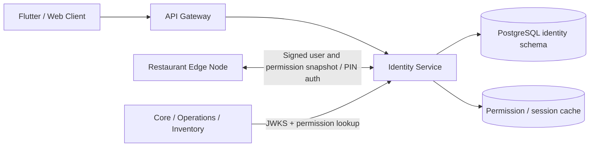
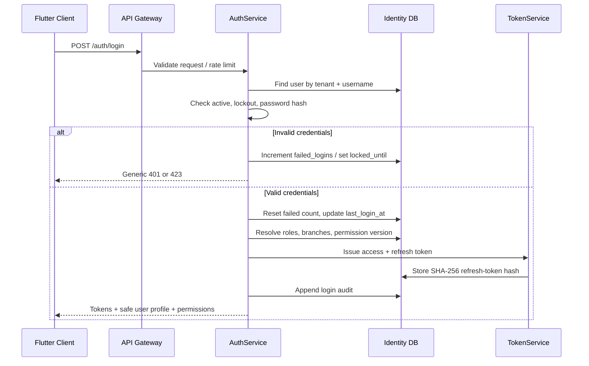
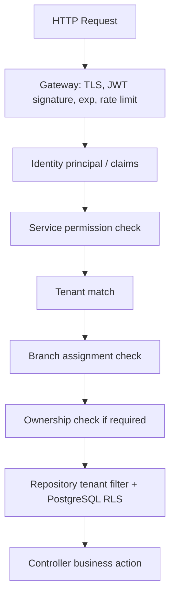

# DineMaster — Authentication & Authorization
## Technical Design and Implementation Guide

**Module:** M1 — Identity Service (with Edge offline-auth integration)  
**Target stack:** Java 21, Spring Boot 3, Spring Security, PostgreSQL 16, Flyway  
**API base:** `/api/v1`  
**Status:** Development specification derived from `DineMaster_Technical_Documentation(1).md`

> **Source labels**
> - **[MASTER]** Explicitly stated in the uploaded master documentation.
> - **[DESIGN]** Detailed implementation recommendation added to make the module buildable.
> - **[DECISION]** Must be confirmed with the product owner / team before production.

---

# 1. Module purpose and boundary

Authentication answers **who is making the request?** Authorization answers **what is that identity allowed to do, and within which tenant/branch?**

This module is a core dependency for every protected DineMaster feature. It must establish a trusted identity, issue and revoke sessions, provide role/permission information, and enforce tenant/branch boundaries.

## 1.1 Service boundary

The module belongs to `identity-service` and owns:

- Login and credential verification
- Access and refresh token lifecycle
- Logout and session revocation
- Password change and password reset
- Device activation/registration
- Role and permission resolution
- Permission cache versioning (`permVersion`)
- Authentication and security audit events
- Offline staff PIN authentication integration with the Edge node

It does **not** own orders, menu, payments, restaurant branches, or staff business profile data beyond identity references. Tenant and branch master records belong to Core. Identity stores `tenant_id` and branch UUID assignments as references.

**[MASTER]** Identity service owns users, roles, permissions, devices, refresh tokens and auth audit logs. It exposes `/api/v1/auth/*`, `/api/v1/users/*`, `/api/v1/roles/*`, and `/api/v1/devices/*`. Login and refresh are public; other endpoints require JWT.

## 1.2 Architecture decision

Start as a module inside the Identity Spring Boot deployable, not as multiple microservices. Keep `auth`, `authorization`, `role`, `permission`, `device`, and `session` package boundaries clear so they can be extracted later if justified.



---

# 2. Submodules

| Submodule | Responsibility | Main classes |
|---|---|---|
| 2.1 Credential Authentication | Verify username/password, lockout, login audit | `AuthController`, `AuthService`, `CredentialService` |
| 2.2 Token Management | Issue, validate, rotate and revoke tokens | `TokenService`, `JwtKeyService`, `RefreshTokenService` |
| 2.3 Session Management | List/revoke active sessions; revoke on deactivation | `SessionController`, `SessionService` |
| 2.4 Password Management | Change password, admin reset, first-login change | `PasswordController`, `PasswordService` |
| 2.5 Device Management | Activate branch device, bind device to tenant/branch | `DeviceController`, `DeviceService` |
| 2.6 Role-Based Access Control | Resolve user roles and role scope | `RoleService`, `UserRoleRepository` |
| 2.7 Permission Management | Permission catalogue, role-permission mapping, permission checks | `PermissionService`, `PermissionEvaluator` |
| 2.8 Tenant / Branch Scope | Verify tenant and assigned branch for every request | `TenantContext`, `BranchScopeService` |
| 2.9 Offline Authentication | PIN login against signed cached snapshot; edge token | Edge integration contract |
| 2.10 Security Audit | Append-only login, logout, password, role and session events | `AuditService`, `AuditLogRepository` |

## 2.1 Role and permission model

**[MASTER]** Roles are data, not hard-coded conditionals. Default mappings are seeded. Permission format is `module:action`, e.g. `user:create`, `payment:refund`.

Roles and scope:

- `SUPER_ADMIN` — platform scope; platform operations only.
- `RESTAURANT_ADMIN` — tenant scope.
- `MANAGER`, `CASHIER`, `WAITER`, `CHEF`, `INVENTORY_MANAGER` — branch scope.

Authorization is not simply “role equals admin”. It is a conjunction of:
1. Valid authenticated principal
2. Required permission code
3. Tenant match
4. Branch assignment match (when branch-scoped)
5. Ownership rule (where applicable)
6. Database tenant isolation / row-level security

**Important:** Super Admin has no default access to restaurant orders, customers, or payments. Support access must be explicitly granted, time-limited, reasoned and audited.

---

# 3. Authentication workflows

## 3.1 Online login flow



Detailed sequence:
1. Client selects restaurant/tenant and branch context; first-time device may need activation.
2. Client sends tenant code, username, password and registered device ID.
3. Gateway applies IP/user rate limits and routes to Identity.
4. Service resolves user by tenant and normalized username.
5. Reject inactive/deleted users and users whose `locked_until` is in the future.
6. Verify password using Argon2id. Do not reveal whether username or password was wrong.
7. On failure, increment failed login count atomically. At 5 failures, lock for 15 minutes.
8. On success, reset counter, update `last_login_at`, resolve role/branch assignments and `permVersion`.
9. Generate a 15-minute access token and 7-day refresh token. Persist only refresh-token hash.
10. Write audit event and return tokens plus safe profile/permissions.

**[MASTER]** Five failed attempts and 15-minute lockout are specified, but the 15-minute duration is marked an assumption in the master file. Confirm it before production.

## 3.2 Refresh flow and token rotation

1. Client submits current refresh token.
2. Hash presented token using SHA-256 and find stored token row.
3. If missing, expired or revoked, return 401.
4. If token was already used/revoked and reuse is detected, revoke the entire token family and require login again.
5. Otherwise atomically revoke old token, create replacement token, link `replaced_by`, and return new access + refresh tokens.
6. Rotation must run in one DB transaction with concurrency protection so two simultaneous refresh requests cannot both succeed.

**[MASTER]** Refresh token is single-use; reuse revokes the full token family.

## 3.3 Logout

- Current-device logout: revoke the presented refresh-token family/session.
- Logout all devices: revoke all active refresh tokens for the user.
- Access JWT remains cryptographically valid until expiry unless a deny-list is introduced. Keep access TTL short (15 minutes).
- Record actor, target session, device, time and request ID.

## 3.4 Password change / reset

- Self-service change requires current password plus new password.
- Admin reset creates a one-time temporary credential or reset token; never return/store plaintext password.
- Require password change on next login using `must_change_password`.
- Revoke existing refresh tokens after password reset/change.
- Do not email a password in plaintext.
- **[DESIGN]** Add password history and reset-token expiry if product requirements need them.

## 3.5 Device activation

1. Admin provisions a device for a tenant and branch.
2. System generates one-time activation code and stores only its hash.
3. Device submits activation code, platform and device name.
4. Validate code, expiry, tenant/branch state and device limit.
5. Mark activation code consumed; issue device identity/credentials.
6. Write audit event.
7. Revoked devices cannot authenticate or sync.

Activation code must be random, short-lived, single-use and rate-limited.

## 3.6 Offline PIN login

**[MASTER]** Offline login is performed by the Edge node, not by the cloud Identity service. Edge validates PIN against a signed cached snapshot of users, roles and permissions and issues a short-lived LAN-only edge token.

- Cloud publishes signed user/role/permission snapshot with `permVersion`, branch and expiry.
- Edge verifies signature and freshness before using snapshot.
- PIN hash is Argon2id; never cache plaintext PIN.
- Edge token is valid only on the branch LAN and expires at shift close / configured short TTL.
- Role changes and deactivation propagate on next sync. Master document proposes a maximum 24-hour snapshot age; this is an assumption and requires owner confirmation.
- High-risk approvals while offline must follow Manager-PIN approval rules and be audited for later sync.

---

# 4. Authorization request pipeline



Order of enforcement:
1. Gateway validates JWT signature, issuer, audience and expiry.
2. Spring Security creates authenticated principal.
3. Endpoint checks required permission code.
4. Service checks tenant ID and branch assignment from trusted claims/context. Never trust a client-supplied tenant ID.
5. Apply ownership rule for “own records”.
6. Repository always filters by tenant. PostgreSQL RLS is second barrier.
7. Audit sensitive security changes.

**[MASTER]** Permissions are not embedded in access JWT. JWT carries `permVersion`; service loads permissions from cache keyed by user/version. When role assignment changes, increment `permVersion` and invalidate/refresh cache.

## 4.1 Access token claims

```json
{
  "sub": "user-uuid",
  "tenantId": "tenant-uuid",
  "branchIds": ["branch-uuid"],
  "roles": ["CASHIER"],
  "permVersion": 14,
  "deviceId": "device-uuid",
  "iss": "https://identity.dinemaster",
  "aud": ["dinemaster-api"],
  "iat": 1793700000,
  "exp": 1793700900
}
```

Use asymmetric signing (e.g. RS256/ES256) and publish public keys through JWKS. Never put password, PIN, refresh token, or large permission arrays in JWT. Signing algorithm and key choice must be finalized in security ADR.

## 4.2 Permission codes

Permission codes are seeded and mapped to roles. Examples:
- `user:view`, `user:create`, `user:update`, `user:deactivate`
- `role:assign`
- `session:revoke`
- `audit:view`
- `device:view`, `device:activate`, `device:revoke`
- `auth:password_reset`

Do not create broad wildcard permissions such as `*:*` for normal roles. Super Admin platform permissions are separate from tenant permissions.

## 4.3 Spring Security implementation pattern

```java
@PreAuthorize("hasAuthority('user:create')")
@PostMapping("/api/v1/users")
public ResponseEntity<UserResponse> create(
        @Valid @RequestBody UserCreateRequest request) {
    return ResponseEntity.status(HttpStatus.CREATED)
            .body(userService.create(request));
}
```

For custom tenant/branch checks, use a service-level authorization component or custom `PermissionEvaluator`; do not rely only on annotations.

---

# 5. API specification

All endpoints use `/api/v1`, JSON camelCase, UTC ISO-8601 timestamps, `Authorization: Bearer <accessToken>` for protected endpoints, and `X-Request-Id` tracing.

## 5.1 Authentication endpoints

| Method | Endpoint | Access | Purpose |
|---|---|---|---|
| POST | `/api/v1/auth/login` | Public + rate limit | Online login |
| POST | `/api/v1/auth/refresh` | Public + refresh token | Rotate refresh token |
| POST | `/api/v1/auth/logout` | JWT | Logout current session |
| POST | `/api/v1/auth/logout-all` | JWT | Revoke all user sessions **[DESIGN]** |
| GET | `/api/v1/auth/me` | JWT | Current profile, roles, branches and permissions |
| POST | `/api/v1/auth/change-password` | JWT | Self password change **[DESIGN]** |
| POST | `/api/v1/auth/forgot-password` | Public + rate limit | Start reset workflow **[DESIGN]** |
| POST | `/api/v1/auth/reset-password` | Reset token | Complete reset workflow **[DESIGN]** |
| POST | `/api/v1/auth/pin-login` | Edge only | Offline PIN login |
| POST | `/api/v1/auth/devices/activate` | Public activation code | Activate device |
| GET | `/api/v1/auth/jwks` | Public | Publish public signing keys **[DESIGN]** |

The master documentation explicitly lists login, refresh, logout, edge PIN login, device activation and `/auth/me`. Additional password/session endpoints above are recommended API decomposition for implementation.

### Login request

```json
{
  "tenantCode": "SPICEROUTE",
  "username": "rahul.cashier",
  "password": "example-password",
  "deviceId": "0191b0c2-aaaa-7000-8000-000000000001"
}
```

### Login response (illustrative; never use real credentials)

```json
{
  "accessToken": "<signed-access-token>",
  "refreshToken": "<opaque-refresh-token>",
  "tokenType": "Bearer",
  "expiresIn": 900,
  "user": {
    "id": "user-uuid",
    "fullName": "Rahul Patil",
    "roles": ["CASHIER"],
    "branchIds": ["branch-uuid"],
    "permissions": ["order:create", "order:view", "bill:generate", "payment:record"],
    "mustChangePassword": false
  }
}
```

### Refresh request

```json
{ "refreshToken": "<opaque-refresh-token>" }
```

### Refresh response

```json
{
  "accessToken": "<new-access-token>",
  "refreshToken": "<new-refresh-token>",
  "tokenType": "Bearer",
  "expiresIn": 900
}
```

### Logout request

```json
{ "refreshToken": "<current-refresh-token>" }
```

### Current user response

```json
{
  "id": "user-uuid",
  "tenantId": "tenant-uuid",
  "fullName": "Rahul Patil",
  "username": "rahul.cashier",
  "roles": ["CASHIER"],
  "branchIds": ["branch-uuid"],
  "permissions": ["order:create", "order:view"],
  "permVersion": 14,
  "deviceId": "device-uuid"
}
```

### Change password request

```json
{
  "currentPassword": "<current-password>",
  "newPassword": "<new-password>"
}
```

### Forgot/reset password

```json
POST /api/v1/auth/forgot-password
{ "tenantCode": "SPICEROUTE", "usernameOrEmail": "rahul.cashier" }

POST /api/v1/auth/reset-password
{ "resetToken": "<single-use-token>", "newPassword": "<new-password>" }
```

Always return a generic forgot-password response to prevent account enumeration.

## 5.2 Authorization / role / permission endpoints

| Method | Endpoint | Permission | Purpose |
|---|---|---|---|
| GET | `/api/v1/roles` | `role:view` | List roles visible in tenant |
| GET | `/api/v1/roles/{id}` | `role:view` | Role detail + mapped permissions |
| POST | `/api/v1/roles` | `role:create` | Create custom role **[Future / decision]** |
| PUT | `/api/v1/roles/{id}` | `role:update` | Update custom role **[Future / decision]** |
| GET | `/api/v1/permissions` | `permission:view` | Permission catalogue |
| GET | `/api/v1/roles/{id}/permissions` | `role:view` | List role permissions |
| PUT | `/api/v1/roles/{id}/permissions` | `role:manage_permissions` | Replace custom role mapping **[Future / decision]** |
| GET | `/api/v1/auth/me/permissions` | JWT | Effective permissions **[DESIGN]** |

Master documentation says permissions are data-driven and default mappings are seeded; custom roles are future scope and need confirmation. Do not expose custom-role mutation APIs as enabled MVP features until approved.

### Effective permission resolution

`user_roles` → `role_permissions` → `permissions`, filtered by role scope and tenant. Combine grants only where the user is legitimately assigned. Do not allow a tenant role to grant platform permissions.

---

# 6. Database design (identity schema)

The uploaded master file's `database.md` was not supplied. The following tables are proposed in the master documentation and must be reconciled with the real migration/schema before deployment.

| Table | Purpose | Important columns |
|---|---|---|
| `identity.users` | Login identity and credentials | `id`, `tenant_id`, `username`, `email`, `phone`, `full_name`, `password_hash`, `pin_hash`, `is_active`, `failed_logins`, `locked_until`, `last_login_at`, `version`, `deleted_at` |
| `identity.roles` | Platform/tenant/branch roles | `id`, `tenant_id`, `code`, `name`, `scope` |
| `identity.permissions` | Permission catalogue | `code`, `description` |
| `identity.role_permissions` | Role-to-permission mapping | `role_id`, `permission_code` |
| `identity.user_roles` | User-to-role mapping | `user_id`, `role_id` |
| `identity.user_branches` | Branch assignments | `user_id`, `branch_id` |
| `identity.devices` | Registered POS/tablet/device | `id`, `tenant_id`, `branch_id`, `name`, `platform`, `activation_code_hash`, `last_seen_at`, `revoked_at` |
| `identity.refresh_tokens` | Hashed refresh tokens and rotation | `id`, `user_id`, `device_id`, `token_hash`, `expires_at`, `revoked_at`, `replaced_by` |
| `identity.audit_logs` | Append-only security trail | `id`, `tenant_id`, `branch_id`, `actor_id`, `action`, `entity`, `entity_id`, `old_value`, `new_value`, `reason`, `ip`, `device_id`, `created_at` |

**[DESIGN]** Add a `token_family_id` or equivalent family relationship to refresh tokens if needed to make reuse revocation explicit. Add `password_changed_at`, `must_change_password`, and reset-token storage only if these fields are not already represented elsewhere.

## 6.1 Key constraints and indexes

- Unique active username per tenant, case-insensitive. Platform users use a reserved null-tenant namespace.
- Unique `token_hash`.
- Index active refresh tokens by user.
- Composite indexes for user/role and user/branch lookups.
- Foreign keys inside the identity schema; `branch_id` is a soft reference to Core because the master design avoids cross-schema foreign keys.
- `audit_logs` is append-only; application DB role must not update/delete audit rows.
- Use UUID v7 IDs.
- Tenant data must be isolated with repository filters and PostgreSQL RLS where applicable.

---

# 7. Validation and business rules

| Field / rule | Validation |
|---|---|
| Username | Required, 3–60 chars; normalized consistently; unique within tenant |
| Password | Required; minimum 10 characters on creation per master; use Argon2id |
| Tenant | Required for tenant user; null only for platform Super Admin |
| Device | Must be active, assigned to tenant/branch and not revoked |
| Login failures | Lock after 5 failed attempts; 15-minute duration is an assumption |
| Access token | 15 minutes (master assumption) |
| Refresh token | 7 days, single-use rotation (master assumption) |
| Branch scope | Branch must be in trusted token/user assignment |
| Permission | Must be granted through effective role mapping |
| Refresh reuse | Revoke entire token family |
| Password reset | Single-use, expiring, never log secret |
| Logout | Revoke refresh session; audit |
| Offline snapshot | Signed and expiry checked; 24-hour age is an assumption |

---

# 8. Security requirements

1. Password hashing: Argon2id. Tune parameters against production hardware (master suggests roughly 100 ms verification target).
2. Refresh token: cryptographically random opaque value; store SHA-256 hash only.
3. JWT: asymmetric signature, key rotation, issuer/audience validation, JWKS.
4. TLS for every cloud API request.
5. Login rate limit: master proposes 10 requests/minute/IP; lockout after five failures. These controls work together and require tuning.
6. Generic login and password-reset errors; no user enumeration.
7. Constant-time secret comparison where applicable.
8. Never log passwords, PINs, access tokens, refresh tokens, reset tokens or activation codes.
9. Revoke sessions when user is deactivated or password is reset.
10. Increment `permVersion` when roles, permissions or branch assignments change.
11. Enforce permissions server-side; hiding UI controls is not security.
12. Tenant/branch isolation in service and database.
13. Append-only audit logs for login, failed login, logout, reset, role changes, device activation/revocation and session revocation.
14. Do not grant Super Admin implicit restaurant-data access.
15. Consider MFA for Super Admin and Restaurant Admin as a recommended enhancement, not an MVP requirement.

---

# 9. Error handling

Use the master API error envelope:

```json
{
  "timestamp": "2026-11-03T13:02:11Z",
  "status": 401,
  "code": "AUTH_TOKEN_INVALID",
  "message": "Authentication is required.",
  "details": [],
  "requestId": "request-uuid"
}
```

| HTTP | Code examples | When |
|---|---|---|
| 400 | `BAD_REQUEST` | Malformed JSON |
| 401 | `INVALID_CREDENTIALS`, `AUTH_TOKEN_INVALID`, `AUTH_TOKEN_EXPIRED` | Missing/invalid credentials |
| 403 | `PERMISSION_DENIED` | Authenticated but forbidden |
| 404 | `NOT_FOUND` | Resource outside tenant/branch; do not reveal existence |
| 409 | `TOKEN_REUSE_DETECTED`, `SESSION_REVOKED` | Token/session conflict |
| 422 | `VALIDATION_FAILED` | Invalid input |
| 423 | `ACCOUNT_LOCKED` | Account locked |
| 429 | `RATE_LIMITED` | Too many requests |
| 500 | `INTERNAL_ERROR` | Unexpected server error |
| 503 | `SERVICE_UNAVAILABLE` | Identity dependency unavailable |

---

# 10. Recommended package structure

```text
identity-service/
└── src/main/java/com/dinemaster/identity/
    ├── IdentityApplication.java
    ├── config/
    │   ├── SecurityConfig.java
    │   ├── JwtConfig.java
    │   ├── JacksonConfig.java
    │   └── OpenApiConfig.java
    ├── auth/
    │   ├── controller/
    │   ├── service/
    │   ├── dto/
    │   └── exception/
    ├── token/
    │   ├── service/
    │   ├── entity/
    │   ├── repository/
    │   └── dto/
    ├── session/
    │   ├── controller/
    │   ├── service/
    │   └── repository/
    ├── password/
    │   ├── controller/
    │   └── service/
    ├── device/
    │   ├── controller/
    │   ├── service/
    │   ├── entity/
    │   └── repository/
    ├── authorization/
    │   ├── annotation/
    │   ├── evaluator/
    │   ├── service/
    │   └── context/
    ├── role/
    ├── permission/
    └── common/
        ├── exception/
        ├── audit/
        ├── tenant/
        ├── pagination/
        └── response/
```

Resources:
```text
src/main/resources/
  application.yml
  application-dev.yml
  application-prod.yml
  db/migration/
    V1__create_identity_schema.sql
    V2__create_roles_permissions.sql
    V3__create_refresh_tokens_devices.sql
    V4__create_audit_logs.sql
    V5__seed_default_permissions_roles.sql
```

Tests mirror packages under `src/test/java`. Keep controller, service, repository, entity, DTO, mapper and validation responsibilities separate.

---

# 11. Implementation order

Do not start by writing all controllers. Build and verify the security foundation in dependency order.

| Step | Work item | Deliverable / exit condition |
|---|---|---|
| 0 | Confirm decisions: tenant code, username uniqueness, JWT algorithm, reset channel, lockout | Approved ADR / config |
| 1 | Identity schema + Flyway | Migrations run on clean PostgreSQL |
| 2 | Seed roles and permission catalogue | Seven standard roles and permission mappings present |
| 3 | Password encoder + user lookup | Argon2id tests pass |
| 4 | Login + lockout + audit | Valid/invalid/locked login tests pass |
| 5 | JWT issuer + JWKS + Spring Security filter | Protected endpoint accepts valid JWT only |
| 6 | Refresh rotation + reuse detection | Concurrent refresh and replay tests pass |
| 7 | Logout/session revocation | Revoked refresh cannot be reused |
| 8 | Permission resolver + `permVersion` cache | Role change takes effect predictably |
| 9 | Tenant and branch authorization | Cross-tenant and cross-branch requests return 404/403 per policy |
| 10 | Device activation | One-time code activation and revoke tests pass |
| 11 | Password change/reset | One-time reset and forced change tests pass |
| 12 | Edge snapshot/PIN integration | Offline test suite passes |
| 13 | OpenAPI, metrics, alerts, runbooks | Production readiness review passed |

---

# 12. Test plan and acceptance criteria

## 12.1 Unit tests
- Password matches / does not match.
- Lockout threshold and expiry.
- Token claims, expiry and signature.
- Refresh token hashing and rotation.
- Refresh-token reuse revokes family.
- Effective permission resolution.
- `permVersion` invalidates stale permission cache.
- Branch and tenant scope checks.

## 12.2 Integration tests
Use Testcontainers PostgreSQL and real Flyway migrations:
- Login with correct credentials.
- Invalid credentials produce generic response.
- Inactive/deleted/locked user cannot log in.
- Expired access token rejected.
- Revoked refresh token rejected.
- Concurrent refresh: exactly one succeeds.
- Old refresh-token replay revokes family.
- User role change invalidates prior permission version.
- User from tenant A cannot access tenant B.
- User assigned to branch A cannot access branch B.
- Revoked device cannot authenticate.
- Audit record created for security actions.

## 12.3 Security tests
- Brute-force/rate-limit tests.
- JWT `alg=none`, wrong issuer, wrong audience, invalid signature.
- Token leakage in logs.
- User enumeration.
- Privilege escalation / mass assignment.
- Tenant ID spoofing.
- Branch ID spoofing.
- Refresh replay.
- Password reset replay and expiry.

## 12.4 Acceptance criteria
- Access token TTL is 15 minutes and refresh TTL 7 days, pending approval of assumptions.
- Refresh token is single-use and rotated atomically.
- Reuse of old refresh token revokes its family.
- Five failed login attempts trigger configured lockout.
- Passwords use Argon2id; plaintext secrets are never stored or logged.
- All protected endpoints enforce authentication and permission/scope checks.
- Tenant and branch isolation tests pass.
- User deactivation/password reset revokes active refresh sessions.
- Auth events are audited.
- OpenAPI contract and production runbook exist.

---

# 13. Decisions / open questions

| ID | Decision required | Why it matters |
|---|---|---|
| AUTH-01 | Confirm access 15 min / refresh 7 days | Token lifecycle |
| AUTH-02 | Confirm lockout 5 attempts / 15 min | Security and support |
| AUTH-03 | Confirm tenant code or tenant slug login identifier | Login lookup |
| AUTH-04 | Confirm email/SMS channel for password reset | Reset implementation |
| AUTH-05 | Confirm signing algorithm and key custody | JWT/JWKS |
| AUTH-06 | Confirm custom roles in MVP or later | Role API scope |
| AUTH-07 | Confirm device limit and activation-code expiry | Device provisioning |
| AUTH-08 | Confirm offline snapshot expiry and stale-snapshot behaviour | Offline risk |
| AUTH-09 | Confirm MFA requirement for Admin / Super Admin | Account protection |
| AUTH-10 | Obtain external `database.md` and reconcile actual schema | Avoid migration conflicts |

---

# 14. Developer handoff checklist

- [ ] Confirm open decisions with owner.
- [ ] Inspect existing code and current DB before creating migrations.
- [ ] Create identity schema migrations.
- [ ] Seed standard roles and permissions.
- [ ] Implement login and audit.
- [ ] Implement JWT and security filter.
- [ ] Implement refresh rotation and replay protection.
- [ ] Implement logout and session revocation.
- [ ] Implement permission resolver and scope checks.
- [ ] Implement device activation.
- [ ] Implement password lifecycle.
- [ ] Implement edge snapshot/PIN contract.
- [ ] Add integration/security tests.
- [ ] Publish OpenAPI and operational runbooks.

**Definition of Done:** Authentication is not complete when login returns a JWT. It is complete only when token lifecycle, authorization, tenant/branch isolation, revocation, audit, tests and offline integration all work.
