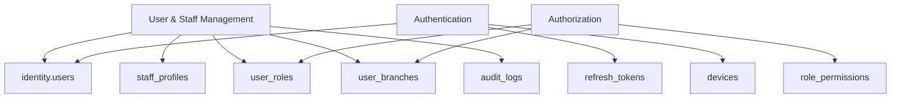
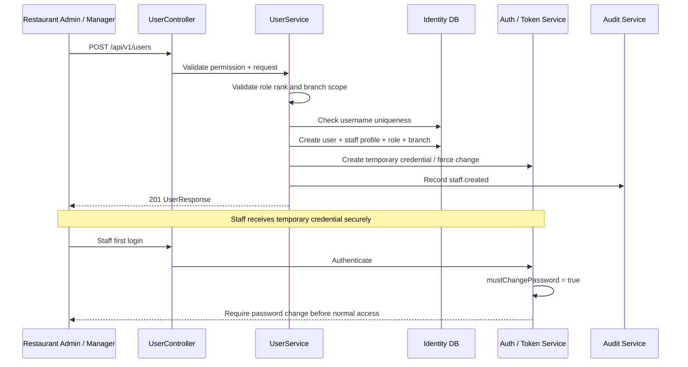
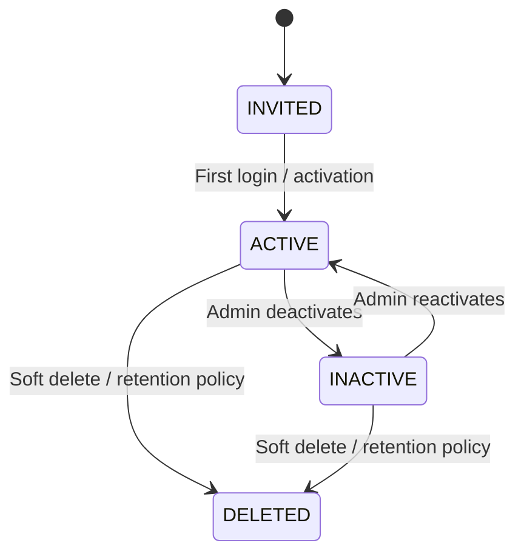

# DineMaster — User & Staff Management
## Technical Design and Implementation Guide

**Module:** M2 — Identity Service  
**Target stack:** Java 21, Spring Boot 3, Spring Security, PostgreSQL 16, Flyway  
**API base:** `/api/v1`  
**Dependency:** Authentication & Authorization (M1)  
**Status:** Development specification derived from `DineMaster_Technical_Documentation(1).md`

> **Source labels**
> - **[MASTER]** Explicitly stated in the uploaded master documentation.
> - **[DESIGN]** Detailed implementation recommendation added to make the module buildable.
> - **[DECISION]** Must be confirmed before production.

---

# 1. Module purpose and boundary

User & Staff Management creates and maintains the people who can access DineMaster and work in a restaurant branch.

It manages identity-linked staff records, role assignments, branch assignments, staff profile information, account status, temporary credentials and administrative actions. Every change must be auditable.

**Primary users:** Restaurant Admin and Manager.  
**Other consumers:** Authentication, Waiter, Chef, POS, KDS, Edge sync and audit/reporting.

## 1.1 Service ownership

This module belongs to `identity-service` and owns:
- User account creation and updates
- Staff profile data
- Role assignment to a user
- Branch assignment to a user
- Account activation/deactivation
- Admin password reset initiation
- Staff search/list/filter/pagination
- Audit history for staff changes
- Publishing staff/role/branch changes to Edge sync

It does not create or manage tenant/branch master records. Those belong to Core. It stores branch UUID assignments as references.

## 1.2 Relationship with Authentication



- M1 verifies credentials and issues tokens.
- M2 creates/updates the account and assigns role/branch scope.
- M1 uses the updated account status, role mappings and `permVersion` at login and during authorization.
- Deactivation must revoke all active refresh tokens and invalidate permissions.

---

# 2. Submodules

| Submodule | Responsibility | Main classes |
|---|---|---|
| 2.1 Staff Directory | Search/list staff, pagination, filters | `UserController`, `UserQueryService` |
| 2.2 Staff Onboarding | Create account and staff profile | `UserService`, `StaffProfileService` |
| 2.3 Staff Profile | Contact, employee code, join date, shift reference | `StaffProfileController`, `StaffProfileService` |
| 2.4 Role Assignment | Assign permitted role(s) | `UserRoleService`, `RoleService` |
| 2.5 Branch Assignment | Assign user to one/multiple branches | `UserBranchService` |
| 2.6 Staff Update | Update editable account/profile fields | `UserService` |
| 2.7 Account Status | Activate/deactivate, soft delete policy | `UserStatusService` |
| 2.8 Password Administration | Admin reset, temporary credential, force change | `PasswordService` from M1 |
| 2.9 Staff Audit | Record who changed what and why | `AuditService` |
| 2.10 Staff Sync | Publish user/role/branch snapshots to Edge | Identity outbox / sync integration |

**Do not mix shift scheduling with account management.** The master document mentions a Shift Assignment screen and a `shift` field in the staff profile, but the detailed employee shift roster, attendance and shift lifecycle are not defined. **[DESIGN]** Store a shift template/reference or current shift label only if the product team confirms what it means. Actual POS cashier shift open/close belongs to Operations.

---

# 3. Roles and access rules

## 3.1 Standard roles

| Role | Scope | User management capability |
|---|---|---|
| `SUPER_ADMIN` | Platform | No default access to tenant staff; platform support only under audited grant |
| `RESTAURANT_ADMIN` | Tenant | Manage staff across tenant branches |
| `MANAGER` | Assigned branch | Create/deactivate only lower roles in own branch |
| `CASHIER` | Assigned branch | No staff management |
| `WAITER` | Assigned branch | No staff management |
| `CHEF` | Assigned branch | No staff management |
| `INVENTORY_MANAGER` | Assigned branch | No staff management |

## 3.2 Permission codes

Master RBAC matrix defines:
- `user:view`
- `user:create`
- `user:update`
- `user:deactivate`
- `role:assign`
- `audit:view`
- `session:revoke`

Role assignment must not be inferred from frontend controls. The backend must validate the acting user's effective permission and scope for every request.

## 3.3 Non-negotiable business rules

1. A user cannot assign themselves a higher role.
2. A user cannot assign a role higher than their own authority.
3. Manager may manage only lower roles in their own branch.
4. Manager cannot edit staff in another branch; return 404 to avoid disclosing existence.
5. Restaurant Admin may manage users within their tenant.
6. A tenant user cannot be assigned to another tenant.
7. A branch assignment must belong to the user's tenant.
8. Last active Restaurant Admin cannot be deactivated.
9. Deactivation is soft; keep historical records and audit trail.
10. Deactivation revokes all active refresh tokens and increments `permVersion`.
11. Password hashes, PIN hashes and reset secrets are never returned.
12. Phone number is masked for roles without permission to see it.
13. Role assignment changes are audited and invalidate permission cache.
14. System roles cannot be deleted by tenant users.
15. **[DESIGN]** Prevent deactivating the currently authenticated account through the same request unless an explicit self-deactivation flow is approved.

---

# 4. User onboarding workflow



Detailed steps:
1. Admin opens Staff Directory and selects Add Staff.
2. Admin enters full name, username, contact information, employee code and join date.
3. Admin selects one or more branches the acting admin is allowed to manage.
4. Admin selects role from the allowed role list.
5. Backend derives tenant from authenticated principal; never accept tenant ownership from untrusted request body.
6. Backend validates username uniqueness within tenant, role rank and branch ownership.
7. In one transaction, create `users`, `staff_profiles`, `user_roles`, `user_branches`.
8. Create temporary password/reset flow and set `must_change_password=true`.
9. Increment or initialize `permVersion`.
10. Write audit event.
11. Return safe staff response; never return password hash or temporary password.
12. Staff signs in and must change temporary password before using the app.

**Credential delivery [DECISION]:** Choose secure one-time invitation link, admin-generated temporary password delivered out-of-band, or another approved mechanism. Do not display or log a permanent plaintext password.

---

# 5. Staff lifecycle



**[DESIGN]** The master file defines active toggle and soft deactivation but does not define a separate `INVITED` or `DELETED` status enum. Treat the diagram as a proposed lifecycle; implement either `is_active + deleted_at + must_change_password` or an approved status enum, not both redundantly.

- `ACTIVE`: login allowed subject to lockout/device rules.
- `INACTIVE`: login denied; sessions revoked.
- `DELETED`: soft-deleted; excluded from normal lists; historical references retained.
- `INVITED`: optional state if an invitation flow is approved.

Reactivation must not silently restore old sessions. User must authenticate again.

---

# 6. API specification

All endpoints use `/api/v1`, JSON camelCase, UTC timestamps, standard error envelope and pagination convention.

## 6.1 Staff directory and CRUD

| Method | Endpoint | Permission | Purpose |
|---|---|---|---|
| GET | `/api/v1/users` | `user:view` | List/search/filter staff |
| POST | `/api/v1/users` | `user:create` | Create staff account |
| GET | `/api/v1/users/{userId}` | `user:view` | Staff details |
| PUT | `/api/v1/users/{userId}` | `user:update` | Update editable details |
| POST | `/api/v1/users/{userId}/deactivate` | `user:deactivate` | Soft deactivate |
| POST | `/api/v1/users/{userId}/reactivate` | `user:update` **[DESIGN]** | Reactivate account |
| POST | `/api/v1/users/{userId}/reset-password` | `user:update` or dedicated permission | Initiate admin password reset |
| PUT | `/api/v1/users/{userId}/roles` | `role:assign` | Replace/assign roles |
| PUT | `/api/v1/users/{userId}/branches` | `user:update` **[DESIGN]** | Replace branch assignments |
| GET | `/api/v1/users/{userId}/audit` | `audit:view` | Staff audit history **[DESIGN]** |
| GET | `/api/v1/users/{userId}/sessions` | `session:revoke` / policy | View active sessions **[DESIGN]** |
| DELETE | `/api/v1/users/{userId}/sessions` | `session:revoke` | Revoke sessions **[DESIGN]** |

The master explicitly lists GET/POST `/users`, GET/PUT `/users/{id}`, deactivate, reset-password and PUT roles. Reactivate, branch-specific endpoint, audit and session endpoints are recommended expansions.

## 6.2 List staff: query parameters

`GET /api/v1/users?page=0&size=20&sort=createdAt,desc&role=WAITER&status=ACTIVE&branchId=<uuid>&q=rahul`

| Parameter | Type | Meaning |
|---|---|---|
| `page` | integer | Zero-based page |
| `size` | integer | Page size; max 100 |
| `sort` | string | Approved sort field + direction |
| `role` | string | Filter by role code |
| `status` | string | `ACTIVE`, `INACTIVE`, optional `DELETED` for authorized views |
| `branchId` | UUID | Filter by assigned branch |
| `q` | string | Search full name, username, employee code; phone only if permitted |

Response:

```json
{
  "content": [
    {
      "id": "user-uuid",
      "fullName": "Rahul Patil",
      "username": "rahul.cashier",
      "phone": "+91******1234",
      "email": "r***@example.com",
      "employeeCode": "EMP-0012",
      "roles": ["CASHIER"],
      "branchIds": ["branch-uuid"],
      "status": "ACTIVE",
      "joinedOn": "2026-11-05"
    }
  ],
  "page": 0,
  "size": 20,
  "totalElements": 1,
  "totalPages": 1
}
```

Only include fields the caller is allowed to view. Master API convention uses `page`, `size`, `totalElements`, `totalPages`; max size 100.

## 6.3 Create staff

`POST /api/v1/users`

Request:

```json
{
  "fullName": "Rahul Patil",
  "username": "rahul.cashier",
  "email": "rahul@example.com",
  "phone": "+919876543210",
  "employeeCode": "EMP-0012",
  "joinedOn": "2026-11-05",
  "roleCodes": ["CASHIER"],
  "branchIds": ["branch-uuid"]
}
```

**Do not accept** `tenantId`, `passwordHash`, `pinHash`, `isSuperAdmin`, `permVersion` or arbitrary permissions from the client. Tenant and actor context come from the authenticated principal; hashes and internal fields are generated server-side.

Response `201 Created`:

```json
{
  "id": "user-uuid",
  "tenantId": "tenant-uuid",
  "fullName": "Rahul Patil",
  "username": "rahul.cashier",
  "email": "rahul@example.com",
  "phone": "+91******1234",
  "employeeCode": "EMP-0012",
  "roles": ["CASHIER"],
  "branchIds": ["branch-uuid"],
  "status": "ACTIVE",
  "mustChangePassword": true,
  "createdAt": "2026-11-05T10:30:00Z"
}
```

## 6.4 Update staff

`PUT /api/v1/users/{userId}`

Request:

```json
{
  "fullName": "Rahul S. Patil",
  "email": "rahul.patil@example.com",
  "phone": "+919876543210",
  "employeeCode": "EMP-0012",
  "joinedOn": "2026-11-05"
}
```

Do not use this endpoint to change role, tenant, branch scope, active status or password. Those have dedicated actions so authorization and audit are explicit.

Use `If-Match: <version>` for concurrent updates if the entity version is exposed. Return 409 `VERSION_CONFLICT` when stale.

## 6.5 Assign roles

`PUT /api/v1/users/{userId}/roles`

Request:

```json
{
  "roleCodes": ["WAITER"]
}
```

Rules:
- Validate acting user has `role:assign`.
- Validate target user is in same tenant and manageable branch scope.
- Validate every requested role exists and belongs to allowed scope.
- Enforce role rank / authority: assigner must outrank target role.
- Never allow tenant users to assign `SUPER_ADMIN`.
- Update `user_roles` atomically.
- Increment target user's `permVersion`.
- Revoke or invalidate active sessions if policy requires immediate effect.
- Audit old and new role codes.

## 6.6 Assign branches

`PUT /api/v1/users/{userId}/branches`

Request:

```json
{
  "branchIds": ["branch-uuid-1", "branch-uuid-2"]
}
```

Rules:
- Every branch must belong to the authenticated tenant.
- Manager can only assign branches they themselves are authorized to manage; master says Manager is restricted to own branch.
- Validate the target role's scope.
- Increment `permVersion` and audit the assignment change.
- **[DECISION]** Confirm whether a user may be assigned to multiple branches. The schema supports multiple branch rows; Manager policy remains own-branch only.

## 6.7 Deactivate staff

`POST /api/v1/users/{userId}/deactivate`

Request:

```json
{
  "reason": "Employee left the organization"
}
```

Service must:
1. Load target within current tenant and authorized branch scope.
2. Check caller permission and role hierarchy.
3. Reject if target is the last active Restaurant Admin.
4. Set `is_active=false` (do not hard-delete).
5. Revoke all active refresh tokens.
6. Increment `permVersion`.
7. Invalidate permission/session caches.
8. Write audit record with reason.
9. Publish staff-deactivated event for Edge sync.

Response:

```json
{
  "id": "user-uuid",
  "status": "INACTIVE",
  "deactivatedAt": "2026-11-05T10:35:00Z"
}
```

## 6.8 Reactivate staff

`POST /api/v1/users/{userId}/reactivate`

- Requires authorized `user:update`.
- Check target is not soft-deleted.
- Set `is_active=true`.
- Do not restore prior refresh tokens.
- Require normal login and, if appropriate, password reset.
- Increment `permVersion` and audit.

## 6.9 Reset staff password

`POST /api/v1/users/{userId}/reset-password`

Request:

```json
{
  "reason": "Employee cannot access account"
}
```

Response:

```json
{
  "userId": "user-uuid",
  "resetInitiated": true,
  "mustChangePassword": true
}
```

The endpoint must not return the new plaintext password. Use a single-use reset link/token or approved temporary credential delivery. Revoke active sessions and audit.

---

# 7. Database design

The master document proposes `identity.users`, `user_roles`, `user_branches` and adds `staff_profiles(user_id, employee_code, shift, joined_on)`.

## 7.1 Tables

| Table | Ownership | Main fields |
|---|---|---|
| `identity.users` | Identity | `id`, `tenant_id`, `username`, `email`, `phone`, `full_name`, `password_hash`, `is_active`, `failed_logins`, `locked_until`, `last_login_at`, `version`, `deleted_at` |
| `identity.staff_profiles` | User & Staff | `user_id`, `employee_code`, `shift`, `joined_on` |
| `identity.user_roles` | Authorization | `user_id`, `role_id` |
| `identity.user_branches` | Scope | `user_id`, `branch_id` |
| `identity.roles` | Authorization | `id`, `tenant_id`, `code`, `name`, `scope` |
| `identity.audit_logs` | Audit | `actor_id`, `action`, `entity`, `entity_id`, old/new values, reason, timestamp |
| `identity.refresh_tokens` | Authentication | Active session revocation on deactivation |

## 7.2 Proposed staff_profiles SQL

The master file specifies the profile fields but does not include a full migration for this table. Proposed SQL:

```sql
CREATE TABLE identity.staff_profiles (
    user_id UUID PRIMARY KEY REFERENCES identity.users(id),
    employee_code VARCHAR(40),
    shift VARCHAR(80),
    joined_on DATE,
    created_at TIMESTAMPTZ NOT NULL DEFAULT now(),
    updated_at TIMESTAMPTZ NOT NULL DEFAULT now(),
    CONSTRAINT uq_staff_employee_code UNIQUE (employee_code)
);
```

**Important design correction:** If employee codes are unique only inside a tenant, use a tenant-aware unique constraint/index, not the global unique constraint shown above. Since `staff_profiles` does not itself contain `tenant_id`, either join through users or add `tenant_id` with a consistency constraint. Confirm the desired uniqueness rule.

## 7.3 Indexes

Recommended:
- Unique case-insensitive username per tenant (master specifies this).
- `user_roles(user_id)` and `user_roles(role_id)`.
- `user_branches(user_id)` and `user_branches(branch_id)`.
- `staff_profiles(employee_code)` with approved tenant uniqueness rule.
- `users(tenant_id, is_active, deleted_at)`.
- Search indexes for full name / username where scale requires.

Use UUID v7. Soft deletion uses `deleted_at`; active toggle uses `is_active`. Avoid hard deletion because historical orders/audit records need stable user references.

---

# 8. Validation rules

| Field / operation | Rule |
|---|---|
| `fullName` | Required; max 150 characters |
| `username` | Required; 3–60 characters; case-insensitive unique per tenant |
| `email` | Optional/required per product decision; valid format |
| `phone` | Validate configured phone format; normalize to E.164 where appropriate |
| `employeeCode` | Optional/required per owner; unique within agreed scope |
| `joinedOn` | Valid date; cannot be an invalid future date unless planned hire is supported |
| `roleCodes` | At least one role; all roles must be assignable by actor |
| `branchIds` | Must exist and belong to actor's tenant |
| `tenantId` | Never accepted from ordinary client request |
| `isActive` | Changed only through activate/deactivate endpoint |
| `passwordHash` | Never accepted from client |
| Role assignment | Actor must outrank target role; no self-escalation |
| Deactivation | Cannot deactivate last active Restaurant Admin |
| Manager scope | Own branch and lower roles only |

Master explicitly calls out unique username, phone format and role required. Other field rules are implementation recommendations and should be aligned with product policy.

---

# 9. Authorization matrix for this module

| Action | Super Admin | Restaurant Admin | Manager | Cashier / Waiter / Chef / Inventory Manager |
|---|---|---|---|---|
| View staff | No default tenant access | Tenant-wide | Own branch | No |
| Create staff | No default tenant access | Tenant-wide | Lower roles in own branch | No |
| Update staff | No default tenant access | Tenant-wide | Limited lower roles in own branch | No |
| Deactivate staff | No default tenant access | Tenant-wide | Limited lower roles in own branch | No |
| Assign role | No default tenant access | Yes, within tenant role catalogue | No in master matrix | No |
| Reset password | Through audited support grant only | Yes | **[DECISION]** master does not explicitly grant | No |
| View audit | No default tenant access | Tenant-wide | Own branch | No |
| Revoke session | No default tenant access | Tenant-wide | Own branch | No |

Master RBAC specifically gives Manager limited create/update/deactivate rights for Cashier, Waiter, Chef and Inventory Manager in their own branch. Manager cannot assign roles in the master permission matrix.

---

# 10. Backend implementation design

## 10.1 Request processing flow

1. Gateway validates JWT.
2. Spring Security loads principal and authorities.
3. Controller validates request DTO using `@Valid`.
4. Service obtains tenant/user/branch context from authenticated principal.
5. Service checks permission and target scope.
6. Service validates business rules (role rank, last admin, branch ownership).
7. Repository loads/writes only tenant-scoped records.
8. Transaction writes user/profile/role/branch changes.
9. Audit event is recorded in same transaction where possible.
10. Cache version is invalidated and sync event is published through an outbox after commit.
11. Response mapper returns safe fields only.

## 10.2 Class responsibilities

| Class | Responsibility |
|---|---|
| `UserController` | HTTP routes, DTO validation, response codes |
| `UserService` | Orchestrates create/update/deactivate |
| `UserQueryService` | Search, filter, pagination |
| `UserRepository` | User persistence and tenant-safe lookup |
| `StaffProfileRepository` | Staff profile persistence |
| `UserRoleService` | Role mapping and hierarchy validation |
| `UserBranchService` | Branch assignment validation |
| `RoleService` | Load role metadata / allowed role catalogue |
| `PasswordService` | Delegates reset to M1 password component |
| `AuditService` | Append-only audit events |
| `StaffSyncPublisher` | Publish changed staff snapshot/event to Edge |

Use `@Transactional` for multi-table writes. Do not call another repository directly from the controller. Avoid returning JPA entities.

---

# 11. Folder structure

```text
identity-service/
└── src/main/java/com/dinemaster/identity/
    ├── user/
    │   ├── controller/
    │   │   └── UserController.java
    │   ├── service/
    │   │   ├── UserService.java
    │   │   ├── UserQueryService.java
    │   │   └── UserStatusService.java
    │   ├── repository/
    │   │   ├── UserRepository.java
    │   │   └── StaffProfileRepository.java
    │   ├── entity/
    │   │   ├── User.java
    │   │   └── StaffProfile.java
    │   ├── dto/
    │   │   ├── UserCreateRequest.java
    │   │   ├── UserUpdateRequest.java
    │   │   ├── UserResponse.java
    │   │   ├── UserListFilter.java
    │   │   ├── AssignRolesRequest.java
    │   │   ├── AssignBranchesRequest.java
    │   │   └── DeactivateUserRequest.java
    │   ├── mapper/
    │   │   └── UserMapper.java
    │   └── validation/
    ├── staffprofile/
    │   ├── service/
    │   ├── repository/
    │   ├── entity/
    │   └── dto/
    ├── role/
    ├── authorization/
    ├── password/
    ├── audit/
    ├── sync/
    └── common/
```

Migrations:
```text
src/main/resources/db/migration/
  V1__create_identity_schema.sql
  V2__create_users_roles_permissions.sql
  V3__create_staff_profiles.sql
  V4__create_user_role_branch_mappings.sql
  V5__seed_default_roles_permissions.sql
```

Do not create duplicate `User` entities in Auth and Staff modules. Authentication and User Management must share the same identity aggregate/repository boundary.

---

# 12. Testing strategy

## 12.1 Unit tests
- Username normalization and uniqueness validation.
- Role rank comparison.
- Manager can manage only allowed lower roles.
- Branch belongs to tenant.
- Last Restaurant Admin protection.
- Safe DTO mapping and phone masking.
- Deactivation workflow revokes sessions and increments `permVersion`.

## 12.2 Integration tests (Testcontainers PostgreSQL)
- Create staff creates user/profile/role/branch mappings.
- Duplicate username in same tenant returns conflict.
- Same username in different tenant follows approved uniqueness policy.
- Update does not allow mass assignment of tenant, role or password hash.
- Manager cannot view/update another branch's staff.
- Tenant A cannot access Tenant B staff.
- Role assignment rejects Super Admin assignment by tenant user.
- Deactivation is soft and preserves references.
- Last active Restaurant Admin cannot be deactivated.
- Deactivation revokes refresh tokens and increments permission version.
- Reset password does not return secret.
- Audit log is written for create/update/role/branch/deactivate/reset.

## 12.3 API negative cases
- 401: missing/expired token.
- 403: missing permission.
- 404: user outside tenant/branch scope.
- 409: duplicate username, last-admin conflict, version conflict.
- 422: invalid phone, missing role, malformed request.
- 429: rate limit.

## 12.4 Acceptance criteria
- Admin can create, list, view, update and deactivate staff within tenant.
- Manager can manage only permitted lower roles in own branch.
- No user can elevate their own role.
- Role and branch assignment always validated server-side.
- Deactivated staff cannot log in and all refresh sessions are revoked.
- Last active Restaurant Admin remains protected.
- Staff history and audit records remain after deactivation.
- Sensitive fields are never exposed to unauthorized roles.
- Edge receives user/role/branch changes through sync.
- All tenant and branch isolation tests pass.

---

# 13. Integration with other modules

| Consumer | What it needs from User & Staff |
|---|---|
| Authentication | Active user, credential status, roles, branches, permission version |
| Authorization | Role assignments, permission mappings, branch scope |
| Waiter | Active waiter list for branch/table assignment |
| KDS / Kitchen | Chef/staff identity for accountability |
| POS / Operations | Cashier identity for bill/payment/shift audit |
| Edge node | Signed/cached staff + role + permission snapshot |
| Audit | Actor identity and staff lifecycle history |
| Core | Tenant and branch IDs; Core remains owner of branch records |

Staff sync should be event/outbox based or part of the documented sync pull. Never allow Edge to become the cloud source of truth for user role assignment.

---

# 14. Development plan

| Phase | Work | Deliverable |
|---|---|---|
| 0 | Confirm role hierarchy, employee code uniqueness, profile fields, Manager password reset policy | Approved decisions |
| 1 | Review existing schema and create Flyway migration | `users`, `staff_profiles`, mapping tables |
| 2 | Seed standard roles and permissions | Default role catalogue |
| 3 | Implement user create/list/detail | Staff directory API |
| 4 | Implement update and profile management | Staff profile API |
| 5 | Implement role assignment | Secure role mapping |
| 6 | Implement branch assignment | Tenant-safe branch mapping |
| 7 | Implement deactivate/reactivate | Session revocation + audit |
| 8 | Implement admin password reset integration | M1 password lifecycle |
| 9 | Add staff audit and Edge sync | Auditable downstream updates |
| 10 | Flutter screens + BLoC | Staff UI |
| 11 | Integration / security / E2E tests | Acceptance sign-off |

Recommended order inside each feature: **Database → Repository → Service → Controller/API → API tests → Frontend → Integration/E2E**.

---

# 15. Open decisions

| ID | Question | Impact |
|---|---|---|
| STAFF-01 | Is username unique per tenant or globally? | Unique index and login |
| STAFF-02 | Is employee code mandatory? Unique per tenant or branch? | Staff profile schema |
| STAFF-03 | Can one staff member belong to multiple branches? | `user_branches` policy |
| STAFF-04 | Can Manager reset passwords, or only Restaurant Admin? | Permission matrix |
| STAFF-05 | What does `shift` in staff profile represent? | Profile vs Operations shift scheduling |
| STAFF-06 | How are temporary credentials delivered? | Onboarding security |
| STAFF-07 | Are custom roles supported in MVP? | Role API and UI |
| STAFF-08 | Is email mandatory? | Onboarding validation |
| STAFF-09 | What is the retention policy for soft-deleted staff? | Data lifecycle |
| STAFF-10 | Which staff fields may Waiter/Chef/Manager see? | Response masking and privacy |

### Current backend defaults (confirm before production)

The existing implementation uses these defaults to keep the MVP consistent. They are not product-owner approvals:

- Username is globally unique; employee code is optional and unique per tenant.
- A user has one effective role and may have multiple branch assignments. Managers are restricted to lower staff roles in their assigned branch.
- Managers may reset passwords for staff they can manage. Creation/reset uses an admin-supplied temporary password; the staff member must change it after login. The admin must deliver it out of band.
- Email is optional. `shiftTiming` is stored as a profile label; shift scheduling remains out of scope.
- Deactivation uses `is_active`; there is no soft-delete timestamp or `DELETED` list filter.
- Phone is shown in full to Restaurant Admin and masked for Manager. Phone-based directory search is limited to Restaurant Admin.
- Current database IDs are numeric `BIGINT`, as used by the existing application schema, rather than the UUID examples in this design.

Staff lifecycle changes are now written transactionally to `staff_sync_outbox`. The outbox is only the durable handoff point: a publisher that produces the M1 signed Edge snapshot and marks events delivered is still required before Edge sync acceptance criteria can be considered complete.

---

# 16. Developer handoff checklist

- [ ] Read and implement M1 Authentication & Authorization first.
- [ ] Inspect current entities, migrations and repositories before adding duplicate models.
- [ ] Confirm role hierarchy and Manager scope.
- [ ] Create staff profile migration.
- [ ] Implement staff list/search/filter/pagination.
- [ ] Implement create/update.
- [ ] Implement role assignment and branch assignment.
- [ ] Implement deactivate/reactivate and last-admin protection.
- [ ] Integrate password reset with M1.
- [ ] Add audit logging and permission version invalidation.
- [ ] Add Edge sync events/snapshot updates.
- [ ] Add API, integration and security tests.
- [ ] Publish OpenAPI and staff onboarding runbook.

**Definition of Done:** Staff management is complete only when user creation, profile maintenance, role/branch scope, deactivation/session revocation, audit, tenant isolation, Edge sync and negative security tests all work.
