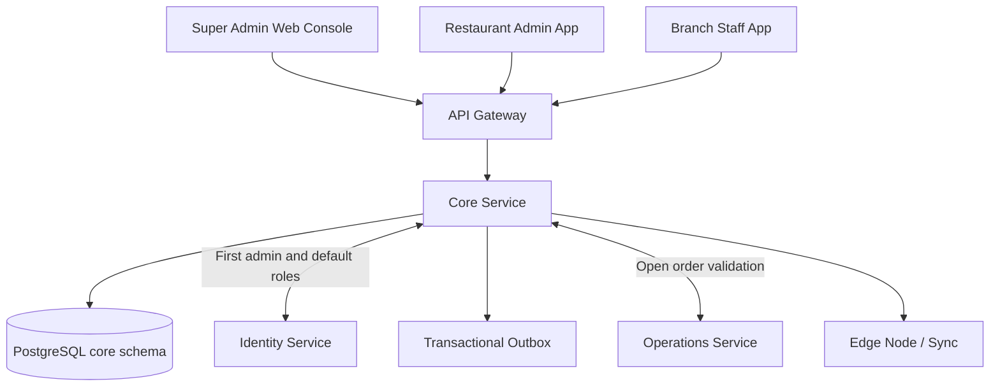
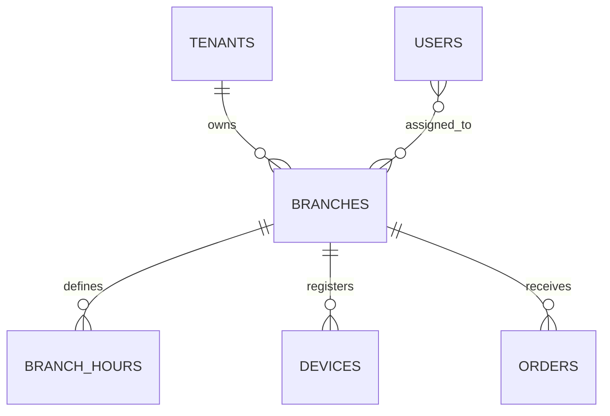
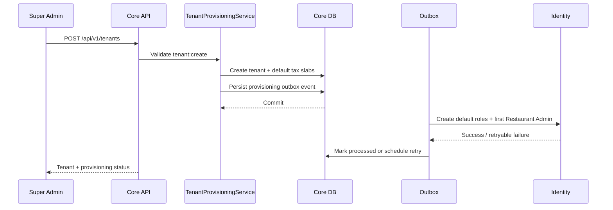
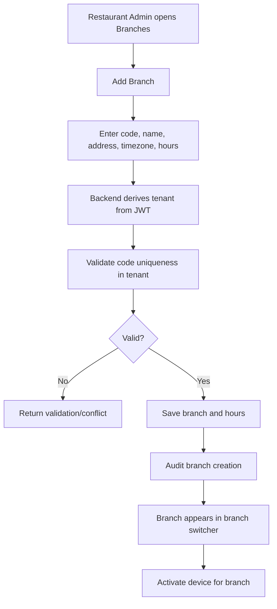

# DineMaster — M3 Restaurant & Branch Management
## Senior Developer Technical Specification

**Module:** M3 | **Service:** CORE | **Dependencies:** M1 Authentication & Authorization, M2 User & Staff Management  
**Stack:** Spring Boot, Java 21, PostgreSQL 16, Flyway | **API base:** `/api/v1`

> **Source fidelity:** Based on M3 in `DineMaster_Technical_Documentation(1).md`. **[MASTER]** means explicitly stated in the source. **[PROPOSED]** means an implementation detail/API contract suggested here and requiring team approval.

---

# 1. Module overview and responsibility

Restaurant & Branch Management maintains the restaurant business account (Tenant) and its physical outlets (Branches). The target architecture separates the old single `restaurant_id` concept into tenant and branch so multiple outlets can belong to one business while remaining isolated.

**Users**
- **Super Admin:** creates and suspends tenants; manages platform-level tenant operations.
- **Restaurant Admin:** manages branches belonging to their tenant.
- **Branch roles:** view only assigned branch(es), according to permissions.

**[MASTER] Tenant profile:** name, GSTIN, currency, logo.  
**[MASTER] Branch profile:** code, address, timezone, operating hours.  
**[MASTER] Rules:** branch code unique per tenant; a branch with open orders cannot be closed; suspended tenant blocks login except for Super Admin.

## 1.1 Service ownership

CORE owns:
- Tenant profile and lifecycle
- Branch CRUD and lifecycle
- Branch operating hours
- Tenant-to-branch relationship
- Branch information consumed by other modules

CORE does not own:
- Credentials, JWT, users, roles and permissions (Identity)
- Staff profile (Identity)
- Orders, payments and cashier shifts (Operations)
- Inventory quantities (Inventory)

## 1.2 Architecture



The master specifies tenant provisioning of tenant, default tax slabs, default roles and first Restaurant Admin. Identity provisioning must be retryable through an outbox.

---

# 2. Submodules

| Submodule | Responsibility | Main classes |
|---|---|---|
| Tenant Profile | Business name, legal name, GSTIN, currency, logo | `TenantController`, `TenantService`, `TenantRepository` |
| Tenant Lifecycle | Activate, suspend, close tenant | `TenantStatusService` |
| Tenant Provisioning | Tax slabs, default roles, first admin | `TenantProvisioningService` |
| Branch Directory | List and view branches | `BranchController`, `BranchQueryService` |
| Branch Onboarding | Create branch with code/address/timezone | `BranchService` |
| Branch Profile | Update branch details | `BranchService` |
| Branch Hours | Weekday opening and closing hours | `BranchHoursService` |
| Branch Lifecycle | Activate/suspend; prevent unsafe closure | `BranchStatusService` |
| Branch Switcher | Show user's accessible branches | Core branch lookup + Identity scope |
| Device Onboarding Integration | Bind device to tenant and branch | Identity Device integration |

**[MASTER] Screens:** Tenant list (web), Tenant form, Branch list, Branch form, Branch switcher.  
**[MASTER] UI events:** `BranchLoaded`, `BranchSaved`, `BranchSwitched`.

---

# 3. Domain model and relationships

## 3.1 Tenant

Tenant is the restaurant business/customer account. A tenant may have multiple branches.

Master SQL fields:
- `id UUID`
- `name varchar(150)`
- `legal_name varchar(200)`
- `gstin varchar(15)`
- `status` (`ACTIVE`, `SUSPENDED`, `CLOSED`)
- `currency char(3)` default `INR`
- `created_at`, `updated_at`, `version`, `deleted_at`

## 3.2 Branch

A branch is a physical outlet belonging to one tenant.

Master SQL fields:
- `id UUID`
- `tenant_id UUID`
- `code varchar(20)`
- `name varchar(150)`
- `address`
- `timezone varchar(50)` default `Asia/Kolkata`
- `is_active`
- `created_at`, `updated_at`, `version`, `deleted_at`

Constraint: `UNIQUE (tenant_id, code)`.

## 3.3 Branch hours

Master specifies `branch_hours(branch_id, weekday, open_time, close_time)`. Exact constraints and support for overnight hours, split shifts and holidays are not defined in the source and must be decided.

## 3.4 Logical ER diagram



Identity owns users and user-branch assignments; Operations owns orders; Core owns tenant/branch records. These cross-service links are UUID references, not cross-schema foreign keys.

---

# 4. Tenant onboarding workflow



**[MASTER] Provisioning sequence**
1. Super Admin creates tenant.
2. Create default tax slabs: 0%, 5%, 12%, 18%.
3. Create default roles.
4. Create first Restaurant Admin through Identity.
5. Identity call is retried through outbox if it fails.

**Important distributed-systems rule:** Core and Identity have separate databases. Do not assume one ACID transaction spans both. Commit tenant + outbox event atomically in Core; deliver the event with retries; make Identity provisioning idempotent.

**[PROPOSED]** Return a provisioning status such as `PENDING`, `COMPLETED`, `FAILED_RETRYING`. Confirm this response contract with the team.

---

# 5. Branch onboarding and lifecycle



Branch update:
1. Authenticate and check `branch:update`.
2. Load branch using both `branch_id` and authenticated `tenant_id`.
3. Validate changed branch code, timezone and hours.
4. Apply optimistic version check.
5. Save and audit old/new values.
6. Publish branch change for Edge sync.

Branch suspend/close:
1. Verify tenant ownership and permission.
2. Ask Operations whether the branch has open orders.
3. If open orders exist, reject closure.
4. Otherwise update lifecycle state and write audit record.
5. Preserve historical orders and references.

The exact “open order” statuses must come from the Operations state machine; Core must not create its own competing order status list.

---

# 6. API specification

All endpoints use JSON/camelCase, `/api/v1`, UTC timestamps, `Authorization: Bearer <accessToken>`, `X-Request-Id`, standard error envelope and tenant scoping.

## 6.1 Endpoints explicitly listed in master

| Method | Endpoint | Access | Purpose |
|---|---|---|---|
| POST | `/api/v1/tenants` | Super Admin | Create tenant |
| GET | `/api/v1/branches` | Authenticated, tenant-scoped | List branches |
| POST | `/api/v1/branches` | Restaurant Admin | Create branch |
| PUT | `/api/v1/branches/{id}` | Restaurant Admin | Update branch |
| POST | `/api/v1/branches/{id}/suspend` | Authorized tenant admin | Suspend branch |

The source lists these endpoints. Tenant profile update, tenant list/detail, branch detail, hours update and activate endpoints are not explicitly listed.

## 6.2 Additional endpoints — [PROPOSED, approval required]

| Method | Endpoint | Purpose |
|---|---|---|
| GET | `/api/v1/tenants` | Super Admin tenant directory |
| GET | `/api/v1/tenants/{tenantId}` | Tenant details |
| GET | `/api/v1/tenants/me` | Current tenant profile |
| PUT | `/api/v1/tenants/me` | Update permitted tenant profile fields |
| POST | `/api/v1/tenants/{tenantId}/suspend` | Suspend tenant |
| POST | `/api/v1/tenants/{tenantId}/activate` | Reactivate tenant |
| GET | `/api/v1/branches/{branchId}` | Branch detail |
| PUT | `/api/v1/branches/{branchId}/hours` | Update operating hours |
| POST | `/api/v1/branches/{branchId}/activate` | Activate branch |
| GET | `/api/v1/branches/accessible` | List branches accessible to current user |

Do not treat proposed routes as existing API contracts until approved and added to OpenAPI.

## 6.3 Create tenant — proposed request

`POST /api/v1/tenants` (Super Admin only)

```json
{
  "name": "Spice Route",
  "legalName": "Spice Route Foods Pvt Ltd",
  "gstin": "27ABCDE1234F1Z5",
  "currency": "INR",
  "firstAdmin": {
    "fullName": "Restaurant Owner",
    "username": "owner.spiceroute",
    "email": "owner@example.com",
    "phone": "+919876543210"
  }
}
```

The `firstAdmin` object is a proposed request design to support the documented provisioning workflow. Password creation must use the approved Identity invitation/temporary credential flow; never accept or return a permanent plaintext password.

Proposed response:
```json
{
  "id": "tenant-uuid",
  "name": "Spice Route",
  "status": "ACTIVE",
  "currency": "INR",
  "provisioningStatus": "PENDING",
  "createdAt": "2026-11-13T04:00:00Z"
}
```

## 6.4 Create branch — proposed request

`POST /api/v1/branches`

```json
{
  "code": "PUNE-01",
  "name": "Spice Route - Baner",
  "address": "Baner, Pune, Maharashtra",
  "timezone": "Asia/Kolkata",
  "hours": [
    {
      "weekday": "MONDAY",
      "openTime": "10:00",
      "closeTime": "23:00",
      "closed": false
    },
    {
      "weekday": "TUESDAY",
      "openTime": "10:00",
      "closeTime": "23:00",
      "closed": false
    }
  ]
}
```

Never accept `tenantId` from a normal Restaurant Admin request body. Derive it from the authenticated principal.

Proposed response:
```json
{
  "id": "branch-uuid",
  "tenantId": "tenant-uuid",
  "code": "PUNE-01",
  "name": "Spice Route - Baner",
  "timezone": "Asia/Kolkata",
  "isActive": true,
  "version": 1
}
```

## 6.5 List branches

`GET /api/v1/branches?page=0&size=20&sort=createdAt,desc`

**[PROPOSED filters]:** `q`, `isActive`. Always filter by authenticated tenant and assigned branch scope.

Response uses common pagination:
```json
{
  "content": [
    {
      "id": "branch-uuid",
      "code": "PUNE-01",
      "name": "Spice Route - Baner",
      "timezone": "Asia/Kolkata",
      "isActive": true
    }
  ],
  "page": 0,
  "size": 20,
  "totalElements": 1,
  "totalPages": 1
}
```

## 6.6 Update branch

`PUT /api/v1/branches/{id}`

```json
{
  "code": "PUNE-01",
  "name": "Spice Route Baner",
  "address": "Updated address",
  "timezone": "Asia/Kolkata"
}
```

Use `If-Match: <version>` for optimistic concurrency. Tenant ownership must not be editable through this endpoint.

## 6.7 Suspend branch

`POST /api/v1/branches/{id}/suspend`

Proposed body:
```json
{ "reason": "Outlet temporarily closed" }
```

Check open-order state with Operations before applying the closure/suspension policy.

---

# 7. Database design

Master architecture: PostgreSQL, one schema per service, UUID keys, `timestamptz`, `version`, soft-delete field and no cross-schema foreign keys.

## 7.1 `core.tenants` — master SQL

```sql
CREATE TABLE core.tenants (
  id          uuid PRIMARY KEY,
  name        varchar(150) NOT NULL,
  legal_name  varchar(200),
  gstin       varchar(15),
  status      varchar(20) NOT NULL DEFAULT 'ACTIVE'
              CHECK (status IN ('ACTIVE','SUSPENDED','CLOSED')),
  currency    char(3) NOT NULL DEFAULT 'INR',
  created_at  timestamptz NOT NULL DEFAULT now(),
  updated_at  timestamptz NOT NULL DEFAULT now(),
  version     integer NOT NULL DEFAULT 1,
  deleted_at  timestamptz
);
```

## 7.2 `core.branches` — master SQL

```sql
CREATE TABLE core.branches (
  id          uuid PRIMARY KEY,
  tenant_id   uuid NOT NULL REFERENCES core.tenants(id),
  code        varchar(20) NOT NULL,
  name        varchar(150) NOT NULL,
  address     text,
  timezone    varchar(50) NOT NULL DEFAULT 'Asia/Kolkata',
  is_active   boolean NOT NULL DEFAULT true,
  created_at  timestamptz NOT NULL DEFAULT now(),
  updated_at  timestamptz NOT NULL DEFAULT now(),
  version     integer NOT NULL DEFAULT 1,
  deleted_at  timestamptz,
  UNIQUE (tenant_id, code)
);
```

## 7.3 `core.branch_hours` — proposed SQL

Master specifies columns `branch_id`, `weekday`, `open_time`, `close_time`; exact DDL is not provided.

```sql
CREATE TABLE core.branch_hours (
  id          uuid PRIMARY KEY,
  branch_id   uuid NOT NULL REFERENCES core.branches(id),
  weekday     varchar(10) NOT NULL,
  open_time   time,
  close_time  time,
  is_closed   boolean NOT NULL DEFAULT false,
  created_at  timestamptz NOT NULL DEFAULT now(),
  updated_at  timestamptz NOT NULL DEFAULT now(),
  UNIQUE (branch_id, weekday)
);
```

Confirm overnight hours, split shifts and holiday exceptions before final migration.

## 7.4 Indexes and rules

- Unique `(tenant_id, code)` on branches.
- Index `branches(tenant_id, is_active)`.
- Index `branch_hours(branch_id)`.
- Every tenant query includes tenant filter.
- UUID v7 IDs; UTC timestamps; branch timezone stored as IANA timezone.
- Soft delete via `deleted_at`; optimistic locking via `version`.
- Apply RLS as a second isolation barrier where configured.

---

# 8. Authorization and tenant isolation

Master permission model:
- `tenant:create`, `tenant:suspend`, `licence:manage`: Super Admin only.
- `branch:view`: tenant roles, limited by assigned branch.
- `branch:create`, `branch:update`: Restaurant Admin.
- Super Admin is not a larger Restaurant Admin. It has no default access to restaurant orders, customers or payments.

Request enforcement:
1. Validate JWT.
2. Check required permission.
3. Derive tenant from trusted token/context.
4. Load branch using `id + tenant_id`.
5. For branch-scoped users, verify branch is assigned.
6. Apply repository tenant filters and database RLS.
7. Audit sensitive changes.

Suspended tenant: login is blocked except for Super Admin. Coordinate tenant-status validation with Identity.

---

# 9. Validation and business rules

| Field / operation | Rule |
|---|---|
| Tenant name | Required, max 150 |
| GSTIN | Optional in schema; validate format when supplied |
| Currency | Three-character currency code; default INR |
| Tenant status | `ACTIVE`, `SUSPENDED`, `CLOSED` |
| Branch code | Required, max 20, unique within tenant |
| Branch name | Required, max 150 |
| Timezone | Valid IANA timezone; default `Asia/Kolkata` |
| Branch hours | Valid weekday/time; overnight rule pending |
| Tenant ID | Never trusted from normal tenant-admin body |
| Branch close | Reject while open orders exist |
| Suspended tenant | Login blocked except Super Admin |
| Branch reads | Tenant and assigned-branch scope |

---

# 10. Backend package structure

```text
core-service/
└── src/main/java/com/dinemaster/core/
    ├── tenant/
    │   ├── controller/
    │   ├── service/
    │   ├── repository/
    │   ├── entity/
    │   ├── dto/
    │   └── mapper/
    ├── branch/
    │   ├── controller/
    │   ├── service/
    │   ├── repository/
    │   ├── entity/
    │   ├── dto/
    │   └── mapper/
    ├── branchhours/
    ├── provisioning/
    ├── integration/
    │   ├── identity/
    │   └── operations/
    ├── outbox/
    ├── audit/
    └── common/
```

Responsibilities:
- `TenantController`: HTTP endpoints only.
- `TenantService`: tenant lifecycle and business rules.
- `TenantProvisioningService`: default tax/roles/admin orchestration.
- `BranchController`: branch endpoints.
- `BranchService`: tenant-scoped create/update/suspend.
- `BranchHoursService`: operating hours validation.
- `IdentityClient`: first admin/default roles integration.
- `OperationsClient`: open-order validation.
- `OutboxPublisher`: reliable asynchronous delivery.

Use Controller → Service → Repository. Do not return JPA entities directly.

---

# 11. Integration points

| System | Direction | Purpose |
|---|---|---|
| Identity | Core → Identity | Default roles and first Restaurant Admin; tenant status for login |
| User & Staff | Identity references Core branch IDs | Staff branch assignment |
| Operations | Core ↔ Operations | Check open orders before branch closure |
| Edge | Core → Edge through sync | Branch configuration and operating hours |
| Device management | Identity owns devices | Device references tenant and branch |
| Analytics | Core dimensions consumed by analytics | Tenant/branch reporting |

Master inter-service rules: REST timeout 2 seconds, 2 retries with backoff, circuit breaker (Resilience4j). Async uses outbox and idempotent consumers.

---

# 12. Testing plan

## Unit tests
- Tenant lifecycle transitions.
- Branch code uniqueness.
- Timezone validation.
- Branch-hours validation.
- Tenant provisioning orchestration.
- Open-order closure guard.
- Tenant/branch scope service.

## Integration tests (Testcontainers PostgreSQL)
- Tenant creation and default tax slabs.
- Outbox record committed with tenant.
- Identity provisioning retries safely and idempotently.
- Branch creation under tenant.
- Duplicate branch code within tenant rejected.
- Same branch code in different tenants allowed.
- Cross-tenant branch lookup returns 404.
- Suspended tenant login blocked by integrated auth flow.
- Branch closure rejected while open orders exist.
- Branch listing returns only permitted tenant/branch records.

## API/security tests
- 401 invalid/missing JWT.
- 403 missing permission.
- 404 cross-tenant resource.
- 409 duplicate code / open-order conflict / stale version.
- 422 invalid GSTIN, timezone or hours.
- Concurrent update with stale `If-Match` rejected.

## Acceptance criteria
- Super Admin can create tenant.
- Provisioning creates default tax slabs (0, 5, 12, 18), roles and first admin via retryable Identity integration.
- Restaurant Admin can create/update branches within tenant.
- Branch code unique per tenant.
- Branch with open orders cannot close.
- Suspended tenant cannot log in except Super Admin.
- Reads enforce tenant isolation.
- Branch switcher shows only accessible branches.
- Onboarding runbook can be completed by a non-developer; Phase 3 target is under 15 minutes.

---

# 13. Implementation order

1. Confirm tenant and branch lifecycle decisions.
2. Inspect existing Core entities/migrations and reconcile actual `database.md`.
3. Create Flyway migrations for tenant, branch and hours.
4. Implement tenant repository/service and Super Admin create endpoint.
5. Implement provisioning outbox and idempotent Identity consumer.
6. Seed tax slabs and default roles.
7. Implement branch list/create/update/suspend APIs.
8. Implement branch-hours validation.
9. Integrate Operations open-order check.
10. Implement branch switcher and access checks.
11. Integrate Edge sync and device activation.
12. Add API, integration, tenant-isolation and E2E tests.
13. Prepare onboarding runbook and licence-limit process.

---

# 14. Open decisions

| ID | Decision | Impact |
|---|---|---|
| CORE-01 | Meaning of tenant `CLOSED` vs `SUSPENDED` | Login and retention |
| CORE-02 | Which tenant fields can Restaurant Admin edit? | Permissions |
| CORE-03 | Difference between branch suspend and close | Lifecycle |
| CORE-04 | Which Operations order states block closure? | Integration contract |
| CORE-05 | Overnight hours, split shifts, holidays | Hours schema |
| CORE-06 | Is GSTIN mandatory? | Validation |
| CORE-07 | Wait for Identity provisioning or return `PENDING`? | API behaviour |
| CORE-08 | Licence limits and enforcement | Super Admin |
| CORE-09 | Branch deletion and retention policy | Historical references |
| CORE-10 | Obtain/reconcile external `database.md` | Migration correctness |

---

# 15. Developer handoff checklist

- [ ] Confirm tenant/branch lifecycle.
- [ ] Review existing Core code and DB before migrations.
- [ ] Implement tenant and branch migrations.
- [ ] Implement tenant provisioning with outbox.
- [ ] Seed default tax slabs and roles.
- [ ] Implement branch CRUD and hours.
- [ ] Implement open-order closure guard.
- [ ] Enforce tenant and branch permissions.
- [ ] Implement branch switcher.
- [ ] Integrate Identity, Operations and Edge.
- [ ] Add tenant-isolation and API tests.
- [ ] Publish OpenAPI and onboarding runbook.

**Definition of Done:** Tenant/branch management is complete when onboarding, branch CRUD, tenant isolation, lifecycle rules, Identity provisioning, open-order protection, branch switcher and Edge configuration sync are verified.
