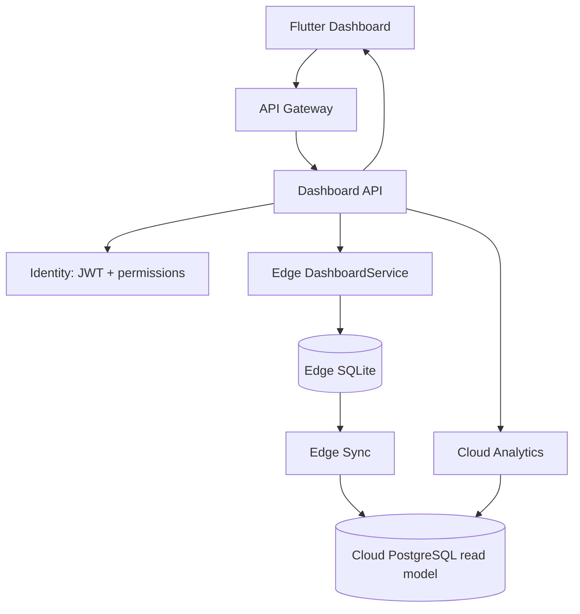

# DineMaster — M4 Dashboard
## Senior Developer Technical Specification

**Module:** M4 | **Ownership:** Analytics (ANA), Operations (OPS), Edge (EDGE)  
**Dependencies:** M1 Authentication & Authorization, M3 Restaurant & Branch, Tables/Floors, Orders, Payments, Inventory  
**API:** `/api/v1/dashboard/summary`

> **Source fidelity:** Based on M4 in `DineMaster_Technical_Documentation(1).md`. **[MASTER]** is stated in the source. **[PROPOSED]** is an implementation recommendation that requires confirmation.

---

# 1. Module overview

Dashboard is a one-screen summary of restaurant operations and business performance. It provides role-specific metrics and allows a user to tap a card/chart and navigate to the relevant module.

**Users:** Restaurant Admin, Manager, limited access for Cashier, Chef and Inventory Manager.

**[MASTER] Dashboard widgets**
- Today's revenue
- Order count
- Average order value
- Table occupancy
- Active orders
- Delayed orders
- Low-stock alerts
- Payment mode split
- Hourly sales chart

**[MASTER] Data source rules**
- Live numbers for a branch come from Edge.
- Historical numbers come from Cloud.
- Restaurant Admin can see consolidated figures across branches.
- Cloud values show an `asOf` timestamp.
- If Analytics is down, Cloud dashboard shows last cached values.
- Chef must not see revenue.

Dashboard owns no mandatory transactional tables. It reads Orders, Payments, Tables and Inventory. Optional read model: `analytics.daily_branch_summary`.

---

# 2. Submodules / dashboard widgets

| Widget | Source | Purpose |
|---|---|---|
| Revenue Summary | Operations payments/orders | Today's eligible revenue |
| Order Summary | Operations orders | Order count for selected date |
| Average Order Value | Revenue + eligible orders | Average order value |
| Table Occupancy | Core tables / Edge live state | Current table utilization |
| Active Orders | Operations / Edge | Orders in progress |
| Delayed Orders | Operations / Kitchen | Orders beyond configured delay |
| Low Stock Alerts | Inventory | Items below stock threshold |
| Payment Mode Split | Operations payments | Payment method distribution |
| Hourly Sales | Operations / Analytics | Sales by local hour |
| Branch Consolidation | Cloud Analytics | Tenant-wide totals |
| Role-based Visibility | Identity permissions | Hide unauthorized widgets |
| Data Freshness | Edge/Cloud sync/query | `asOf` timestamp |

The source does not define every KPI formula, delay threshold, stock threshold or payment grouping. Those are open product/finance decisions; do not silently hard-code assumptions.

---

# 3. Architecture and data flow



Ownership:
- Operations owns orders, order items, payments, KOT and order state.
- Core owns branches and tables.
- Inventory owns stock data and low-stock state.
- Analytics is read-only reporting and builds from replicated data.
- Edge serves live in-branch operational aggregates.
- Dashboard is an aggregation/read layer, never the transaction source of truth.

## 3.1 Branch dashboard

1. User selects an assigned branch.
2. API validates branch permission and tenant scope.
3. Live metrics are served from Edge for that branch.
4. UI shows the data source and freshness.
5. When Edge is disconnected, show cached/local values with clear offline/freshness indication.

## 3.2 Consolidated tenant dashboard

1. Restaurant Admin requests tenant-wide view.
2. Cloud Analytics aggregates data across branches in the authenticated tenant.
3. API returns consolidated values and `asOf`.
4. Do not describe these figures as live if Edge sync is delayed.

---

# 4. User workflow and frontend states

**[MASTER]**
- Dashboard screen with cards and chart widgets.
- BLoC events: `DashboardRequested`, `DashboardRefreshed`.
- State: `DashboardLoaded(metrics, asOf)`.
- Auto refresh through WebSocket.
- Login leads to role home screen; user taps a card to drill into the module.

**[PROPOSED] BLoC states**
- `DashboardInitial`
- `DashboardLoading`
- `DashboardLoaded(metrics, asOf)`
- `DashboardEmpty`
- `DashboardPartial(metrics, unavailableWidgets, asOf)`
- `DashboardFailure(code)`

Every screen should handle initial/loading/success/empty/failure. WebSocket reconnect should not create duplicate subscriptions. If refresh fails, preserve last valid data and show its age rather than replacing it with zeros.

---

# 5. Metric definitions and calculations

The master explicitly defines revenue eligibility and occupancy formula. The other KPI formulas below are proposed and require Finance/Operations approval.

## 5.1 Revenue

**[MASTER]** Revenue counts orders in `PAID` and `COMPLETED` only.

The master does not specify tax, service charge, discount, partial payment or refund treatment.

**[PROPOSED]** Aggregate settled eligible payment/order totals using Operations as source of truth. Finance must decide whether revenue is gross/net, tax-inclusive, and how refunds are attributed. Prevent split-payment double counting.

## 5.2 Order count

**[PROPOSED]** Count distinct orders for the selected branch and local business date. Exact included statuses are not specified in M4 and must be agreed.

## 5.3 Average order value

**[PROPOSED]**
\[
AOV = \frac{Eligible\ Revenue}{Eligible\ Order\ Count}
\]

Handle zero orders without division by zero. Confirm refund and cancellation treatment with Finance.

## 5.4 Occupancy

**[MASTER]**
\[
Occupancy =
\frac{Tables\ not\ AVAILABLE\ or\ OUT\_OF\_SERVICE}
{Active\ Tables}
\times 100
\]

Use the same branch and current snapshot for numerator and denominator. Handle zero active tables. Under the literal master formula, any status other than `AVAILABLE` and `OUT_OF_SERVICE` is included; confirm treatment of `CLEANING`.

## 5.5 Active orders

**[PROPOSED]** Count orders in the in-progress states from the Operations order state machine. Do not create a separate Dashboard status definition.

## 5.6 Delayed orders

**[PROPOSED]** Count orders/KOTs beyond the configured preparation/service SLA. Master does not specify threshold or timer start point (order confirmation, KOT firing or promised time).

## 5.7 Low-stock alerts

Read Inventory's own low-stock/availability result. Dashboard must not independently calculate stock balance. Threshold definition is not specified in M4.

## 5.8 Payment mode split

Aggregate payment ledger by payment method. The source does not specify whether chart displays amount, count or percentage, or the exact method enum.

**[PROPOSED]** Show amount and percentage after Finance approves refund/void treatment.

## 5.9 Hourly sales

Group eligible revenue by branch-local hour. Use branch timezone for date boundaries. Master does not specify whether grouping uses order-created time or payment-settled time; confirm with Finance/Operations.

---

# 6. API specification

**[MASTER endpoint]**

`GET /api/v1/dashboard/summary?branchId=&date=`

Master describes the Cloud implementation as FastAPI `/dashboard/summary` and Edge as `DashboardService` with SQL aggregates. Public API path remains `/api/v1/dashboard/summary`.

## 6.1 Request

Example:
`GET /api/v1/dashboard/summary?branchId=branch-uuid&date=2026-11-13`

Requirements:
- JWT required.
- Derive tenant from authenticated principal, not arbitrary query input.
- Verify user has access to requested branch.
- Resolve metric visibility from permissions.
- Use branch timezone for business-date boundaries.

## 6.2 Proposed response contract

The master does not supply a full response JSON. This is an illustrative contract:

```json
{
  "branchId": "branch-uuid",
  "date": "2026-11-13",
  "scope": "BRANCH",
  "source": "EDGE",
  "asOf": "2026-11-13T09:40:00+05:30",
  "metrics": {
    "revenue": {
      "value": 25450.00,
      "currency": "INR",
      "visible": true
    },
    "orderCount": {
      "value": 48,
      "visible": true
    },
    "averageOrderValue": {
      "value": 530.21,
      "currency": "INR",
      "visible": true
    },
    "occupancy": {
      "value": 62.5,
      "unit": "PERCENT",
      "visible": true
    },
    "activeOrders": {
      "value": 7,
      "visible": true
    },
    "delayedOrders": {
      "value": 2,
      "visible": true
    },
    "lowStockAlerts": {
      "value": 4,
      "visible": true
    },
    "paymentModeSplit": [
      { "mode": "CASH", "amount": 12000.00 },
      { "mode": "UPI", "amount": 10000.00 },
      { "mode": "CARD", "amount": 3450.00 }
    ],
    "hourlySales": [
      { "hour": "09:00", "amount": 1200.00 },
      { "hour": "10:00", "amount": 2400.00 }
    ]
  }
}
```

For unauthorized metrics, omit the value or return `visible:false` without a value. Never return hidden revenue as zero because zero could be interpreted as a real figure.

## 6.3 Tenant consolidated summary

Master requires consolidated Cloud numbers for Admin but does not specify a separate route.

**[PROPOSED]** Add a documented tenant-scope mode or separate endpoint after approval. Tenant scope must be authorized by backend permission; do not trust a client-supplied `scope=TENANT`.

## 6.4 Freshness and partial failure

- Cloud responses must include `asOf`.
- **[PROPOSED]** Include `source` such as `EDGE`, `CLOUD`, `CACHED`.
- If Analytics is unavailable, return last cached values as master requires, with a stale indicator.
- Do not silently turn unavailable metrics into zero.
- Agree whether partial dependency failure returns partial success or a dependency error.

---

# 7. Database and query design

**[MASTER]** Dashboard has no mandatory tables. It reads Orders, Payments, Tables and Inventory.

Optional master read model:
`analytics.daily_branch_summary(branch_id, day, revenue, orders, tax, ...)`

## 7.1 Data ownership by metric

| Metric | Source owner | Read pattern |
|---|---|---|
| Revenue | Operations | Payment/order aggregate |
| Order count | Operations | Count eligible orders |
| AOV | Operations | Derived aggregate |
| Occupancy | Core + Edge | Current table status |
| Active orders | Operations | In-progress state count |
| Delayed orders | Operations/Kitchen | SLA/delay query |
| Low stock | Inventory | Read low-stock summary |
| Payment split | Operations | Group payment ledger by method |
| Hourly sales | Operations/Analytics | Time-bucket aggregate |

## 7.2 Optional daily aggregate table

The source only names the optional columns; the following is a proposed expanded SQL shape:

```sql
CREATE TABLE analytics.daily_branch_summary (
  branch_id uuid NOT NULL,
  day date NOT NULL,
  revenue numeric(12,2) NOT NULL DEFAULT 0,
  orders integer NOT NULL DEFAULT 0,
  tax numeric(12,2) NOT NULL DEFAULT 0,
  updated_at timestamptz NOT NULL DEFAULT now(),
  PRIMARY KEY (branch_id, day)
);
```

This is a rebuildable read model, not a transaction ledger. It must never be used to settle payments.

## 7.3 Performance

**[MASTER]** Add an index on `(branch_id, created_at)` for query performance.

**[PROPOSED]**
- Inspect query plans before adding indexes to source tables.
- Consider branch/date indexes on Orders and Payments.
- Consider branch/status index for active operational counts.
- Convert branch-local date boundaries to UTC before timestamp queries.
- Cache dashboard summaries with explicit `asOf`.
- Use bounded queries and timeouts.

---

# 8. Authorization and role-based visibility

Dashboard content is permission-scoped. Master explicitly states Chef sees no revenue.

Rules:
1. Validate JWT and tenant.
2. Validate branch assignment.
3. Resolve metric permissions from Identity.
4. Query only authorized scope.
5. Do not expose hidden metric values.
6. UI hiding is convenience; API is the real security boundary.
7. Chef must not see revenue.
8. Cashier has limited dashboard; master role notes elsewhere say Cashier sees own shift totals only. Align exact widgets with the permission matrix.
9. Manager sees assigned branch.
10. Restaurant Admin can see consolidated tenant figures.
11. Inventory Manager should see inventory widgets unless additional permissions are explicitly approved.

---

# 9. Flutter package structure

Master specifies Dashboard screen, cards/charts, `DashboardRequested`, `DashboardRefreshed`, `DashboardLoaded(metrics, asOf)` and WebSocket auto refresh.

**[PROPOSED package structure]**
```text
features/dashboard/
  data/
    datasource/
      dashboard_remote_data_source.dart
      dashboard_edge_data_source.dart
    models/
      dashboard_summary_model.dart
    repositories/
      dashboard_repository_impl.dart
  domain/
    entities/
      dashboard_summary.dart
    repositories/
      dashboard_repository.dart
    usecases/
      get_dashboard_summary.dart
  presentation/
    bloc/
      dashboard_bloc.dart
      dashboard_event.dart
      dashboard_state.dart
    pages/
      dashboard_page.dart
    widgets/
      revenue_card.dart
      order_count_card.dart
      aov_card.dart
      occupancy_card.dart
      active_orders_card.dart
      delayed_orders_card.dart
      low_stock_card.dart
      payment_mode_chart.dart
      hourly_sales_chart.dart
```

Card taps navigate to the relevant module only if the user has permission. WebSocket reconnect should not create duplicate subscriptions. Show data freshness when offline or stale.

---

# 10. Testing plan

## Unit tests
- Revenue eligibility includes only `PAID` and `COMPLETED`.
- Occupancy excludes `AVAILABLE` and `OUT_OF_SERVICE`.
- Zero active tables does not divide by zero.
- Branch timezone date boundaries.
- Chef never receives revenue.
- Cached data freshness and stale labels.
- Partial dependency failure behaviour.

## Integration tests
- Branch summary uses correct tenant and branch.
- Restaurant Admin consolidated data contains only their tenant's branches.
- Manager cannot request another branch.
- Chef response does not contain revenue.
- Empty day returns valid empty summary.
- Branch live metrics use Edge.
- Cloud response contains `asOf`.
- Analytics outage returns last cached values with stale indication.
- Payment split reconciles with source ledger under approved rules.
- Hourly sales uses branch timezone.

## Performance tests
- Query uses `(branch_id, created_at)` index.
- Large history does not cause unbounded scans.
- Dashboard query load and WebSocket refresh remain bounded.
- Performance targets must be confirmed against project NFRs.

## Acceptance criteria
- All specified cards/charts are available.
- Branch live numbers come from Edge.
- Historical/consolidated numbers come from Cloud.
- Cloud response shows `asOf`.
- Analytics outage falls back to last cached values.
- Chef does not see revenue.
- Tenant/branch isolation is enforced.
- Revenue counts only `PAID` and `COMPLETED`.
- Occupancy follows the master formula.
- Empty-day and timezone tests pass.

---

# 11. Implementation sequence

1. Confirm KPI formulas, role visibility and freshness rules.
2. Inspect Operations, Core and Inventory schemas/contracts.
3. Implement Edge `DashboardService` SQL aggregates for live branch data.
4. Implement Cloud Analytics summary/read model.
5. Decide whether `daily_branch_summary` is needed.
6. Implement `/api/v1/dashboard/summary` with permission/scope enforcement.
7. Add tenant-wide consolidated summary for Restaurant Admin if approved.
8. Add caching and `asOf` metadata.
9. Add WebSocket refresh/reconnect handling.
10. Implement Flutter BLoC, cards and charts.
11. Add unit, integration, role, tenant, branch, timezone and performance tests.
12. Reconcile metrics against Operations/Finance source of truth.

---

# 12. Open decisions

| ID | Decision | Impact |
|---|---|---|
| DASH-01 | Revenue includes/excludes tax, service charge, discounts and refunds? | Finance correctness |
| DASH-02 | Which order statuses count toward order count? | KPI definition |
| DASH-03 | AOV numerator/denominator and refund rules? | KPI correctness |
| DASH-04 | Delayed order threshold and timer start point? | SLA |
| DASH-05 | Low-stock threshold source? | Inventory contract |
| DASH-06 | Payment split by amount, count or percentage? | Chart |
| DASH-07 | Hourly sales by order time or payment time? | Finance |
| DASH-08 | Exact widgets visible to Cashier? | Permissions |
| DASH-09 | WebSocket event and refresh interval? | Load/UX |
| DASH-10 | Maximum acceptable stale-cache age? | Freshness |
| DASH-11 | Tenant consolidated endpoint shape? | API |
| DASH-12 | Is daily summary table required or deferred? | Analytics storage |

---

# 13. Developer handoff checklist

- [ ] Confirm KPI definitions with Finance/Operations.
- [ ] Confirm role-to-widget visibility.
- [ ] Inspect source schemas and ownership.
- [ ] Implement Edge live aggregates.
- [ ] Implement Cloud Analytics summary.
- [ ] Implement summary API with branch/tenant scope.
- [ ] Add `asOf` and stale-cache behaviour.
- [ ] Add optional daily aggregate only if approved.
- [ ] Implement WebSocket refresh.
- [ ] Build Flutter dashboard widgets and BLoC.
- [ ] Add role, tenant, branch, timezone and empty-day tests.
- [ ] Reconcile metrics against source ledger.
- [ ] Publish OpenAPI and operational notes.

**Definition of Done:** Dashboard is complete only when KPIs reconcile with source systems, Edge/Cloud source rules are respected, role-based visibility is enforced, stale data is disclosed, and tenant/branch/timezone tests pass.
