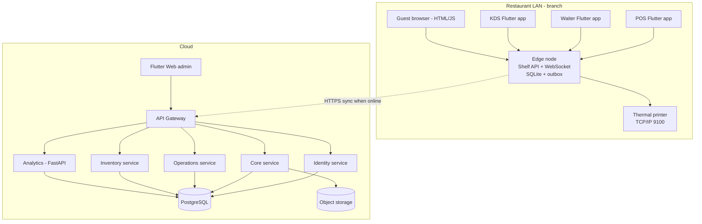
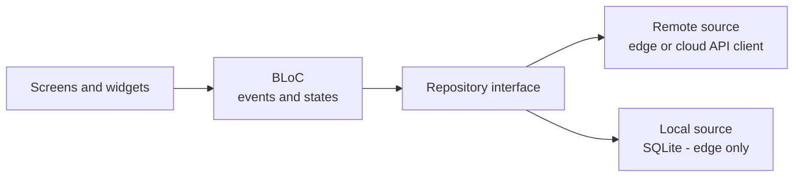
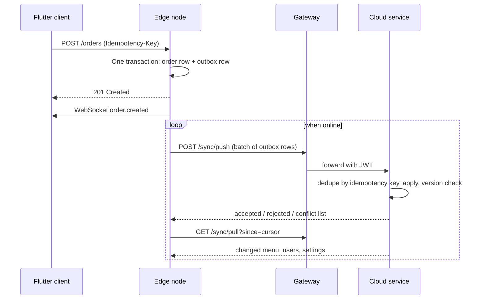
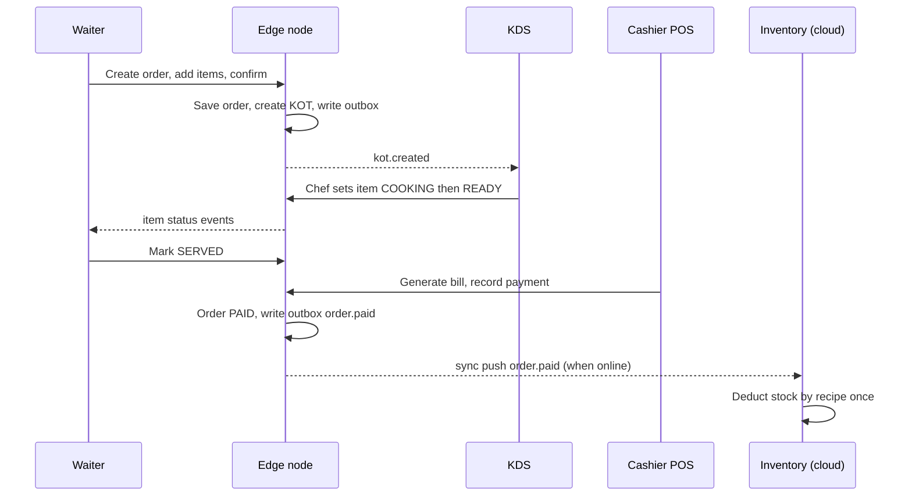
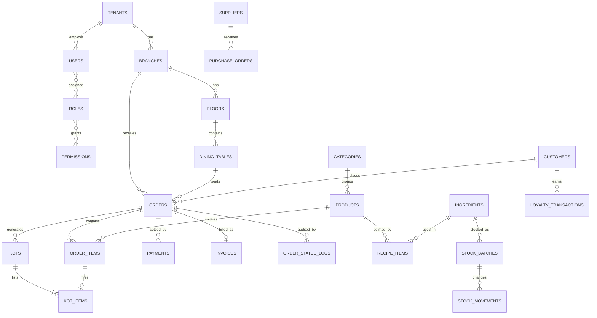
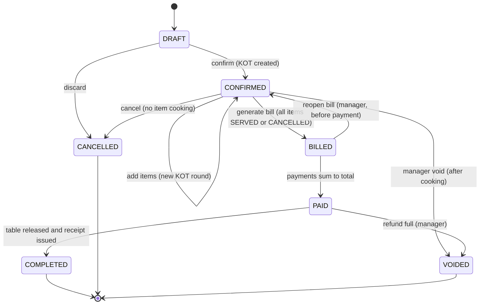
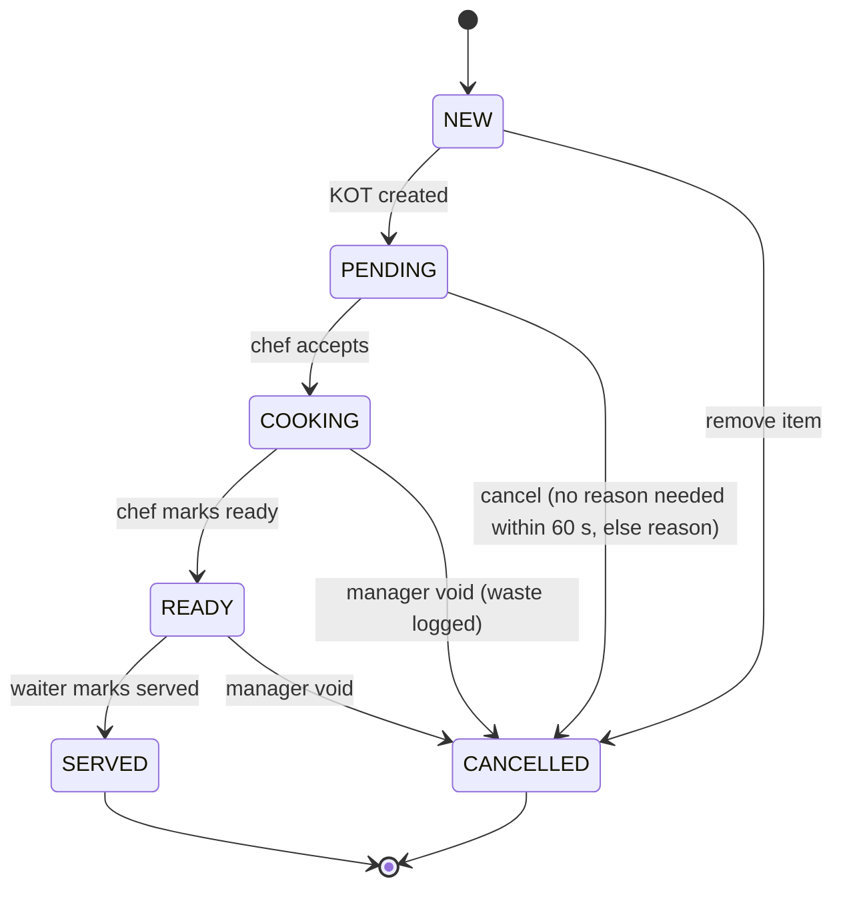
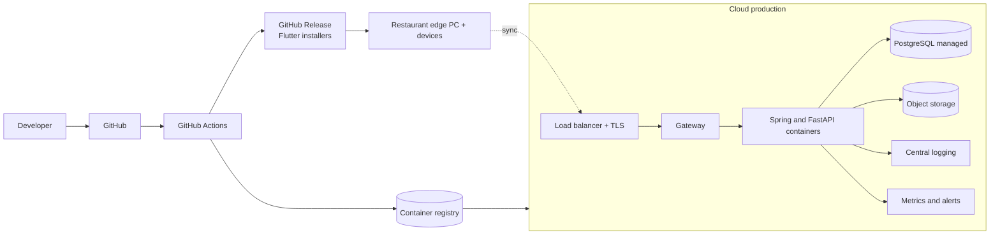

# DineMaster: Complete Technical Documentation

**Enterprise Restaurant ERP and POS Management System**

| | |
|---|---|
| Document | Master Technical Documentation (single reference) |
| Version | 1.0 draft for owner approval |
| Date | 3 November 2026 |
| Based on | DineMaster Developer Documentation v1.0.0 (Complex Innovators Company) and the project brief |
| Not received | Application Architecture Diagram, external `database.md` |

## How to read this document

- **[Existing]** is stated in the v1.0.0 PDF. **[Target]** is requested but not built. **[ASSUMPTION]** is a value chosen by the author because no source defines it. **[Pending]** needs an owner decision.
- Nothing about the current implementation is invented. Where the PDF is silent, this document says so.
- Chapters 2 and 16 list every open decision and risk.

## Contents map

| Ch. | Title | Ch. | Title |
|----|-------|----|-------|
| 1 | Project Overview | 9 | Module Documentation (28 modules, M1 to M28) |
| 2 | Architecture Decisions (ADR) | 10 | API Documentation |
| 3 | System Architecture | 11 | Security Guidelines |
| 4 | Roles and Permission Matrix | 12 | Testing Strategy |
| 5 | Microservices Design | 13 | DevOps and Deployment |
| 6 | Database Architecture and SQL | 14 | Folder Structures |
| 7 | Order and Kitchen Workflow | 15 | Development Roadmap |
| 8 | Offline-First and Synchronisation | 16 | Production Readiness and Open Items |

# 1. Project Overview

**Status:** Draft v0.1 | **Sources:** DineMaster Developer Documentation v1.0.0 (PDF), project brief.
Items marked **[Existing]** come from the PDF. Items marked **[Target]** are requested but not built. **[ASSUMPTION]** marks author choices.

## 1.1 Introduction

DineMaster is a Restaurant ERP and POS system for dine-in, takeaway and delivery restaurants. Version 1.0.0 **[Existing]** is a Flutter application with a local SQLite database and an embedded Shelf HTTP and WebSocket server on port 8080. All devices on the restaurant Wi-Fi share data through that server. It works with no internet.

The next generation **[Target]** keeps that offline strength and adds a cloud backend (Spring Boot, PostgreSQL, a Python analytics service) for central management, multiple restaurants, and reporting.

## 1.2 Business objectives

1. Replace separate billing, kitchen, waiter and inventory tools with one connected system.
2. Keep service running during internet outages.
3. Give owners one view across all branches **[Target]**.
4. Reduce food waste and billing errors through recipe-based stock deduction and an audit trail.
5. Let DineMaster operate as a multi-tenant product (Super Admin, licensing) **[Target, needs owner confirmation]**.

## 1.3 Problems being solved

| Problem | Example | How DineMaster addresses it |
|---------|---------|-----------------------------|
| Disconnected tools | Waiter writes an order on paper, kitchen misreads it | Waiter tablet sends the KOT directly to the kitchen screen |
| Slow billing at peak time | Cashier retypes items | Table order flows straight into the bill |
| Stock mismatch | Paneer runs out but the menu still sells it | Recipe (BOM) deducts stock on sale, low-stock alerts |
| No accountability | A discount is given with no record | Discounts need a remark, status changes are logged with staff and time |
| Internet dependency | Cloud POS stops during an outage | Local edge node keeps working |
| No multi-outlet view | Owner phones each branch for sales | Central reports (cloud) |

## 1.4 Scope

### 4.1 In scope: MVP

The 28 requested modules are grouped by priority. **[ASSUMPTION]** This grouping is a proposal and needs owner approval.

| Priority | Modules |
|----------|---------|
| **MVP (must have)** | 1 Auth, 2 User and Staff, 3 Restaurant and Branch, 4 Dashboard, 5 Table and Floor, 7 Menu and Category, 8 Product, 10 POS and Cart, 11 Order, 12 KDS, 13 KOT, 14 Waiter, 16 Payment, 17 Billing and Invoice, 25 Printer Integration, 26 Backup and Restore, 27 System Settings, 28 Offline Sync |
| **Phase 2** | 6 Reservation, 9 Recipe and BOM, 18 Inventory, 19 Supplier and Vendor, 22 Analytics and Reporting, 23 Accounting and Expense, 24 Notification |
| **Phase 3 (later)** | 15 QR Self-Ordering, 20 Offers and Discount, 21 Customer and Loyalty |

Notes:

- QR ordering, reservations, inventory and offers already exist in v1.0.0 **[Existing]**. "Later" here refers to the **re-architecture**, not to dropping working features. If this is a migration, they must still be carried over (see Pending question P5 in Chapter 2).
- Basic discounts (flat or percent with a remark) are part of POS and are MVP. The Offers module covers promotional codes.

### 4.2 Out of scope (future enhancements)

From the PDF future-scope list. None are required for the first production release:

- Swiggy and Zomato adapters, customer mobile app, customer feedback
- AI demand forecasting, auto-replenishment, allergen engine, KDS voice alerts
- ML analytics, Tally and QuickBooks export, Stripe or embedded UPI
- Biometric attendance, scales, cash drawer, franchise management, HACCP

## 1.5 Target users

| User | Typical day | Main device |
|------|-------------|-------------|
| Super Admin (platform) | Creates tenants, manages licences, supports customers | Web console |
| Restaurant Admin | Sets up branches, staff, tax, menu, reads P&L | Desktop or web |
| Manager | Runs the shift, approves voids and discounts, checks reports | Desktop or tablet |
| Cashier | Bills tables and takeaway, takes payment, prints receipts | POS terminal |
| Waiter | Takes orders at the table, fires KOT, serves | Phone or tablet |
| Chef | Sees tickets, marks cooking and ready | Kitchen screen |
| Inventory Manager | Receives stock, raises purchase needs, checks expiry | Desktop or tablet |
| Guest (non-staff) | Scans a table QR and orders from a phone browser | Phone browser |

## 1.6 Functional requirements

IDs are stable and referenced from module documents. "Source" shows whether the feature exists in v1.0.0.

### 6.1 Core operations

| ID | Requirement | Source |
|----|-------------|--------|
| FR-POS-01 | Create orders by type: Dine-In, Table, Takeaway, Delivery, Online, Walk-in | Existing |
| FR-POS-02 | Cart with quantity change, item notes and category navigation | Existing |
| FR-POS-03 | GST slabs 0, 5, 12, 18 percent, configurable | Existing |
| FR-POS-04 | Flat or percentage discount with a mandatory remark | Existing |
| FR-POS-05 | Split payment across Cash, Card, UPI, Wallet | Existing |
| FR-POS-06 | Park an order and reopen it with the cart intact | Existing |
| FR-TBL-01 | Floor plan with colour-coded table statuses and zones | Existing |
| FR-TBL-02 | Assign a waiter to a table | Existing |
| FR-RSV-01 | Reservation workflow Pending, Confirmed, Seated, Cancelled, with clash detection | Existing |
| FR-KIT-01 | KOT is sent to the kitchen automatically when an order is confirmed | Existing |
| FR-KIT-02 | Route items to stations (Chinese, Tandoor, and others) | Existing |
| FR-KIT-03 | Sort tickets by age, priority, table or prep time | Existing |
| FR-KIT-04 | Delay alert with a reason recorded | Existing |
| FR-ORD-01 | Immutable status log: who changed what, and when | Existing |
| FR-PRN-01 | ESC/POS thermal printing over TCP/IP, and PDF invoice | Existing |

### 6.2 Back office

| ID | Requirement | Source |
|----|-------------|--------|
| FR-MNU-01 | Menu items with category, price, GST slab, veg/non-veg, dietary tags, badges | Existing |
| FR-RCP-01 | Recipe (BOM) maps a menu item to ingredients with quantities | Existing |
| FR-INV-01 | Stock levels with thresholds, status, and expiry (FEFO) | Existing |
| FR-INV-02 | Units: Kg, Gram, Liter, mL, Pieces, Packs, Boxes, Crates | Existing |
| FR-SUP-01 | Supplier directory linked to ingredients | Existing |
| FR-ANA-01 | Dashboard: revenue, occupancy, active orders, stock alerts | Existing |
| FR-ANA-02 | Sales reports by date, payment mode, order type; top and slow items | Existing |
| FR-ACC-01 | P&L: gross sales, expenses, tax, net balance | Existing |
| FR-ACC-02 | Expense entry by category with date filter | Existing |
| FR-SYS-01 | One-click backup and safe restore | Existing |
| FR-SYS-02 | Printer settings, GST settings, assignment toggles | Existing |

### 6.3 New in the target architecture

| ID | Requirement | Source |
|----|-------------|--------|
| FR-PLT-01 | Super Admin creates and suspends tenants | Target |
| FR-PLT-02 | Tenant, branch separation with central reports across branches | Target |
| FR-AUT-01 | JWT login, refresh, logout, and device sessions | Target |
| FR-AUT-02 | Offline staff login from a cached snapshot | Target |
| FR-SYN-01 | Two-way sync between edge SQLite and cloud PostgreSQL | Target |
| FR-SYN-02 | Sync status screen with pending count and last success time | Target |
| FR-NOT-01 | Notifications (in-app first; SMS or email later) | Target |
| FR-INV-03 | Inventory Manager role with receiving, adjustments, and stock counts | Target |
| FR-ORD-02 | Void, cancel, and refund with approval | Target (gap in PDF) |
| FR-ORD-03 | Table transfer, merge, split bill | Target (gap in PDF) |
| FR-PAY-01 | Cashier shift open and close with cash reconciliation | Target (gap in PDF) |

## 1.7 Non-functional requirements

The PDF gives no numbers. The values below are **[ASSUMPTION]** and must be confirmed (Pending P7).

| Area | Requirement |
|------|-------------|
| Offline | Order, KOT, bill and payment must work with no internet. The edge node must continue for at least 7 days offline |
| LAN latency | KOT appears on the kitchen screen within 1 second at the 95th percentile |
| Cloud API | 95th percentile under 500 ms for normal reads |
| Sync lag (online) | Under 30 seconds for orders, under 5 minutes for reports |
| Availability (cloud) | 99.5 percent monthly |
| RPO / RTO | RPO 15 minutes for cloud data, RTO 4 hours. Edge: nightly local backup |
| Capacity | Up to 20 devices per branch, 500 orders per hour per branch, 200 tenants in year one |
| Security | OWASP ASVS Level 2 as the target baseline |
| Audit | Status changes, discounts, voids, price edits, and logins are logged and not editable |
| Usability | Billing flow completes in 5 taps or fewer for a common order |
| Compatibility | Windows and Android as primary. macOS and iOS supported. Linux best-effort **[Existing]** |
| Privacy | Customer data handling aligned to India DPDP Act 2023 **[ASSUMPTION: India market]** |

## 1.8 System limitations

1. **Edge node is a single point of failure** for a branch. Mitigation: a documented standby procedure (restore the latest backup on a second machine). Automatic failover is not in the MVP.
2. **A phone or tablet must not be the edge host.** Mobile operating systems can suspend background servers.
3. **Guest QR ordering is served over the LAN** and works only on the restaurant Wi-Fi.
4. **Flutter Web is online only** (ADR-007).
5. **No automatic merge of arbitrary offline edits.** Conflicts follow fixed per-entity rules. Rare cases go to a manual review queue.
6. **Tax logic is India GST only** until other markets are specified. GSTIN, HSN codes, CGST/SGST split, and e-invoicing are not documented in the PDF.
7. **AI features are not part of the first release.**

## 1.9 Production requirements

Before any release, the following must be true. Detailed lists are in Chapter 16.

- Password storage upgraded to a proper password-hashing algorithm
- Guest QR links signed so that table IDs cannot be tampered with
- TLS on all cloud traffic. On the LAN, the edge node uses HTTPS with a locally trusted certificate, or an accepted risk is recorded
- Automated tests on money calculations, state transitions and sync
- Tested backup and restore, for both edge and cloud
- Monitoring and alerts on the cloud services and on sync failures
- Data migration from v1.0.0 SQLite verified on real data copies

## 1.10 Missing requirements and risks (summary)

**Missing information:** the architecture diagram, `database.md`, primary key type, the real password algorithm, the 10 table statuses, order and invoice numbering rules, host failure handling, refunds and shifts, tax detail, scale numbers, and retention policy.

**Top risks:** edge single point of failure (R1), mobile host suspension (R2), sync conflicts (R8), double or missed stock deduction (R9), guessable QR table IDs (R4), weak password hashing (R5). The full table with ratings is in the assessment and carried into Chapter 3.

## 1.11 Document map

| File | Purpose |
|------|---------|
| Chapter 2 | Conflicts and ADRs |
| Chapter 3 | Components, communication, diagrams |
| Chapter 4 | Roles and permission codes |
| Chapter 5, Chapter 6, Chapter 8 | Stage 3 |
| MODULES/ | Stages 4 to 6 |
| API, Security, Testing, DevOps, Roadmap, Checklist, README | Stages 7 and 8 |

# 2. Architecture Decisions (ADR)

**Document status:** Draft v0.1 for approval | **Source of truth:** DineMaster Developer Documentation v1.0.0 (PDF) and the project brief.
**Not available when written:** the Application Architecture Diagram and the external `database.md`. Every decision below must be re-checked against them.

## How to read this document

- **Existing** means stated in the v1.0.0 PDF.
- **Target** means requested in the project brief and not yet built.
- **[ASSUMPTION]** means the author chose a value because no source defines it.
- **Status values:** Proposed, Accepted, Pending (needs an owner decision), Superseded.

All ADRs are currently **Proposed**. None is Accepted until the product owner signs off.

---

## 2.1 Conflict register (existing vs target)

| ID | Area | Existing (PDF) | Target (brief) | Resolution |
|----|------|----------------|----------------|------------|
| C1 | Deployment | LAN only, no cloud | Cloud microservices and gateway | ADR-001 (hybrid) |
| C2 | Backend | Shelf embedded in the Flutter app | Spring Boot and FastAPI | ADR-002, ADR-003 |
| C3 | Database | SQLite is the only database | PostgreSQL primary, SQLite local | ADR-001, ADR-005 |
| C4 | Authentication | Local users table, hashed passwords | JWT access and refresh tokens | ADR-006 |
| C5 | Real-time | Shelf WebSocket plus 10 s polling | Not specified | ADR-004 |
| C6 | Roles | 5 roles (Admin, Manager, Cashier, Waiter, Chef) | 7 roles (adds Super Admin, Inventory Manager) | ADR-009 |
| C7 | Order states | KOT: Pending, Cooking, Ready, Served. Table: Ordering, Pending, Preparing | Draft to Completed (10 states) | ADR-008 |
| C8 | Web platform | Web listed as supported | Not addressed | ADR-007 |
| C9 | Module scope | Loyalty is "Phase 2 future" but loyalty and offers tables exist | 28 modules | MVP classification in Chapter 1 |
| C10 | AI service | AI forecasting is "Phase 3 future" | Python AI Service | Deferred, ADR-003 |

---

## ADR-001: Hybrid edge plus cloud architecture

**Status:** Proposed

**Context.** The existing product promises "100% offline on the local network with no cloud dependency." The brief asks for an API gateway, microservices, PostgreSQL and a Super Admin. A restaurant cannot stop taking orders when the internet drops.

**Options**

| Option | Pros | Cons |
|--------|------|------|
| A. Local only (as today) | Works offline, nothing to host | No central admin, no Super Admin, no cross-branch reports, no remote backup |
| B. Cloud only | Simple mental model | Fails the core offline promise, so rejected |
| C. Hybrid | Offline on the LAN, central control in the cloud | More moving parts, needs a sync design |

**Decision.** Option C. The restaurant runs an **edge node** that is the real-time authority on its LAN. The **cloud backend** is the system of record for tenants, users, menu, and reporting. The two exchange data through a sync protocol (see Chapter 8).

**Consequences**

- Two data stores must be kept consistent. Sync correctness becomes the highest-risk part of the project.
- Every entity needs a sync-safe identity (ADR-005).
- A restaurant can run in "standalone mode" (edge only) without a cloud account. This preserves the current product.

---

## ADR-002: Keep Shelf as the edge node (decision pending)

**Status:** Pending (recommendation: keep Shelf)

**Context.** Shelf and Spring Boot are not interchangeable. Shelf runs inside the Flutter app on a restaurant device. Spring Boot runs on a server. They play different roles.

**Options**

1. **Keep Shelf (Dart) as the edge node.** Reuses the existing code and the existing SQLite schema. One language for the edge.
2. **Rewrite the edge node in Spring Boot.** Same stack as the cloud, but it needs a JVM on the restaurant machine and a full rewrite.
3. **Shared logic via a Dart package.** Edge and clients share order and tax rules in one package.

**Recommendation.** Option 1, plus Option 3 for shared business rules (tax, totals, state transitions).

**Consequences**

- The edge node must run on a stable machine (desktop or mini PC), **not a phone or tablet**, because mobile operating systems suspend background servers (risk R2).
- Business rules exist in two places (edge in Dart, cloud in Java). A shared contract test suite is required so both produce identical totals and transitions.

---

## ADR-003: Modular monolith first, services later

**Status:** Proposed

**Context.** The brief lists 15 candidate services. A small team running 15 services pays a heavy cost in deployment, tracing and data consistency, with little early benefit.

**Decision.** Start with **four deployables plus a gateway**, each internally split into modules with clear package boundaries:

| Deployable | Technology | Modules inside |
|------------|-----------|----------------|
| Gateway | Spring Cloud Gateway (or Nginx, see Pending) | Routing, rate limits, JWT check |
| Identity | Spring Boot | Auth, users, roles, permissions |
| Core | Spring Boot | Restaurant, branch, menu, product, table, reservation, customer, offers |
| Operations | Spring Boot | Order, KOT and kitchen, payment, billing, notification |
| Inventory | Spring Boot | Stock, recipe and BOM, supplier, accounting and expense |
| Analytics | FastAPI | Reporting, read models. AI forecasting deferred |

**Split triggers** (separate a module into its own service only when one is true):

- It needs independent scaling (for example, Notification during peak hours).
- Its release cadence blocks others.
- A separate team owns it.
- It needs a different technology (the Python Analytics service already meets this).

**Consequences.** Each module owns its tables and exposes an internal interface. No module reads another module's tables directly, which makes later extraction possible.

---

## ADR-004: Two real-time layers with separate responsibilities

**Status:** Proposed

**Context.** The PDF uses a Shelf WebSocket for LAN devices. The brief does not say whether cloud services also push events.

**Decision**

- **LAN WebSocket (edge):** the only channel for POS, KDS, waiter and customer-QR events. Kitchen traffic never depends on the cloud.
- **Cloud push (optional, later):** a separate channel for remote dashboards and notifications. Not required for the MVP.
- Keep the existing **10-second polling heartbeat** as a fallback. WebSocket delivery is best-effort, so clients must be able to re-fetch state.

**Consequences.** Events carry a monotonically increasing sequence number per branch, so a reconnecting client can ask for "everything after sequence N".

---

## ADR-005: Sync-safe data model

**Status:** Proposed

**Context.** SQLite and PostgreSQL do not synchronise automatically. The PDF does not state the primary key type (likely auto-increment integers, **to be verified**). Integer keys created independently on several devices will collide.

**Decision**

- Primary keys are **UUID v7** (time-ordered) on all synced tables.
- Every synced row has `created_at`, `updated_at`, `version` (integer, incremented on each write), `deleted_at` (soft delete) and `origin_device_id`.
- Each device keeps a local **outbox** table of pending changes.
- Every write from a device carries an **idempotency key**, so retries cannot create duplicates.
- Conflict rules are per entity (full table in Chapter 8):
  - **Orders and payments:** append-only events, no overwrite.
  - **Menu, prices, settings:** cloud wins.
  - **Stock:** store signed deltas, never absolute overwrites.

**Consequences.** Existing integer-key data needs a one-time migration to UUIDs. The migration plan is documented in Chapter 8.

---

## ADR-006: Authentication and offline login

**Status:** Proposed

**Context.** The existing app authenticates against a local `users` table. JWT needs a server. Staff still need to log in when the internet is down.

**Decision**

- The cloud Identity service issues **access tokens (15 minutes)** and **refresh tokens (7 days, rotated on use)** **[ASSUMPTION: durations]**.
- When a device is online, it caches a **signed role and permission snapshot** for each active staff member.
- When offline, the edge node authenticates staff with **PIN or password against the cached snapshot** and issues a short-lived **edge token** (for example, 12 hours, ending at shift close). Edge tokens work only on the LAN.
- Passwords use **Argon2id** (or bcrypt as a fallback). The PDF says passwords use the `crypto` package. That package provides hash functions such as SHA-256, **not a password-hashing algorithm**. This must be verified in code. If plain SHA-256 is used, existing hashes must be upgraded at next login.

**Consequences.** A user disabled in the cloud stays able to log in on an offline edge node until the snapshot refreshes. This window is accepted and must be documented (maximum 24 hours **[ASSUMPTION]**).

---

## ADR-007: Flutter Web is an online client only

**Status:** Proposed

**Context.** The PDF lists Web as supported. `sqflite` does not run on Flutter Web, and a browser cannot host a Shelf server.

**Decision.** Flutter Web is limited to online use: admin console, reports, and Super Admin tools. It talks to the cloud API through the gateway. It is **not** an offline node and not a POS terminal.

---

## ADR-008: Three separate state machines

**Status:** Proposed

**Context.** The PDF shows KOT states (Pending, Cooking, Ready, Served) and table states (Ordering, Pending, Preparing), but never defines order-level states. The brief defines a 10-state order flow. One overloaded status field would mix three different concerns.

**Decision.** Keep three machines that react to each other through events:

| Machine | Tracks | States |
|---------|--------|--------|
| Order | Commercial lifecycle | Draft, Confirmed, Billed, Paid, Completed, Cancelled, Voided |
| Order item / KOT | Kitchen progress | Pending, Cooking, Ready, Served, Cancelled |
| Table | Physical table | Defined in Chapter 9 (Module M5) (the PDF mentions 10 statuses but does not list them) |

The brief's combined flow (KOT Generated, Pending, Cooking, Ready, Served) is a **view over item states**, not an order status. The order shows "In Kitchen" when any item is in progress. Full transition tables are in Chapter 7.

**Consequences.** The brief's wording differs from the stored statuses. The mapping is documented so that UI labels and database values stay consistent.

---

## ADR-009: Tenancy model and role scopes

**Status:** Proposed

**Context.** The PDF uses one `restaurant_id` column for both "restaurant" and "branch", and has no platform-level administrator. The brief adds Super Admin and distinguishes global from restaurant-level users.

**Decision**

- Three levels: **Platform** (DineMaster operator), **Tenant** (a restaurant business), **Branch** (one outlet).
- Every business table carries `tenant_id` and, where applicable, `branch_id`. All queries filter by `tenant_id` at the repository level, and PostgreSQL row-level security is enabled as a second barrier.
- **Super Admin** is a platform-scope role. It manages tenants, licences and support access, and has no default access to a tenant's orders or customers. Support access must be time-limited and audited.
- The other six roles are tenant or branch scoped.
- Existing `restaurant_id` data is migrated to `branch_id` and a new `tenant_id` is created per restaurant group **[ASSUMPTION: each existing restaurant becomes one tenant with one branch]**.

---

## ADR-010: REST by default, gRPC only when justified

**Status:** Proposed

**Decision.** All client-facing APIs use REST and JSON under `/api/v1/`. gRPC is **not** used in the MVP. A candidate for later is the Operations-to-Inventory call that deducts stock by recipe (BOM), if measured latency requires it. The decision is revisited with real data, not before.

**Consequences.** One API style to document, test and secure. Flutter does not need generated gRPC clients.

---

## ADR-011: Idempotent, outbox-based events between modules

**Status:** Proposed

**Context.** Inventory deduction after payment must happen exactly once. A retry after a partial failure must not deduct twice, and a failure must not skip the deduction (risk R9).

**Decision.** Operations writes a domain event (for example `order.paid`) to an **outbox table in the same database transaction** as the order change. A relay publishes it. Inventory consumes it and records the event ID in a processed-events table before deducting. Re-delivered events are ignored.

---

## 2.2 Pending decisions (owner input needed)

| # | Question | Needed by |
|---|----------|-----------|
| P1 | Confirm hybrid model (ADR-001) | Before any build |
| P2 | Keep Shelf at the edge (ADR-002) | Before Phase 1 |
| P3 | Gateway product: Spring Cloud Gateway or Nginx/Kong | Phase 1 |
| P4 | Message transport between modules: database outbox only, or a broker (RabbitMQ, Kafka) | Phase 5 |
| P5 | New build or migration of the current Flutter app | Before Phase 1 |
| P6 | Target markets, tax rules beyond India GST | Before Phase 7 |
| P7 | Expected scale (tenants, devices, orders per hour) | Before Phase 1 |
| P8 | Cloud provider and region, and data residency rules | Phase 1 |
| P9 | Real hash algorithm in current code, and primary key type in `database.md` | Immediately |

## 2.3 Template for new ADRs

```
## ADR-NNN: Title
Status: Proposed | Accepted | Superseded by ADR-XXX
Context: what forces the decision
Options: at least two, with pros and cons
Decision: what was chosen
Consequences: what becomes easier, what becomes harder
```

# 3. System Architecture

**Status:** Draft v0.1 | Depends on Chapter 2 (ADR-001 to ADR-011). Everything marked **[Target]** is not built. **[ASSUMPTION]** marks author choices.

> The Application Architecture Diagram was not supplied. This document must be compared with it before approval.

## 3.1 Overall architecture

DineMaster has two runtime zones.

- **Restaurant LAN (edge zone).** Runs without internet. Owns live operations.
- **Cloud zone.** Owns tenants, users, central data, reports. Needs internet.



## 3.2 Component responsibilities

| Component | Zone | Responsibility | Must NOT do |
|-----------|------|----------------|-------------|
| Flutter app (POS, Waiter, KDS modes) | LAN | UI, local state (BLoC), calls edge API | Write to SQLite directly when a host exists |
| Guest web page | LAN | Show menu, place order for a signed table link | Store any staff data |
| Edge node | LAN | Local REST API, WebSocket broadcast, SQLite writes, outbox, printer dispatch, offline auth | Make decisions that need other branches' data |
| Printer | LAN | Print KOT and receipts | None |
| API Gateway | Cloud | TLS termination, JWT validation, routing, rate limiting, request IDs | Business logic |
| Identity service | Cloud | Login, tokens, users, roles, permissions, device registration | Own menu or orders |
| Core service | Cloud | Tenant, branch, menu, product, table, reservation, customer, offers | Own orders or stock |
| Operations service | Cloud | Order history, KOT history, payments, invoices, notifications | Own menu prices |
| Inventory service | Cloud | Stock, recipes, suppliers, expenses | Own orders |
| Analytics service | Cloud | Read-only reports built from synced data | Write business data |
| PostgreSQL | Cloud | Durable system of record | Be accessed by clients directly |
| Object storage | Cloud | Images, recipe videos, backups, PDFs | Store structured data |
| Flutter Web admin | Cloud client | Admin console and reports (online only) | Offline operation |

## 3.3 Frontend architecture (Flutter)

**Existing stack:** Flutter, Dart, BLoC, GoRouter, SQLite. Keep it.

**Layering (proposed)**



Rules:

1. Screens never call HTTP or SQLite. They send events to a BLoC.
2. A BLoC talks only to repository interfaces.
3. A repository chooses the source. A client app (waiter, KDS) talks to the **edge API**. The edge process uses SQLite.
4. Shared Dart packages hold models, tax and total calculation, and state transition rules, so that edge and clients agree.
5. Routing uses GoRouter with a **permission guard** (see RBAC document).

**Run modes** of the same codebase **[ASSUMPTION]**:

| Mode | Starts Shelf? | Opens SQLite? | Device |
|------|---------------|---------------|--------|
| Host (POS plus edge) | Yes | Yes | Desktop or mini PC |
| Client (waiter, KDS, second POS) | No | No (cache only) | Any |
| Web admin | No | No | Browser |

Existing folder layout (`lib/core`, `models`, `repositories`, `screens`, `services`, `widgets`) is kept as the base. The target folder structure is in Chapter 14.

## 3.4 Backend architecture

### 4.1 Edge node (Shelf, Dart)

- Exposes the same `/api/v1/...` shape as the cloud wherever possible, so clients use one API client.
- Writes go through a single writer inside the process. This removes SQLite multi-writer problems (risk R3).
- Each write commits two things in **one SQLite transaction**: the data change and an outbox row.
- Broadcasts events on the WebSocket after commit.

### 4.2 Cloud services (Spring Boot)

Each deployable uses a layered package structure:

```
controller -> service -> repository -> entity
        \-> dto / mapper / validation
```

Cross-module calls go through a module interface, never through another module's repository (ADR-003).

### 4.3 Analytics (FastAPI)

Reads replicated data and builds report endpoints. It has a read-only database role.

## 3.5 Database architecture

| Store | Location | Role |
|-------|----------|------|
| SQLite | Edge node | Operational store for one branch. Source of truth **while offline** |
| PostgreSQL | Cloud | System of record across tenants and branches |
| Local cache (shared_preferences or small SQLite) | Client apps | Cache only, never authoritative |

Key rules (details in Chapter 6):

- UUID v7 keys, `version`, `updated_at`, `deleted_at` on synced tables (ADR-005).
- `tenant_id` and `branch_id` on business tables. Row-level security in PostgreSQL (ADR-009).
- **Each cloud service owns its tables.** No service reads another's tables. Reporting uses a read replica or replicated views owned by Analytics.
- Schemas are separated inside one PostgreSQL instance at first (`identity`, `core`, `ops`, `inventory`, `analytics`). Separate instances become possible later without code changes if cross-schema joins are never used.

## 3.6 API Gateway

Responsibilities:

1. Terminate TLS.
2. Validate the JWT signature and expiry, and forward claims as headers.
3. Route `/api/v1/auth/*` to Identity, and the other prefixes to their service.
4. Apply rate limits per IP, per user, per tenant.
5. Add a request ID for tracing, and write access logs.

The gateway **does not** decide permissions. Each service enforces its own permission codes (defence in depth). Product choice is Pending (P3).

## 3.7 Inter-service communication

| Need | Style | Example |
|------|-------|---------|
| Client to service | REST, JSON | POS history screen calls Operations |
| Service to service, needs an answer now | REST internal | Operations asks Core for a product price snapshot |
| Service to service, can wait | Asynchronous event through an outbox | `order.paid` triggers stock deduction |
| gRPC | Not in MVP | Revisit if Operations to Inventory latency requires |

Failure behaviour: synchronous calls use timeouts, limited retries with backoff, and a circuit breaker. If Inventory is down, an order is **still paid**. The deduction event stays in the outbox and is delivered later. If Core is down, edge nodes keep using their synced menu.

## 3.8 WebSocket communication

**LAN WebSocket (edge) [Existing, extended]**

| Event | Sent to | Trigger |
|-------|---------|---------|
| `order.created`, `order.updated` | POS, Waiter | Order change |
| `kot.created` | KDS | Order confirmed |
| `kot.item_status_changed` | Waiter, POS | Chef action |
| `table.status_changed` | Waiter, POS | Table state change |
| `order.guest_ack` | Guest page | Guest order accepted |
| `sync.status` | POS | Sync state change |

Message envelope:

```json
{
  "event": "kot.item_status_changed",
  "seq": 18452,
  "branch_id": "0191a2b4-...",
  "occurred_at": "2026-11-03T12:41:07Z",
  "data": { "kot_id": "0191...", "item_id": "0191...", "status": "COOKING" }
}
```

Reconnect: the client sends `last_seq`. The server replays missed events or tells the client to reload. The 10-second polling heartbeat stays as a fallback **[Existing]**.

**Cloud push** is optional and later (ADR-004).

## 3.9 Offline-first architecture (summary)

Full design: Chapter 8.

| Works offline (edge up, internet down) | Needs internet |
|----------------------------------------|----------------|
| Staff login from cached snapshot | First-time device activation |
| Orders, KOT, KDS, waiter flow | Creating a new tenant or branch |
| Billing, cash/card/UPI recording, printing | Pushing data to cloud, and cloud reports |
| Table and reservation changes | Changing roles that must take effect now |
| Stock deduction (local), expiry view | Cloud backup |
| Local backup and restore | Online payment gateways (Future) |

**Does not work if the edge node is down**, even with internet. Clients depend on the edge for live operations.

## 3.10 Local-to-server synchronisation (summary)



## 3.11 Order flow across components



## 3.12 Deployment modes

| Mode | Components | Use |
|------|-----------|-----|
| **Standalone** | Edge and clients only | Same as v1.0.0, no cloud account |
| **Connected** | Standalone plus cloud sync | Target product |
| **Web-only admin** | Browser against cloud | Owners, Super Admin |

## 3.13 Architectural risks carried forward

| ID | Risk | Severity | Mitigation in this design |
|----|------|----------|---------------------------|
| R1 | Edge is a single point of failure | High | Standby procedure, nightly backup. Failover is a later enhancement |
| R2 | Mobile OS suspends host | High | Host must be a desktop or mini PC |
| R3 | SQLite concurrent writes | High | Single writer in the edge process |
| R4 | Guessable QR table link | High | Signed, expiring table token |
| R5 | Weak password hashing | High | Argon2id, upgrade on login |
| R6 | Tenant and branch conflated | Medium | `tenant_id` plus `branch_id` |
| R7 | Too many services too early | Medium | Modular monolith first |
| R8 | Offline edit conflicts | High | Per-entity rules, deltas, append-only events |
| R9 | Double or missed stock deduction | Medium | Outbox plus processed-event table |
| R10 | Web offline mismatch | Medium | Web is online client only |
| R11 | Order numbers colliding across devices | Medium | Per-branch counter on the edge, prefixed by device or day **[ASSUMPTION]** |
| R12 | Clock drift between devices | Medium | Server time on the edge is authoritative. Cloud records its own receive time |

## 3.14 Naming conventions (fixed for all documents)

| Item | Convention | Example |
|------|-----------|---------|
| Database tables and columns | snake_case, plural tables | `order_items`, `created_at` |
| Primary keys | `id` UUID v7 | |
| REST paths | `/api/v1/<plural-noun>` kebab-case | `/api/v1/kitchen-tickets` |
| JSON fields | camelCase | `branchId` |
| Permission codes | `module:action` | `order:create` |
| Event names | `entity.action`, lowercase | `order.paid` |
| Dart | Effective Dart, `snake_case.dart` files | |
| Java packages | `com.dinemaster.<service>.<module>` **[ASSUMPTION: package root]** | |

# 4. Roles and Permission Matrix (RBAC)

**Status:** Draft v0.1 | Depends on ADR-006 (auth) and ADR-009 (tenancy).
The PDF defines 5 roles (Admin, Manager, Cashier, Waiter, Chef) with short capability lists. **Super Admin** and **Inventory Manager** are new in the target design. All permission codes below are **proposed**.

## 4.1 Scope levels

| Scope | Meaning | Roles |
|-------|---------|-------|
| **Platform** | Across all tenants. Operated by DineMaster staff | Super Admin |
| **Tenant** | One restaurant business, all its branches | Restaurant Admin |
| **Branch** | One outlet, or a list of outlets assigned to the user | Manager, Cashier, Waiter, Chef, Inventory Manager |

**Key rule:** Super Admin is **not** a "bigger Restaurant Admin". It manages tenants, licences and support. It has **no default access** to orders, customers or payments. Support access to tenant data requires a time-limited grant (default 1 hour **[ASSUMPTION]**), a written reason, and is audited.

## 4.2 Role definitions

| Role | Purpose | Existing in PDF |
|------|---------|-----------------|
| Super Admin | Platform operator | New |
| Restaurant Admin | Owner or head office user. Full control inside the tenant | Renamed from "Admin" |
| Manager | Runs a branch day to day | Yes |
| Cashier | Billing and settlement | Yes |
| Waiter | Table-side ordering | Yes |
| Chef | Kitchen display and ticket status | Yes |
| Inventory Manager | Stock, suppliers, receiving | New |

## 4.3 Permission code convention

Format: `module:action`. Actions: `view`, `create`, `update`, `delete`, plus specific verbs (`approve`, `void`, `refund`, `export`).

Permissions are stored as data, not hard-coded per role, so a Restaurant Admin can later create custom roles **[Future]**. Default role-to-permission mappings ship as seed data.

## 4.4 Permission matrix

Legend: **Y** allowed | **-** denied | **B** allowed only for assigned branch(es) | **L** limited (see notes) | **O** own records only

### 4.1 Platform and tenant management

| Permission | Super Admin | Rest. Admin | Manager | Cashier | Waiter | Chef | Inv. Mgr |
|-----------|:-:|:-:|:-:|:-:|:-:|:-:|:-:|
| `tenant:create` / `tenant:suspend` | Y | - | - | - | - | - | - |
| `licence:manage` | Y | - | - | - | - | - | - |
| `support:grant_access` | Y | - | - | - | - | - | - |
| `branch:view` | - | Y | B | B | B | B | B |
| `branch:create` / `branch:update` | - | Y | - | - | - | - | - |
| `settings:view` | - | Y | B | - | - | - | - |
| `settings:update` (tax, printer, general) | - | Y | L | - | - | - | - |
| `backup:create` | - | Y | B | - | - | - | - |
| `backup:restore` | - | Y | - | - | - | - | - |

Notes: Manager `settings:update` is limited to printer and operational toggles, not tax slabs or tenant details. Restore is Restaurant Admin only because it overwrites live data.

### 4.2 Users and access

| Permission | Super Admin | Rest. Admin | Manager | Cashier | Waiter | Chef | Inv. Mgr |
|-----------|:-:|:-:|:-:|:-:|:-:|:-:|:-:|
| `user:view` | - | Y | B | - | - | - | - |
| `user:create` / `user:update` | - | Y | L | - | - | - | - |
| `user:deactivate` | - | Y | L | - | - | - | - |
| `role:assign` | - | Y | - | - | - | - | - |
| `audit:view` | - | Y | B | - | - | - | - |
| `session:revoke` | - | Y | B | - | - | - | - |

Notes: Manager may create and deactivate only Cashier, Waiter, Chef and Inventory Manager in their own branch. A user can never assign a role higher than their own. Nobody can change their own role.

### 4.3 Floor, reservations, menu

| Permission | Super Admin | Rest. Admin | Manager | Cashier | Waiter | Chef | Inv. Mgr |
|-----------|:-:|:-:|:-:|:-:|:-:|:-:|:-:|
| `table:view` | - | Y | B | B | B | B | - |
| `table:update_status` | - | Y | B | B | B | - | - |
| `table:manage_layout` | - | Y | B | - | - | - | - |
| `table:assign_waiter` | - | Y | B | B | - | - | - |
| `reservation:view` | - | Y | B | B | B | - | - |
| `reservation:create` / `update` | - | Y | B | B | B | - | - |
| `menu:view` | - | Y | B | B | B | B | B |
| `menu:manage` (category, product, price) | - | Y | B | - | - | - | - |
| `menu:toggle_availability` | - | Y | B | - | - | B | - |
| `recipe:view` | - | Y | B | - | - | B | B |
| `recipe:manage` | - | Y | B | - | - | - | - |

Note: Chef may mark an item "unavailable" (for example, out of an ingredient) but cannot change prices.

### 4.4 Orders, kitchen, billing, payment

| Permission | Super Admin | Rest. Admin | Manager | Cashier | Waiter | Chef | Inv. Mgr |
|-----------|:-:|:-:|:-:|:-:|:-:|:-:|:-:|
| `order:create` | - | Y | B | B | B | - | - |
| `order:view` | - | Y | B | B | O | L | - |
| `order:update` (before KOT) | - | Y | B | B | O | - | - |
| `order:cancel` (before cooking) | - | Y | B | L | O | - | - |
| `order:void` (after cooking started) | - | Y | B (approve) | - | - | - | - |
| `order:park` / `order:reopen` | - | Y | B | B | O | - | - |
| `discount:apply` (within limit) | - | Y | B | L | - | - | - |
| `discount:approve` (above limit) | - | Y | B | - | - | - | - |
| `kot:view` | - | Y | B | B | O | B | - |
| `kot:update_status` | - | - | B (override) | - | L | B | - |
| `kot:reprint` | - | Y | B | B | B | B | - |
| `bill:generate` | - | Y | B | B | - | - | - |
| `bill:reprint` | - | Y | B | B | - | - | - |
| `payment:record` | - | Y | B | B | - | - | - |
| `payment:refund` | - | Y | B (approve) | - | - | - | - |
| `shift:open` / `shift:close` | - | Y | B | B (own) | - | - | - |

Notes

- **Chef** `order:view` is limited to item names, quantities, notes and table number. No prices, no customer details.
- **Waiter** `kot:update_status` is limited to marking items **Served**. Waiters cannot mark Cooking or Ready.
- **Cashier** `order:cancel` only before any item is cooking, and only with a reason. Cashier `discount:apply` is limited to a configured maximum (default 10 percent **[ASSUMPTION]**). Above it, a Manager approval is required.
- **Manager override** of kitchen status requires a reason and is logged.
- **Separation of duties:** the person who requests a void, refund or large discount cannot approve their own request.

### 4.5 Inventory, suppliers, finance, reports

| Permission | Super Admin | Rest. Admin | Manager | Cashier | Waiter | Chef | Inv. Mgr |
|-----------|:-:|:-:|:-:|:-:|:-:|:-:|:-:|
| `inventory:view` | - | Y | B | - | - | L | B |
| `inventory:receive` | - | Y | B | - | - | - | B |
| `inventory:adjust` | - | Y | B (approve) | - | - | - | B (request) |
| `inventory:count` | - | Y | B | - | - | - | B |
| `supplier:view` | - | Y | B | - | - | - | B |
| `supplier:manage` | - | Y | B | - | - | - | B |
| `expense:view` | - | Y | B | - | - | - | L |
| `expense:create` | - | Y | B | - | - | - | L |
| `expense:approve` | - | Y | - | - | - | - | - |
| `offer:view` | - | Y | B | B | B | - | - |
| `offer:manage` | - | Y | B | - | - | - | - |
| `customer:view` | - | Y | B | B | L | - | - |
| `customer:manage` | - | Y | B | L | - | - | - |
| `dashboard:view` | - | Y | B | L | - | L | L |
| `report:sales` | - | Y | B | O | - | - | - |
| `report:kitchen` | - | Y | B | - | - | O | - |
| `report:inventory` | - | Y | B | - | - | - | B |
| `report:finance` (P&L) | - | Y | - | - | - | - | - |
| `report:export` | - | Y | B | - | - | - | L |
| `notification:view` | - | Y | B | B | B | B | B |
| `notification:manage` | - | Y | B | - | - | - | - |
| `sync:view_status` | - | Y | B | B | - | - | - |
| `sync:resolve_conflict` | - | Y | B | - | - | - | - |

Notes

- **Chef** `inventory:view` shows only availability of ingredients used in their recipes.
- **Inventory Manager** `expense:*` is limited to purchase-related categories.
- **Cashier** dashboard shows own shift totals only. Cashier `customer:manage` can add a customer at billing, not edit loyalty balances.
- **P&L** is visible to Restaurant Admin only. Managers see sales but not profit **[ASSUMPTION: confirm with owner]**.

## 4.5 Mapping from the existing PDF roles

| PDF capability | New permission codes | Gap |
|----------------|---------------------|-----|
| Admin: full system access | All tenant-scope codes | PDF "Admin" had no platform concept |
| Manager: POS, tables, reservations, menu, recipe, inventory, vendors, analytics | Matches section 4 with branch scope | PDF did not mention approvals |
| Cashier: POS, active tables, settlement, receipts | `order:*`, `bill:*`, `payment:record` | Refund, shift, discount limit are new |
| Waiter: handheld floor plan, ordering, KOT firing | `order:create`, `table:view`, `kot:view` | Own-orders restriction is new |
| Chef: KDS, KOT status, cooking timers | `kot:update_status` | Menu availability toggle is new |
| Inventory Manager | Not in PDF | New role, partly taken from Manager |

## 4.6 API authorisation

**Token claims** (access JWT)

```json
{
  "sub": "0191a2b4-7c1e-7a10-9f21-3b6d8e0c1a55",
  "tenantId": "0191a2b4-0001-7000-8000-aaaaaaaaaaaa",
  "branchIds": ["0191a2b4-0002-7000-8000-bbbbbbbbbbbb"],
  "roles": ["CASHIER"],
  "permVersion": 14,
  "deviceId": "pos-front-01",
  "iat": 1793700000,
  "exp": 1793700900
}
```

Permissions are **not** placed in the token, because the list is long and goes stale. The token carries `permVersion`. Services load the permission set from a cache keyed by user and version. When roles change, `permVersion` increases and caches refresh.

**Enforcement order on every request**

1. Gateway: JWT signature, expiry, and rate limit.
2. Service: required permission code for the endpoint.
3. Service: **scope check.** The `branchId` in the path or body must be in `branchIds`. The `tenantId` must match the token.
4. Service: **ownership check** where the permission is `O` (own records).
5. Database: tenant filter on every query, plus row-level security as a second barrier.

Spring Boot example (proposed):

```java
@PreAuthorize("hasAuthority('payment:refund')")
@PostMapping("/api/v1/payments/{id}/refunds")
public RefundResponse refund(@PathVariable UUID id,
                             @Valid @RequestBody RefundRequest req) { ... }
```

**Error responses**

| Case | Status | Body `code` |
|------|--------|-------------|
| Missing or invalid token | 401 | `AUTH_TOKEN_INVALID` |
| Expired token | 401 | `AUTH_TOKEN_EXPIRED` |
| Authenticated but permission missing | 403 | `PERMISSION_DENIED` |
| Resource in another tenant or branch | 404 | `NOT_FOUND` (do not reveal that it exists) |
| Approval required | 409 | `APPROVAL_REQUIRED` |

## 4.7 Edge node (offline) authorisation

- The edge holds a **signed snapshot** of users, roles and permissions per branch, with a `permVersion` and an expiry.
- Offline, the edge validates the **edge token** and applies the same permission codes from the snapshot.
- Approvals that require a Manager (void, refund, large discount) work offline by a **Manager PIN entered on the requesting device**. The approval is logged and synced later.
- If the snapshot is older than the allowed limit (24 hours **[ASSUMPTION]**), the edge shows a warning and allows only low-risk actions until it reconnects. Whether it blocks all logins after a longer period is a **pending decision**.

## 4.8 UI access control (Flutter)

| Layer | Behaviour |
|-------|-----------|
| Navigation | GoRouter `redirect` checks the permission for each route. A missing permission goes to an "Access denied" screen |
| Menus and tiles | Hidden when the user lacks the `view` permission |
| Buttons and actions | Disabled or hidden when the permission is missing. Destructive actions ask for confirmation, and approval-required actions ask for a Manager PIN |
| Data fields | Sensitive fields (prices for Chef, customer phone for Waiter) are not rendered |
| Default rule | **UI hiding is convenience only.** The API is the real control. Every UI rule has a matching server check |

Default landing screen per role:

| Role | Landing screen |
|------|----------------|
| Super Admin | Tenant list (web) |
| Restaurant Admin | Executive dashboard |
| Manager | Branch dashboard |
| Cashier | POS terminal |
| Waiter | Floor plan |
| Chef | Kitchen display |
| Inventory Manager | Stock overview |

## 4.9 Real-world examples

1. **Discount.** A cashier applies 25 percent to a 2,000 rupee bill. The limit is 10 percent. The app asks for a Manager PIN. The manager enters it. The bill is discounted, and the audit log records requester, approver, remark and time.
2. **Void.** A waiter's table cancels a dish after the chef has started cooking. The waiter cannot cancel. A manager voids the item with a reason. The kitchen ticket shows "Cancelled". Stock deduction for that item follows the wastage rule (Inventory module, pending).
3. **Support.** A tenant reports missing orders. Super Admin requests a one-hour support grant with a reason. The tenant Admin is notified. All reads are logged.

## 4.10 Open items

| # | Item |
|---|------|
| RB-1 | Confirm the cashier discount limit and whether it is configurable per tenant |
| RB-2 | Confirm whether Managers may see P&L |
| RB-3 | Decide edge behaviour when the snapshot is very old |
| RB-4 | Confirm whether custom roles are needed in the first release |
| RB-5 | Confirm Waiter visibility of customer data (phone numbers) |

# 5. Microservices Design

**Rule (ADR-003):** start with 4 deployables plus gateway and Analytics. Split later only when a trigger is met. Every service owns its tables. No service reads another service's tables.

## 5.1 Service map

| Service | Tech | Owns (schema) | Phase |
|---------|------|---------------|-------|
| api-gateway | Spring Cloud Gateway **[Pending P3]** | none | 1 |
| identity-service | Spring Boot 3, Java 21 | `identity` | 1 |
| core-service | Spring Boot | `core` | 1 |
| operations-service | Spring Boot | `ops` | 1 |
| inventory-service | Spring Boot | `inventory` | 2 |
| analytics-service | FastAPI (Python 3.12) | `analytics` (read models) | 2 |
| edge-node | Dart, Shelf, SQLite | local SQLite | 1 |
| ai-service | FastAPI | none yet | **Deferred** (PDF: Phase 3 future) |

Services from the brief that are **grouped, not separate**: User, Auth to Identity. Restaurant, Menu, Table, Reservation, Customer to Core. Order, Kitchen, Payment, Notification to Operations.

## 5.2 Per-service specification

### identity-service
1. **Responsibility:** login, tokens, users, roles, permissions, devices, sessions, audit of auth events.
2. **Boundary:** knows users and permissions. Does not know orders or menu.
3. **Tables:** `users`, `roles`, `permissions`, `role_permissions`, `user_roles`, `user_branches`, `devices`, `refresh_tokens`, `audit_logs` (auth part).
4. **REST:** `/api/v1/auth/*`, `/api/v1/users/*`, `/api/v1/roles/*`, `/api/v1/devices/*`.
5. **Calls out:** none. Others call it only for token keys (JWKS) and permission lookup.
6. **Auth:** public for login and refresh only. Everything else needs JWT.
7. **Errors:** common error format (section 10.2). Lockout after 5 failed logins for 15 minutes **[ASSUMPTION]**.
8. **Logging:** JSON logs with `requestId`, `tenantId`, `userId`. Never log passwords or tokens.
9. **Docker:** `eclipse-temurin:21-jre`, non-root user, health check `/actuator/health`.

### core-service
- **Responsibility:** tenant and branch, floors and tables, reservations, categories, products, tax slabs, customers, loyalty ledger, offers, printers and settings.
- **Tables:** `tenants`, `branches`, `floors`, `dining_tables`, `reservations`, `categories`, `products`, `tax_slabs`, `customers`, `loyalty_transactions`, `offers`, `printers`, `settings`.
- **Calls:** identity (permission cache). **Called by:** operations (price and tax snapshot), inventory (product list), edge sync pull.

### operations-service
- **Responsibility:** system of record for orders, KOT, item status, payments, invoices, shifts, notifications. Receives pushes from edge nodes. Serves history and reports feed.
- **Tables:** `orders`, `order_items`, `kots`, `kot_items`, `order_status_logs`, `payments`, `refunds`, `invoices`, `shifts`, `notifications`, `outbox_events`, `idempotency_keys`.
- **Emits events:** `order.paid`, `order.voided`, `payment.refunded`.
- **If inventory is down:** payment still succeeds. Events wait in outbox.

### inventory-service
- **Responsibility:** ingredients, recipes (BOM), stock levels and movements, suppliers, purchase orders, expenses.
- **Tables:** `ingredients`, `recipes`, `recipe_items`, `stock_batches`, `stock_movements`, `suppliers`, `purchase_orders`, `purchase_order_items`, `expenses`, `processed_events`.
- **Consumes:** `order.paid`, `order.voided`. **Exposes:** availability to core for menu toggles.

### analytics-service
- **Responsibility:** read-only reporting (sales, products, chef performance, P&L). Builds from replicated data (nightly or near real-time).
- **Database role:** read-only. Cannot write to other schemas.

### edge-node
- **Responsibility:** LAN API, WebSocket, SQLite writes, outbox, printer dispatch, offline auth, guest QR server.
- **Differs from cloud:** SQLite not PostgreSQL, no multi-tenant (one branch), single writer.

## 5.3 Folder structure (every Spring service)

```
identity-service/
  pom.xml
  Dockerfile
  src/main/java/com/dinemaster/identity/
    IdentityApplication.java
    config/            security, jackson, openapi, cache
    auth/              controller, service, dto
    user/              controller, service, repository, entity, dto, mapper
    role/ ...
    common/            exception, audit, tenant context, pagination
  src/main/resources/
    application.yml  application-dev.yml  application-prod.yml
    db/migration/      V1__init.sql ...  (Flyway)
  src/test/java/...
```

## 5.4 Inter-service communication rules

| Rule | Detail |
|------|--------|
| Sync call | REST, timeout 2 s, 2 retries with backoff, circuit breaker (Resilience4j) |
| Async | Outbox table, relay polls every 1 s **[ASSUMPTION]**, consumer idempotent |
| Auth between services | Internal JWT signed by identity, or mTLS inside the network **[Pending]** |
| Contracts | OpenAPI files stored in repo, consumer-driven contract tests |

## 5.5 When to split

| Candidate | Trigger |
|-----------|---------|
| notification from operations | SMS and email volume needs separate scaling |
| kitchen from operations | KDS load or different release cycle |
| reservation from core | Needs a separate team or online booking traffic |
| customer from core | Loyalty becomes a product by itself |
| ai-service | Forecasting starts (PDF Phase 3) |

---

# 6. Database Architecture and SQL

> The external `database.md` was **not supplied**. All tables below are **proposed**. Before build, reconcile with the v1.0.0 SQLite schema (19 tables listed in the PDF) and write the migration.

## 6.1 Principles

1. PostgreSQL 16, one instance, **one schema per service** (`identity`, `core`, `ops`, `inventory`, `analytics`).
2. Keys: `uuid` (v7 generated by the application).
3. Every synced table has: `tenant_id`, `branch_id` (where branch-specific), `created_at`, `updated_at`, `version`, `deleted_at`, `origin_device_id`.
4. Money: `numeric(12,2)`. Quantities: `numeric(14,3)`. Never float.
5. Time: `timestamptz` in UTC. Edge SQLite stores ISO-8601 UTC text.
6. No cross-schema foreign keys. Cross-service references are plain UUID columns checked by the application ("soft references").
7. Row-level security on every tenant table.

## 6.2 ER diagram (logical)



## 6.3 Ownership

| Schema | Tables |
|--------|--------|
| identity | users, roles, permissions, role_permissions, user_roles, user_branches, devices, refresh_tokens, audit_logs |
| core | tenants, branches, floors, dining_tables, reservations, categories, products, tax_slabs, customers, loyalty_transactions, offers, printers, settings |
| ops | orders, order_items, kots, kot_items, order_status_logs, payments, refunds, invoices, shifts, notifications, outbox_events, idempotency_keys, sync_cursors |
| inventory | ingredients, recipes, recipe_items, stock_batches, stock_movements, suppliers, purchase_orders, purchase_order_items, expenses, processed_events |

## 6.4 Migration script V1 (identity and core, key tables)

```sql
-- V1__identity_core.sql  (PostgreSQL 16, Flyway)
CREATE SCHEMA IF NOT EXISTS identity;
CREATE SCHEMA IF NOT EXISTS core;

CREATE TABLE core.tenants (
  id            uuid PRIMARY KEY,
  name          varchar(150) NOT NULL,
  legal_name    varchar(200),
  gstin         varchar(15),
  status        varchar(20)  NOT NULL DEFAULT 'ACTIVE'
                CHECK (status IN ('ACTIVE','SUSPENDED','CLOSED')),
  currency      char(3)      NOT NULL DEFAULT 'INR',
  created_at    timestamptz  NOT NULL DEFAULT now(),
  updated_at    timestamptz  NOT NULL DEFAULT now(),
  version       integer      NOT NULL DEFAULT 1,
  deleted_at    timestamptz
);

CREATE TABLE core.branches (
  id            uuid PRIMARY KEY,
  tenant_id     uuid NOT NULL REFERENCES core.tenants(id),
  code          varchar(20)  NOT NULL,
  name          varchar(150) NOT NULL,
  address       text,
  timezone      varchar(50)  NOT NULL DEFAULT 'Asia/Kolkata',
  is_active     boolean      NOT NULL DEFAULT true,
  created_at    timestamptz  NOT NULL DEFAULT now(),
  updated_at    timestamptz  NOT NULL DEFAULT now(),
  version       integer      NOT NULL DEFAULT 1,
  deleted_at    timestamptz,
  UNIQUE (tenant_id, code)
);

CREATE TABLE identity.users (
  id             uuid PRIMARY KEY,
  tenant_id      uuid,                      -- NULL only for platform Super Admin
  username       varchar(60)  NOT NULL,
  email          varchar(200),
  phone          varchar(20),
  full_name      varchar(150) NOT NULL,
  password_hash  varchar(255) NOT NULL,     -- Argon2id
  pin_hash       varchar(255),              -- offline PIN, Argon2id
  is_active      boolean NOT NULL DEFAULT true,
  failed_logins  smallint NOT NULL DEFAULT 0,
  locked_until   timestamptz,
  last_login_at  timestamptz,
  created_at     timestamptz NOT NULL DEFAULT now(),
  updated_at     timestamptz NOT NULL DEFAULT now(),
  version        integer NOT NULL DEFAULT 1,
  deleted_at     timestamptz
);
CREATE UNIQUE INDEX ux_users_tenant_username
  ON identity.users (coalesce(tenant_id, '00000000-0000-0000-0000-000000000000'), lower(username))
  WHERE deleted_at IS NULL;

CREATE TABLE identity.roles (
  id uuid PRIMARY KEY, tenant_id uuid,   -- NULL = system role
  code varchar(40) NOT NULL, name varchar(80) NOT NULL,
  scope varchar(10) NOT NULL CHECK (scope IN ('PLATFORM','TENANT','BRANCH')),
  UNIQUE (tenant_id, code)
);
CREATE TABLE identity.permissions (code varchar(60) PRIMARY KEY, description text);
CREATE TABLE identity.role_permissions (
  role_id uuid REFERENCES identity.roles(id),
  permission_code varchar(60) REFERENCES identity.permissions(code),
  PRIMARY KEY (role_id, permission_code));
CREATE TABLE identity.user_roles (
  user_id uuid REFERENCES identity.users(id),
  role_id uuid REFERENCES identity.roles(id),
  PRIMARY KEY (user_id, role_id));
CREATE TABLE identity.user_branches (
  user_id uuid REFERENCES identity.users(id),
  branch_id uuid NOT NULL,                  -- soft reference to core.branches
  PRIMARY KEY (user_id, branch_id));

CREATE TABLE identity.refresh_tokens (
  id uuid PRIMARY KEY, user_id uuid NOT NULL REFERENCES identity.users(id),
  device_id uuid, token_hash char(64) NOT NULL UNIQUE,
  expires_at timestamptz NOT NULL, revoked_at timestamptz,
  replaced_by uuid, created_at timestamptz NOT NULL DEFAULT now());
CREATE INDEX ix_refresh_user ON identity.refresh_tokens (user_id) WHERE revoked_at IS NULL;

CREATE TABLE identity.audit_logs (
  id uuid PRIMARY KEY, tenant_id uuid, branch_id uuid, actor_id uuid,
  action varchar(60) NOT NULL, entity varchar(60), entity_id uuid,
  old_value jsonb, new_value jsonb, reason text, ip inet, device_id uuid,
  created_at timestamptz NOT NULL DEFAULT now());
CREATE INDEX ix_audit_tenant_time ON identity.audit_logs (tenant_id, created_at DESC);
-- audit_logs is append-only: REVOKE UPDATE, DELETE from the application role.

-- Row-level security example
ALTER TABLE core.branches ENABLE ROW LEVEL SECURITY;
CREATE POLICY tenant_isolation ON core.branches
  USING (tenant_id = current_setting('app.tenant_id')::uuid);
```

## 6.5 Migration script V2 (core: floor, menu, tax)

```sql
CREATE TABLE core.floors (
  id uuid PRIMARY KEY, tenant_id uuid NOT NULL, branch_id uuid NOT NULL REFERENCES core.branches(id),
  name varchar(80) NOT NULL, sort_order smallint NOT NULL DEFAULT 0,
  created_at timestamptz NOT NULL DEFAULT now(), updated_at timestamptz NOT NULL DEFAULT now(),
  version integer NOT NULL DEFAULT 1, deleted_at timestamptz,
  UNIQUE (branch_id, name));

CREATE TABLE core.dining_tables (
  id uuid PRIMARY KEY, tenant_id uuid NOT NULL, branch_id uuid NOT NULL,
  floor_id uuid NOT NULL REFERENCES core.floors(id),
  label varchar(20) NOT NULL, seats smallint NOT NULL CHECK (seats > 0),
  status varchar(20) NOT NULL DEFAULT 'AVAILABLE',  -- values: see Table module (PDF says 10, not listed)
  assigned_waiter_id uuid, pos_x smallint, pos_y smallint,
  created_at timestamptz NOT NULL DEFAULT now(), updated_at timestamptz NOT NULL DEFAULT now(),
  version integer NOT NULL DEFAULT 1, deleted_at timestamptz,
  UNIQUE (branch_id, label));

CREATE TABLE core.tax_slabs (
  id uuid PRIMARY KEY, tenant_id uuid NOT NULL, name varchar(40) NOT NULL,
  rate_percent numeric(5,2) NOT NULL CHECK (rate_percent BETWEEN 0 AND 100),
  is_active boolean NOT NULL DEFAULT true, version integer NOT NULL DEFAULT 1,
  UNIQUE (tenant_id, name));

CREATE TABLE core.categories (
  id uuid PRIMARY KEY, tenant_id uuid NOT NULL, name varchar(100) NOT NULL,
  sort_order smallint NOT NULL DEFAULT 0, is_active boolean NOT NULL DEFAULT true,
  created_at timestamptz NOT NULL DEFAULT now(), updated_at timestamptz NOT NULL DEFAULT now(),
  version integer NOT NULL DEFAULT 1, deleted_at timestamptz,
  UNIQUE (tenant_id, name));

CREATE TABLE core.products (
  id uuid PRIMARY KEY, tenant_id uuid NOT NULL,
  category_id uuid NOT NULL REFERENCES core.categories(id),
  name varchar(150) NOT NULL, description text, sku varchar(40),
  price numeric(12,2) NOT NULL CHECK (price >= 0),
  tax_slab_id uuid NOT NULL REFERENCES core.tax_slabs(id),
  is_veg boolean NOT NULL DEFAULT true,
  dietary_tags text[] NOT NULL DEFAULT '{}',   -- JAIN, VEGAN, GLUTEN_FREE
  badges text[] NOT NULL DEFAULT '{}',         -- BEST_SELLER, NEW ...
  station varchar(30),                         -- kitchen routing
  prep_minutes smallint, is_available boolean NOT NULL DEFAULT true,
  image_url text,
  created_at timestamptz NOT NULL DEFAULT now(), updated_at timestamptz NOT NULL DEFAULT now(),
  version integer NOT NULL DEFAULT 1, deleted_at timestamptz);
CREATE UNIQUE INDEX ux_products_sku ON core.products (tenant_id, sku) WHERE sku IS NOT NULL AND deleted_at IS NULL;
CREATE INDEX ix_products_cat ON core.products (tenant_id, category_id) WHERE deleted_at IS NULL;
```

## 6.6 Migration script V3 (operations)

```sql
CREATE SCHEMA IF NOT EXISTS ops;

CREATE TABLE ops.orders (
  id uuid PRIMARY KEY, tenant_id uuid NOT NULL, branch_id uuid NOT NULL,
  order_no varchar(30) NOT NULL,              -- e.g. BR01-20261103-0042
  order_type varchar(15) NOT NULL CHECK (order_type IN
     ('DINE_IN','TAKEAWAY','DELIVERY','ONLINE','WALK_IN')),
  channel varchar(15) NOT NULL DEFAULT 'POS'  -- POS, WAITER, QR
     CHECK (channel IN ('POS','WAITER','QR','ONLINE')),
  table_id uuid, customer_id uuid, waiter_id uuid, guest_count smallint,
  status varchar(15) NOT NULL DEFAULT 'DRAFT' CHECK (status IN
     ('DRAFT','CONFIRMED','BILLED','PAID','COMPLETED','CANCELLED','VOIDED')),
  subtotal numeric(12,2) NOT NULL DEFAULT 0,
  discount_amount numeric(12,2) NOT NULL DEFAULT 0,
  discount_remark text,
  tax_amount numeric(12,2) NOT NULL DEFAULT 0,
  round_off numeric(5,2) NOT NULL DEFAULT 0,
  total numeric(12,2) NOT NULL DEFAULT 0,
  notes text, parked boolean NOT NULL DEFAULT false,
  idempotency_key varchar(64),
  origin_device_id uuid, created_by uuid NOT NULL,
  confirmed_at timestamptz, completed_at timestamptz,
  created_at timestamptz NOT NULL DEFAULT now(), updated_at timestamptz NOT NULL DEFAULT now(),
  version integer NOT NULL DEFAULT 1, deleted_at timestamptz,
  UNIQUE (branch_id, order_no));
CREATE UNIQUE INDEX ux_orders_idem ON ops.orders (tenant_id, idempotency_key) WHERE idempotency_key IS NOT NULL;
CREATE INDEX ix_orders_branch_status ON ops.orders (branch_id, status, created_at DESC);
CREATE INDEX ix_orders_table ON ops.orders (table_id) WHERE status NOT IN ('COMPLETED','CANCELLED','VOIDED');

CREATE TABLE ops.order_items (
  id uuid PRIMARY KEY, tenant_id uuid NOT NULL,
  order_id uuid NOT NULL REFERENCES ops.orders(id),
  product_id uuid NOT NULL,                   -- soft ref to core.products
  product_name varchar(150) NOT NULL,         -- SNAPSHOT: price and name at order time
  unit_price numeric(12,2) NOT NULL, tax_rate_percent numeric(5,2) NOT NULL,
  quantity numeric(8,2) NOT NULL CHECK (quantity > 0),
  line_total numeric(12,2) NOT NULL,
  spice_level varchar(15), diet_pref varchar(20), notes text,
  status varchar(12) NOT NULL DEFAULT 'NEW' CHECK (status IN
     ('NEW','PENDING','COOKING','READY','SERVED','CANCELLED')),
  cancel_reason text, station varchar(30),
  created_at timestamptz NOT NULL DEFAULT now(), updated_at timestamptz NOT NULL DEFAULT now(),
  version integer NOT NULL DEFAULT 1);
CREATE INDEX ix_items_order ON ops.order_items (order_id);

CREATE TABLE ops.kots (
  id uuid PRIMARY KEY, tenant_id uuid NOT NULL, branch_id uuid NOT NULL,
  order_id uuid NOT NULL REFERENCES ops.orders(id),
  kot_no varchar(30) NOT NULL, round_no smallint NOT NULL DEFAULT 1,   -- 2nd round of items
  priority varchar(10) NOT NULL DEFAULT 'NORMAL' CHECK (priority IN ('NORMAL','URGENT')),
  station varchar(30), assigned_chef_id uuid,
  printed_count smallint NOT NULL DEFAULT 0,
  created_at timestamptz NOT NULL DEFAULT now(), accepted_at timestamptz,
  ready_at timestamptz, delay_reason text,
  version integer NOT NULL DEFAULT 1,
  UNIQUE (branch_id, kot_no));

CREATE TABLE ops.kot_items (
  kot_id uuid NOT NULL REFERENCES ops.kots(id),
  order_item_id uuid NOT NULL REFERENCES ops.order_items(id),
  PRIMARY KEY (kot_id, order_item_id));

CREATE TABLE ops.order_status_logs (          -- append only
  id uuid PRIMARY KEY, tenant_id uuid NOT NULL, branch_id uuid NOT NULL,
  order_id uuid NOT NULL, order_item_id uuid,
  entity varchar(10) NOT NULL CHECK (entity IN ('ORDER','ITEM','KOT')),
  from_status varchar(15), to_status varchar(15) NOT NULL,
  changed_by uuid NOT NULL, approved_by uuid, reason text, device_id uuid,
  occurred_at timestamptz NOT NULL DEFAULT now());
CREATE INDEX ix_status_logs_order ON ops.order_status_logs (order_id, occurred_at);

CREATE TABLE ops.payments (
  id uuid PRIMARY KEY, tenant_id uuid NOT NULL, branch_id uuid NOT NULL,
  order_id uuid NOT NULL REFERENCES ops.orders(id),
  method varchar(10) NOT NULL CHECK (method IN ('CASH','CARD','UPI','WALLET')),
  amount numeric(12,2) NOT NULL CHECK (amount > 0),
  reference_no varchar(60), status varchar(10) NOT NULL DEFAULT 'SUCCESS'
     CHECK (status IN ('SUCCESS','FAILED','REFUNDED')),
  shift_id uuid, received_by uuid NOT NULL, idempotency_key varchar(64),
  created_at timestamptz NOT NULL DEFAULT now(), version integer NOT NULL DEFAULT 1);
CREATE UNIQUE INDEX ux_pay_idem ON ops.payments (tenant_id, idempotency_key) WHERE idempotency_key IS NOT NULL;

CREATE TABLE ops.invoices (
  id uuid PRIMARY KEY, tenant_id uuid NOT NULL, branch_id uuid NOT NULL,
  order_id uuid NOT NULL UNIQUE REFERENCES ops.orders(id),
  invoice_no varchar(30) NOT NULL, issued_at timestamptz NOT NULL DEFAULT now(),
  pdf_url text, print_count smallint NOT NULL DEFAULT 0,
  UNIQUE (branch_id, invoice_no));

CREATE TABLE ops.outbox_events (
  id uuid PRIMARY KEY, aggregate varchar(40) NOT NULL, aggregate_id uuid NOT NULL,
  event_type varchar(60) NOT NULL, payload jsonb NOT NULL,
  created_at timestamptz NOT NULL DEFAULT now(), published_at timestamptz);
CREATE INDEX ix_outbox_unpub ON ops.outbox_events (created_at) WHERE published_at IS NULL;
```

## 6.7 Migration script V4 (inventory)

```sql
CREATE SCHEMA IF NOT EXISTS inventory;
CREATE TABLE inventory.ingredients (
  id uuid PRIMARY KEY, tenant_id uuid NOT NULL, name varchar(120) NOT NULL,
  uom varchar(10) NOT NULL CHECK (uom IN ('KG','G','L','ML','PCS','PACK','BOX','CRATE')),
  low_stock_threshold numeric(14,3) NOT NULL DEFAULT 0, is_perishable boolean NOT NULL DEFAULT false,
  version integer NOT NULL DEFAULT 1, deleted_at timestamptz, UNIQUE (tenant_id, name));
CREATE TABLE inventory.recipe_items (
  id uuid PRIMARY KEY, tenant_id uuid NOT NULL, product_id uuid NOT NULL,
  ingredient_id uuid NOT NULL REFERENCES inventory.ingredients(id),
  quantity numeric(14,4) NOT NULL CHECK (quantity > 0),
  UNIQUE (product_id, ingredient_id));
CREATE TABLE inventory.stock_batches (
  id uuid PRIMARY KEY, tenant_id uuid NOT NULL, branch_id uuid NOT NULL,
  ingredient_id uuid NOT NULL REFERENCES inventory.ingredients(id),
  quantity_on_hand numeric(14,3) NOT NULL DEFAULT 0 CHECK (quantity_on_hand >= 0),
  expiry_date date, unit_cost numeric(12,4), received_at timestamptz NOT NULL DEFAULT now());
CREATE INDEX ix_batches_fefo ON inventory.stock_batches (branch_id, ingredient_id, expiry_date NULLS LAST);
CREATE TABLE inventory.stock_movements (        -- append only ledger
  id uuid PRIMARY KEY, tenant_id uuid NOT NULL, branch_id uuid NOT NULL,
  ingredient_id uuid NOT NULL, batch_id uuid,
  delta numeric(14,3) NOT NULL,                 -- signed
  reason varchar(20) NOT NULL CHECK (reason IN
     ('PURCHASE','SALE','VOID_WASTE','ADJUSTMENT','COUNT','TRANSFER','EXPIRED')),
  ref_type varchar(20), ref_id uuid, created_by uuid,
  created_at timestamptz NOT NULL DEFAULT now());
CREATE TABLE inventory.processed_events (
  event_id uuid PRIMARY KEY, processed_at timestamptz NOT NULL DEFAULT now());
```

Other tables (`suppliers`, `purchase_orders`, `expenses`, `customers`, `loyalty_transactions`, `offers`, `reservations`, `shifts`, `refunds`, `notifications`, `printers`, `settings`) follow the same column rules and are specified inside each module in Chapter 9.

## 6.8 Transactions and consistency

| Operation | Boundary |
|-----------|----------|
| Confirm order | One DB transaction: order status, KOT rows, status log, outbox row |
| Record payment | One transaction: payment row, order total check, status log, outbox `order.paid` |
| Stock deduction | In inventory: one transaction per event: check `processed_events`, insert movements, update batches, insert event id |
| Cross-service | Eventual consistency via outbox. No distributed transactions |

## 6.9 Indexing, backup, audit

- Index every foreign key and every `(tenant_id, branch_id, status, created_at)` list query. Review slow queries monthly (`pg_stat_statements`).
- Partition `order_status_logs`, `audit_logs`, `stock_movements` by month once above about 50 million rows **[ASSUMPTION]**.
- Backup: continuous WAL archiving plus daily base backup, 30-day retention. Restore drill each quarter.
- Audit: `audit_logs` (who changed config, roles, prices, discounts), `order_status_logs` (order flow). Both append-only. Application database role has no UPDATE or DELETE on them.
- Soft delete: `deleted_at` on master data. Financial rows (orders, payments, invoices, movements) are **never deleted**. Cancellation uses status.

# 7. Order Management and Kitchen Workflow

This is the core of the system. Three state machines work together (ADR-008).

## 7.1 Mapping your lifecycle to stored states

Your brief: *Draft, Confirmed, KOT Generated, Pending, Cooking, Ready, Served, Billed, Paid, Completed.*

| Brief label | Stored where | Stored value |
|-------------|--------------|--------------|
| Draft | order.status | `DRAFT` |
| Confirmed | order.status | `CONFIRMED` |
| KOT Generated | kots row exists | (event `kot.created`) |
| Pending | item.status | `PENDING` |
| Cooking | item.status | `COOKING` |
| Ready | item.status | `READY` |
| Served | item.status | `SERVED` |
| Billed | order.status | `BILLED` |
| Paid | order.status | `PAID` |
| Completed | order.status | `COMPLETED` |

UI shows a combined label "In Kitchen" while any item is `PENDING`, `COOKING` or `READY`.

## 7.2 Order state machine



| From | To | Who (permission) | Conditions | Side effects |
|------|----|------------------|-----------|--------------|
| DRAFT | CONFIRMED | Waiter, Cashier, Manager (`order:create`) | At least 1 item, table free or owned by order | KOT created, table status updated, event `order.confirmed` |
| DRAFT | CANCELLED | Creator or Manager | none | Order kept for audit |
| CONFIRMED | BILLED | Cashier, Manager (`bill:generate`) | No item in NEW, PENDING, COOKING, READY unless manager override | Invoice number assigned, totals frozen |
| CONFIRMED | CANCELLED | Cashier (with reason), Manager | No item COOKING or later | All items CANCELLED |
| CONFIRMED | VOIDED | Manager (`order:void`) | Reason required | Stock waste rule applies, event `order.voided` |
| BILLED | PAID | Cashier, Manager (`payment:record`) | Sum of SUCCESS payments equals total | event `order.paid` (stock deduction) |
| BILLED | CONFIRMED | Manager | Only before any payment | Invoice voided, number kept in log |
| PAID | COMPLETED | System | Receipt printed or skipped, table moved to cleaning | Order locked |
| PAID | VOIDED | Manager (`payment:refund`) | Refund recorded | Refund event |

**Rule:** a status change is allowed only if the `(from, to)` pair is in this table. The API rejects other pairs with `409 INVALID_TRANSITION`.

## 7.3 Item and KOT state machine



| Transition | Who | Notes |
|------------|-----|-------|
| PENDING to COOKING | Chef (`kot:update_status`) | Sets `accepted_at`, assigns chef |
| COOKING to READY | Chef | Sets `ready_at`. Waiter notified (`kot.item_status_changed`) |
| READY to SERVED | Waiter (own tables), Manager | Table status may move to "Served" |
| Backward moves | Manager only | Reason required, logged as override |

A **KOT** has no status of its own. Its state is derived from its items: all `PENDING` means Pending, any `COOKING` means In progress, all `READY` or `SERVED` means Ready.

## 7.4 Table state mapping

The PDF mentions 10 table statuses but lists only some (Ordering, Pending, Preparing, Cleaning appear in the flow). **The full list is pending from `database.md`.** Proposed minimum set:

`AVAILABLE`, `RESERVED`, `OCCUPIED` (seated), `ORDERING`, `FOOD_PENDING`, `PREPARING`, `SERVED`, `BILL_REQUESTED`, `CLEANING`, `OUT_OF_SERVICE`.

| Order or item event | Table becomes |
|---------------------|---------------|
| Guests seated | OCCUPIED |
| Draft order started | ORDERING |
| Order CONFIRMED | FOOD_PENDING |
| First item COOKING | PREPARING |
| All items SERVED | SERVED |
| Bill generated | BILL_REQUESTED |
| Order PAID then COMPLETED | CLEANING |
| Staff marks clean | AVAILABLE |

## 7.5 Confirm order: processing logic

```text
confirmOrder(orderId, idempotencyKey, actor):
  if idempotency record exists for key: return stored response     # duplicate safe
  begin transaction (SERIALIZABLE on SQLite edge / READ COMMITTED + row lock on PG)
    order = load orderId FOR UPDATE
    assert order.status == DRAFT and order.items.count > 0
    assert actor has order:create and branch matches
    revalidate each item: product active, available, price == snapshot
    recalc totals with shared calculator (same code on edge and cloud)
    group NEW items by station -> one KOT per station per round
    for each KOT: insert kot, kot_items; set items PENDING
    order.status = CONFIRMED, order.confirmed_at = now
    table.status = FOOD_PENDING
    insert order_status_logs rows (ORDER and each ITEM)
    insert outbox rows: order.confirmed, kot.created
    save idempotency record with response
  commit
  after commit: WebSocket broadcast kot.created to KDS, order.updated to POS/waiters
  after commit: enqueue print job to station printer
```

If the WebSocket or printer fails after commit, the order is still valid. Clients re-fetch on reconnect. A print job is retried and shown in a "failed prints" list.

## 7.6 Totals calculation (single shared rule)

```text
for each item (not CANCELLED):
   line = unit_price * qty
subtotal = sum(line)
discount = flat or percent of subtotal (percent rounded half-up to 2 decimals)
taxable_i = line_i - discount * (line_i / subtotal)       # discount spread by share
tax_i = taxable_i * rate_i / 100                          # per slab, rounded half-up
total_raw = subtotal - discount + sum(tax_i)
round_off = round(total_raw) - total_raw                  # to nearest rupee [ASSUMPTION]
total = total_raw + round_off
```

CGST and SGST split (half each) and GSTIN printing are required for legal Indian invoices. **Exact rules need a tax review (Pending P6).**

## 7.7 Cancellation, void, partial orders

| Case | Rule |
|------|------|
| Remove item before KOT | Free. Item removed. |
| Cancel item PENDING | Allowed by Waiter or Cashier. Kitchen ticket shows "CANCELLED" with sound alert. |
| Cancel item COOKING or READY | Manager only. Reason required. Food counted as waste. |
| Cancel whole order | Allowed if no item is COOKING or later. Else void by Manager |
| Add items to a running order | New KOT with `round_no + 1`. Same order. Earlier KOT unchanged |
| Partial serve | Items served one by one. Bill allowed only when every item is SERVED or CANCELLED (manager may override) |
| Split bill (Target) | Items assigned to bill groups. Each group has its own invoice and payments |
| Table transfer (Target) | Change `table_id`, both tables updated, logged |

## 7.8 Duplicate request prevention

1. Client generates a UUID `Idempotency-Key` per user action (button press).
2. Server stores `(tenant_id, key) -> response` for 24 hours.
3. A repeated request with the same key returns the stored response, not a second order.
4. Same key with a different body returns `422 IDEMPOTENCY_KEY_REUSED`.
5. Buttons are disabled while a request is in flight.
6. Optimistic locking: updates send `If-Match: <version>`. A mismatch returns `409 VERSION_CONFLICT`.

## 7.9 Failed order recovery

| Failure | Recovery |
|---------|----------|
| App crash before confirm | Draft is stored on the edge. Reopen from "Active drafts" |
| Network drop between client and edge | Client retries with the same idempotency key |
| Edge crash after commit, before broadcast | On restart, edge re-broadcasts recent events. Clients also poll every 10 s |
| KDS offline | Ticket waits. On reconnect, KDS requests events after `last_seq` |
| Printer offline | Job stays queued, retried 3 times, then flagged to Manager. KOT is still visible on KDS |
| Sync push rejected | Item goes to the "needs review" queue. Local operation is not undone |

## 7.10 WebSocket events (order and kitchen)

| Event | Payload keys | Subscribers |
|-------|--------------|-------------|
| `order.created` | orderId, tableId, status | POS, Waiter |
| `order.confirmed` | orderId, kotIds | POS, Waiter |
| `kot.created` | kotId, station, items | KDS (matching station) |
| `kot.item_status_changed` | kotId, itemId, from, to, by | Waiter, POS, KDS |
| `kot.delay_alert` | kotId, minutes | KDS, Manager |
| `order.status_changed` | orderId, from, to | POS, Waiter |
| `table.status_changed` | tableId, status | POS, Waiter |
| `order.guest_ack` | orderId | Guest page |

## 7.11 Audit

Every transition writes one `order_status_logs` row: entity, from, to, who, approver, reason, device, time. Overrides and voids always carry a reason. Rows are never updated or deleted.

---

# 8. Offline-First Architecture and Synchronisation

**SQLite and PostgreSQL do not sync by themselves.** The design below is what the team must build.

## 8.1 What works offline

| Capability | Edge up, internet down | Edge down |
|------------|:---:|:---:|
| Login with cached users | Yes | No |
| Orders, KOT, KDS | Yes | No |
| Billing, payments, print | Yes | No |
| Reservations, table changes | Yes | No |
| Local stock deduction | Yes | No |
| Menu or price edits | Local edit only if allowed, see rules | No |
| Create tenant or branch | No | No |
| Cloud reports, cloud backup | No | No |
| Guest QR ordering (LAN) | Yes | No |

## 8.2 Local SQLite additions

```sql
-- every synced table gets: id TEXT(uuid), version INTEGER, updated_at TEXT, deleted_at TEXT,
-- sync_state TEXT CHECK (sync_state IN ('SYNCED','PENDING','CONFLICT'))

CREATE TABLE sync_outbox (
  seq          INTEGER PRIMARY KEY AUTOINCREMENT,
  id           TEXT NOT NULL UNIQUE,           -- change id (uuid)
  entity       TEXT NOT NULL,                  -- 'orders', 'payments', ...
  entity_id    TEXT NOT NULL,
  op           TEXT NOT NULL CHECK (op IN ('INSERT','UPDATE','DELETE')),
  payload      TEXT NOT NULL,                  -- JSON
  base_version INTEGER,                        -- version the change started from
  created_at   TEXT NOT NULL,
  attempts     INTEGER NOT NULL DEFAULT 0,
  next_try_at  TEXT,
  last_error   TEXT,
  status       TEXT NOT NULL DEFAULT 'PENDING' CHECK (status IN ('PENDING','SENT','FAILED','DEAD'))
);
CREATE INDEX ix_outbox_status ON sync_outbox (status, next_try_at);

CREATE TABLE sync_state (
  key TEXT PRIMARY KEY, value TEXT NOT NULL);   -- pull_cursor, last_success_at, device_id, schema_version

CREATE TABLE sync_conflicts (
  id TEXT PRIMARY KEY, entity TEXT, entity_id TEXT,
  local_payload TEXT, server_payload TEXT, detected_at TEXT, resolved_by TEXT, resolution TEXT);
```

Rule: the data change and its `sync_outbox` row are written in **one SQLite transaction**.

## 8.3 Push and pull protocol

**Push** `POST /api/v1/sync/push`

```json
{
  "deviceId": "0191b0c2-aaaa-7000-8000-000000000001",
  "branchId": "0191a2b4-0002-7000-8000-bbbbbbbbbbbb",
  "schemaVersion": 3,
  "changes": [
    {
      "changeId": "0191b0c3-1111-7000-8000-000000000010",
      "entity": "orders",
      "entityId": "0191b0c3-2222-7000-8000-000000000020",
      "op": "UPDATE",
      "baseVersion": 2,
      "payload": { "status": "PAID", "total": 1180.00 },
      "createdAt": "2026-11-03T12:55:10Z"
    }
  ]
}
```

Response `200`:

```json
{
  "results": [
    { "changeId": "0191b0c3-1111-7000-8000-000000000010", "result": "ACCEPTED", "serverVersion": 3 }
  ],
  "serverTime": "2026-11-03T12:55:12Z"
}
```

`result` is `ACCEPTED`, `DUPLICATE` (already applied, treated as success), `CONFLICT` or `REJECTED` (with `reasonCode`).

**Pull** `GET /api/v1/sync/pull?since=<cursor>&limit=500` returns changed rows (menu, prices, users, settings, other devices' data) and a new `cursor`.

## 8.4 Retry

| Attempt | Delay |
|---------|-------|
| 1 | 5 s |
| 2 | 30 s |
| 3 | 2 min |
| 4 | 10 min |
| 5+ | 30 min, max 24 attempts, then `DEAD` and alert Manager |

Network recovery: `connectivity_plus` plus a real health call to the gateway (a Wi-Fi link does not mean internet works). On recovery, the pusher starts immediately in order of `seq`. Changes for the same entity are sent in order.

## 8.5 Conflict rules (per entity)

| Entity | Rule | Why |
|--------|------|-----|
| orders, order_items, payments, kots, status logs | **Append-only events**. Edge is the authority for its branch. The cloud never overwrites with older data | One branch writes its own orders |
| invoices | Number assigned on the edge from a per-branch counter. Cloud rejects duplicates | Legal numbering |
| products, categories, prices, tax slabs, settings | **Cloud wins.** Edge edits (if allowed) are sent as proposals | One source for menu |
| users, roles | **Cloud wins** | Security |
| stock | **Signed deltas** in `stock_movements`. Balance is computed. Never overwrite a balance | Two devices cannot lose each other's changes |
| tables (status) | Edge wins (live state). Layout cloud wins | Live vs configuration |
| reservations | Last write by `updated_at`, but a clash with another booking goes to review | Rare |
| customers, loyalty | Customer fields: newer `updated_at`. Loyalty: ledger rows (append-only) | |

Anything the rules cannot resolve is stored in `sync_conflicts` and shown to Manager in "Sync Review".

## 8.6 Duplicate prevention and versioning

- Every change has a `changeId`. The cloud keeps processed ids. A repeat returns `DUPLICATE`.
- Every row has `version`. A cloud update with `baseVersion` lower than the server version is a conflict, unless the entity is append-only.
- Order numbers: `<branchCode>-<yyyymmdd>-<seq>` where `seq` comes from the **host edge** only. If a branch has two hosts (not supported), numbers could collide. Add a device code to prevent it **[ASSUMPTION]**.

## 8.7 Multi-device and multi-branch

- Within a branch, all clients write through **one edge host**. That is how multiple devices stay consistent.
- Across branches, the cloud merges. A branch pulls only data it needs (menu, users, settings), not other branches' orders.
- Clock drift: the edge host stamps server time. Devices never decide the official timestamp.

## 8.8 Sync monitoring

Screen "Sync status": online or offline, pending count, failed count, last success, oldest pending age. Alerts: pending age over 30 minutes while online, any `DEAD` item, schema version mismatch. Metrics sent to the cloud: `sync_pending_count`, `sync_lag_seconds`, `sync_conflict_count`.

## 8.9 Migration of existing v1.0.0 data

1. Back up the SQLite file.
2. Add `uuid` columns and generate a UUID v7 per row. Keep the old integer id in `legacy_id`.
3. Rewrite foreign keys using a mapping table.
4. Create `tenant` and `branch` per existing `restaurant` row **[ASSUMPTION]**.
5. Rehash passwords: keep old hash with a flag. On next successful login, replace it with Argon2id.
6. Run row-count and totals checks (sum of orders, payments) before and after. Sign off before go-live.

## 8.10 Risks specific to sync

Clock errors, a restored old backup pushing stale data (the cloud must reject a device with a lower `sync epoch`), two people editing price while offline, very large first sync (use pages and compression).

# 9. Module-wise Development Documentation

Each module follows sections A to M. To avoid repeating, these shared rules apply to **every** module and are not restated:

- **Common backend:** controller, service, repository, entity, DTO layers. Bean validation (`@Valid`). Global exception handler returns the common error format (10.2). All queries filter by `tenant_id`. Soft delete with `deleted_at` on master data.
- **Common frontend:** each screen has states `initial`, `loading`, `success`, `empty`, `failure`. Failure shows message and Retry. BLoC pattern: `<Name>Event`, `<Name>State`, `<Name>Bloc`. GoRouter route with permission guard.
- **Common offline UI:** a banner shows "Offline, changes will sync". Reads come from the edge. Pending items show a clock icon.
- **Common security:** JWT, permission check, tenant isolation, audit log on create, update, delete of master data, rate limits from 11.6.
- **Common testing:** unit tests for services, repository tests with Testcontainers PostgreSQL, API tests, Flutter widget tests for each screen and BLoC tests with `bloc_test`, plus negative cases (401, 403, 404, 409, 422).
- **Common production checklist:** migrations tested forward and on a copy of production data, indexes reviewed, permissions seeded, dashboards and alerts present, API documented in OpenAPI, no secrets in code.
- **Task order inside a module:** Database, Backend, API tests, Flutter, Integration, E2E tests.

Service ownership key: **ID**=identity, **CORE**=core, **OPS**=operations, **INV**=inventory, **ANA**=analytics, **EDGE**=edge node.

---

## M1. Authentication and Authorization (ID, EDGE)

**A. Overview.** Verifies who the user is and what they may do. Needed because every restaurant action must be tied to a person (audit) and limited by role. Users: all staff.

**B. Features and rules.** Username and password login. Offline PIN login. Access token 15 min, refresh token 7 days with rotation. Logout and revoke. Device registration. Lockout after 5 failures. Password change and reset by Admin. Rules: a refresh token is single use. Reuse of an old refresh token revokes the whole token family. Limits: no social login or MFA in MVP (MFA is a recommended enhancement for Admin and Super Admin).

**C. Workflow.** Open app, select restaurant and branch (first time: activate device with a code), enter credentials, receive tokens, land on role home screen. Offline: enter PIN, edge validates against the cached snapshot, issues edge token.

**D. Frontend.** Screens: Device activation, Branch select, Login, PIN pad, Change password, Session expired dialog. Forms: username (required, 3-60), password (required, min 10 on creation). BLoC events: `LoginSubmitted`, `PinSubmitted`, `TokenRefreshRequested`, `LogoutRequested`. States: `AuthUnauthenticated`, `AuthLoading`, `AuthAuthenticated(user, permissions)`, `AuthFailure(code)`, `AuthLocked(until)`. Routes: `/activate`, `/login`, redirect guard on all other routes. Offline: PIN screen is shown when the cloud is unreachable.

**E. Backend.** `AuthController`, `AuthService`, `TokenService`, `UserRepository`, `RefreshTokenRepository`, `DeviceService`. DTOs `LoginRequest`, `TokenResponse`. Password hash Argon2id. Exceptions: `InvalidCredentials`, `AccountLocked`, `TokenReuseDetected`.

**F. Database.** `identity.users`, `refresh_tokens`, `devices`, `audit_logs` (see 6.4). `devices(id, tenant_id, branch_id, name, platform, activation_code_hash, last_seen_at, revoked_at)`. Unique index on activation code hash.

**G. API.**

| Method | Endpoint | Auth | Permission | Purpose |
|--------|----------|------|-----------|---------|
| POST | /api/v1/auth/login | Public | none | Login |
| POST | /api/v1/auth/refresh | Public (refresh token) | none | New tokens |
| POST | /api/v1/auth/logout | JWT | none | Revoke |
| POST | /api/v1/auth/pin-login | Edge only | none | Offline login |
| POST | /api/v1/auth/devices/activate | Public (code) | none | Register device |
| GET | /api/v1/auth/me | JWT | none | Profile and permissions |

**H. Logic.** `login`: find user by tenant and username, check lock, verify hash, reset counter, create tokens, write audit. On failure increment counter, set `locked_until` at 5. Refresh: hash token, find row, if revoked then revoke family and return 401, else rotate.

**I. Integration.** All modules depend on it. If identity is unreachable: existing access tokens stay valid until expiry. Edge uses the cached snapshot.

**J. Security.** Constant-time hash compare, generic error text ("Invalid username or password"), rate limit 10 login requests per minute per IP, tokens never logged, HTTPS only, refresh tokens stored as SHA-256 hash.

**K. Testing.** Valid login, wrong password, locked user, expired access token, reused refresh token, disabled user, PIN login offline, tenant mismatch. Acceptance: login under 1 s, locked after 5 failures.

**L. Production.** Key rotation plan (JWKS), Argon2 parameters tuned (about 100 ms), brute-force alerts, password reset runbook.

**M. Tasks.** DB (users, tokens) then Backend (login, refresh) then Gateway JWT filter then Flutter auth BLoC then Edge PIN login then tests. Depends on: project setup (Phase 1).

---

## M2. User and Staff Management (ID)

**A.** Create and manage staff accounts and roles. Needed for accountability and shift control. Users: Restaurant Admin, Manager.

**B.** Create, edit, deactivate users. Assign roles and branches. Staff profile: contact, shift, active toggle. Reset password. Rules: a user cannot raise their own role. Manager manages only lower roles in own branch. Deactivation is soft and keeps history. Last Restaurant Admin cannot be deactivated.

**C.** Admin opens Staff, taps Add, enters details, picks role and branches, saves, gives staff a temporary password, staff changes it on first login.

**D.** Screens: Staff list (search, filter by role, status), Staff form, Shift assignment. Validations: unique username, phone format, role required. Events: `StaffLoaded`, `StaffSaved`, `StaffDeactivated`. States: `StaffListLoaded`, `StaffSaving`, `StaffError`.

**E.** `UserController`, `UserService`, `UserRepository`, `RoleService`. DTO `UserCreateRequest`.

**F.** `identity.users`, `user_roles`, `user_branches`; add `staff_profiles(user_id, employee_code, shift, joined_on)`.

**G.** `GET/POST /api/v1/users`, `GET/PUT /api/v1/users/{id}`, `POST /api/v1/users/{id}/deactivate`, `POST /api/v1/users/{id}/reset-password`, `PUT /api/v1/users/{id}/roles`. Permissions `user:*`, `role:assign`. Pagination `page,size,sort`; filters `role,status,branchId,q`.

**H.** Role assignment check: `assignerRank > targetRoleRank`. Deactivate revokes all refresh tokens and bumps `permVersion`.

**I.** Feeds Waiter, Chef assignment lists. Edge gets users through sync pull.

**J.** Audit every change, never return hashes, mask phone for roles without access.

**K.** Test privilege escalation, duplicate username, deactivating last admin, Manager editing other branch (expect 404).

**L.** Seed system roles, bulk import plan.

**M.** DB, Backend, Flutter staff screens, sync pull of users to edge.

---

## M3. Restaurant and Branch Management (CORE)

**A.** Manages tenant profile and branches (multi-branch with isolation). Needed because the PDF's single `restaurant_id` mixes both. Users: Super Admin (tenants), Restaurant Admin (branches).

**B.** Tenant profile (name, GSTIN, currency, logo). Branch CRUD (code, address, timezone, hours). Activate and suspend. Branch switcher in app. Rules: branch code unique per tenant. A branch with open orders cannot be closed. Suspended tenant blocks login except for Super Admin.

**C.** Super Admin creates tenant, creates first Restaurant Admin, Admin adds branches, activates devices.

**D.** Screens: Tenant list (web), Tenant form, Branch list, Branch form, Branch switcher. Events `BranchLoaded`, `BranchSaved`, `BranchSwitched`.

**E.** `TenantController`, `BranchController`, services, repositories.

**F.** `core.tenants`, `core.branches` (6.4), `branch_hours(branch_id, weekday, open_time, close_time)`.

**G.** `POST /api/v1/tenants` (Super Admin), `GET /api/v1/branches`, `POST /api/v1/branches`, `PUT /api/v1/branches/{id}`, `POST /api/v1/branches/{id}/suspend`.

**H.** Create tenant in one transaction: tenant, default tax slabs (0,5,12,18), default roles, first admin user (via identity call, retried through outbox).

**I.** Everything depends on branch and tenant ids.

**J.** Only Super Admin can create tenants. All reads filtered by tenant.

**K.** Test tenant isolation, duplicate codes, closing branch with open orders.

**L.** Onboarding runbook, licence limits.

**M.** DB, Backend, Super Admin web screens, Flutter branch switcher.

---

## M4. Dashboard (ANA, OPS, EDGE)

**A.** One-screen status of the business. Users: Admin, Manager, limited for Cashier, Chef, Inventory Manager.

**B.** Cards: today revenue, order count, average order value, occupancy, active orders, delayed orders, low-stock alerts, payment mode split, hourly sales chart. Live (edge) numbers when in a branch, consolidated (cloud) across branches for Admin. Rule: live numbers come from the edge, history from the cloud. Cloud numbers show "as of" time.

**C.** Login, land on dashboard, tap a card to drill into the module.

**D.** Screen: Dashboard with cards and chart widgets. Events `DashboardRequested`, `DashboardRefreshed`. States `DashboardLoaded(metrics, asOf)`. Auto refresh via WebSocket.

**E.** Edge: `DashboardService` with SQL aggregates. Cloud: FastAPI `/dashboard/summary`.

**F.** No own tables. Reads orders, payments, tables, inventory. Optional `analytics.daily_branch_summary(branch_id, day, revenue, orders, tax, ...)`.

**G.** `GET /api/v1/dashboard/summary?branchId=&date=`.

**H.** Occupancy = tables with status not AVAILABLE or OUT_OF_SERVICE divided by active tables. Revenue counts PAID and COMPLETED only.

**I.** Depends on Order, Payment, Table, Inventory. If analytics down, cloud dashboard shows last cached values.

**J.** Permission scoped content per role (Chef sees no revenue).

**K.** Test role-based card visibility, empty day, timezone boundaries.

**L.** Query performance with an index on `(branch_id, created_at)`.

**M.** Edge aggregates, analytics endpoint, Flutter dashboard.

---

## M5. Table and Floor Management (CORE, EDGE)

**A.** Digital floor plan with live status. Prevents double seating and speeds service. Users: Manager, Cashier, Waiter.

**B.** Floors and zones (Main Hall, AC Room, Terrace, Bar, Private Dining, Banquet). Table layout (label, seats, position). Colour-coded live status. Assign waiter. Merge and transfer (Target). Rules: a table can have only one open order (except split bills). Layout edits blocked while a table has an open order.

**C.** Guests arrive, waiter taps free table, sets guest count, assigns self, starts order. After payment table goes to Cleaning, staff marks Available.

**D.** Screens: Floor plan grid, Table detail sheet, Layout editor (Admin). Events `TablesLoaded`, `TableTapped`, `TableStatusChanged`, `WaiterAssigned`. Real-time via `table.status_changed`.

**E.** `TableController`, `TableService` (status guard), `FloorService`.

**F.** `core.floors`, `core.dining_tables` (6.5). Edge keeps live status as the authority.

**G.** `GET /api/v1/floors`, `GET /api/v1/tables?floorId=&status=`, `PUT /api/v1/tables/{id}/status`, `PUT /api/v1/tables/{id}/waiter`, `POST/PUT /api/v1/tables` (layout).

**H.** Status changes follow table 7.4. Illegal moves return 409.

**I.** Order module drives status. Reservation reserves tables.

**J.** Waiter can only change status for assigned tables.

**K.** Concurrent seating by two waiters (one gets 409), layout edit with open order.

**L.** Table status list confirmed against v1.0.0 schema.

**M.** DB, Backend, Edge live status, Flutter floor grid.

---

## M6. Reservation Management (CORE, EDGE)

**A.** Pre-booking of tables with clash detection. Users: Manager, Cashier, Waiter.

**B.** Create, confirm, seat, cancel, no-show. 24-hour time grid. Rules: no overlap for the same table; default hold time 15 minutes before no-show **[ASSUMPTION]**; party size must not exceed seats (warning only).

**C.** Phone call, staff opens grid, picks table and slot, enters guest name and phone, confirms. On arrival: Seated creates a draft order for that table.

**D.** Screens: Time grid, Reservation form, Reservation detail. Events `ReservationsLoaded`, `ReservationCreated`, `ReservationSeated`. Clash shown inline before save.

**E.** `ReservationService.checkClash`.

**F.** `core.reservations(id, tenant_id, branch_id, table_id, customer_id, guest_name, phone, party_size, starts_at, ends_at, status, notes, ...)`. Exclusion constraint: `EXCLUDE USING gist (table_id WITH =, tstzrange(starts_at, ends_at) WITH &&) WHERE status IN ('PENDING','CONFIRMED','SEATED')`. SQLite: checked in code inside a transaction.

**G.** `GET/POST /api/v1/reservations`, `PUT /api/v1/reservations/{id}`, `POST /api/v1/reservations/{id}/seat`, `/cancel`. Filters `date,tableId,status`.

**H.** Clash: `exists reservation r where r.table=t and r.status active and r.start < new.end and r.end > new.start`.

**I.** Sets table `RESERVED` shortly before start. Notification module may send reminders (later).

**J.** Phone number protected, creator logged.

**K.** Overlap, adjacent slots (allowed), past date, cancelled slot reuse.

**L.** Time zone handling tested.

**M.** DB with exclusion constraint, Backend, Flutter grid.

---

## M7. Menu and Category Management (CORE)

**A.** Organises what is sold. Users: Admin, Manager.

**B.** Categories with order and active flag, branch availability, menu schedule (Target), menu version published to edges. Rules: category with active products cannot be deleted, only archived. Menu changes apply to **new** orders, never to old ones (snapshots).

**C.** Admin creates category, adds products, publishes. Edges receive changes by sync pull within minutes.

**D.** Screens: Category list with drag sort, Category form, Branch availability matrix. Events `CategoriesLoaded`, `CategorySaved`, `CategoryReordered`.

**E.** `CategoryController`, `CategoryService`.

**F.** `core.categories` (6.5), `branch_products(branch_id, product_id, is_available, price_override)`.

**G.** `GET/POST /api/v1/categories`, `PUT/DELETE /api/v1/categories/{id}`, `PUT /api/v1/categories/reorder`, `GET /api/v1/menu?branchId=` (full tree for clients, ETag cached).

**H.** `GET /menu` returns categories with active, available products and current tax rate; supports `If-None-Match`.

**I.** POS, Waiter, QR read it. Edge serves it from local cache if cloud is down.

**J.** `menu:manage` only. Price changes audited.

**K.** Reorder, archive with products, menu fetch while offline.

**L.** Cache invalidation tested.

**M.** DB, Backend, Flutter menu admin, edge cache.

---

## M8. Product Management (CORE)

**A.** Menu items with price, tax, dietary data. Users: Admin, Manager. Chef toggles availability.

**B.** Item fields: name, SKU, price, GST slab, veg flag, dietary tags (Jain, Semi Jain, Vegan, Gluten-Free), taste (Sweet, Mild, Spicy, Extra Spicy, Tangy), badges (Chef's Special, Best Seller, New, Seasonal, Recommended), station, prep time, image, cooking metadata and training video link. Rules: price >= 0; SKU unique per tenant; a product used in orders is archived not deleted.

**C.** Admin opens Products, Add, fills form, uploads image, links recipe (Module 9), saves.

**D.** Screens: Product list (search, filter), Product form, Image upload. Validations: name 2-150, price numeric 2 decimals. Events `ProductsLoaded`, `ProductSaved`, `AvailabilityToggled`.

**E.** `ProductController`, `ProductService`, `ImageStorageService` (object storage with signed URLs).

**F.** `core.products` (6.5), `product_media(id, product_id, kind, url)`.

**G.** `GET/POST /api/v1/products`, `GET/PUT /api/v1/products/{id}`, `POST /api/v1/products/{id}/archive`, `PUT /api/v1/products/{id}/availability`, `POST /api/v1/products/{id}/image` (multipart, max 2 MB, jpeg or png).

**H.** Image: validate type by content, resize, store, return URL.

**I.** Order snapshots price and name. Recipe links by product id. Inventory out-of-stock can set availability false.

**J.** Reject oversize or wrong-type files, strip metadata, no public bucket listing.

**K.** Price edit does not change old orders, SKU clash, image abuse.

**L.** CDN or LAN caching of images for the edge.

**M.** DB, Backend, object storage, Flutter form.

---

## M9. Recipe and BOM Management (INV)

**A.** Links each dish to raw ingredients for automatic stock deduction and cost. Users: Admin, Manager. Chef reads.

**B.** Recipe items (ingredient, quantity, unit), yield and portion, cooking steps, prep and cook time, difficulty, training video. Rules: quantity > 0; units convert within the same family (g to kg); one recipe version active at a time; changing a recipe affects future sales only.

**C.** Manager opens product, Recipe tab, adds ingredients, saves. On each paid order the system deducts the BOM.

**D.** Screens: Recipe editor, Cost summary, Video player (local or URL). Events `RecipeLoaded`, `IngredientAdded`, `RecipeSaved`.

**E.** `RecipeController`, `RecipeService`, `UnitConversionService`.

**F.** `inventory.recipe_items` (6.7), `recipes(id, product_id, version, steps jsonb, prep_min, cook_min, portion, difficulty, video_url, is_active)`.

**G.** `GET/PUT /api/v1/recipes/{productId}`, `GET /api/v1/recipes/{productId}/cost`.

**H.** Deduction per sold item: `delta = -(recipe_qty * sold_qty)` converted to the ingredient's base unit; FEFO batches consumed oldest expiry first.

**I.** Depends on Product ids. Consumed by Inventory deduction.

**J.** Recipes are business-sensitive: `recipe:view` required.

**K.** Unit conversion, missing ingredient, recipe with zero items (no deduction, warning).

**L.** Cost recalculation job tested.

**M.** DB, Backend, Flutter editor.

---

## M10. POS and Cart Management (EDGE, OPS)

**A.** Fast billing terminal. Users: Cashier, Manager.

**B.** Order types (Dine-In, Table, Takeaway, Delivery, Online, Walk-in), cart with quantity and notes, category navigation and search, discounts (flat or percent with remark), park and reopen, customer attach, GST totals. Rules: shared calculator (7.6); discount above limit needs Manager PIN; parked order keeps its cart.

**C.** Login, select order type or table, add items, apply discount, confirm (Module 11), later bill and pay (Modules 16, 17).

**D.** Screens: POS main (category rail, product grid, cart panel), Customer picker, Discount dialog, Parked orders. Events `ItemAdded`, `QtyChanged`, `NoteSet`, `DiscountApplied`, `OrderParked`, `OrderConfirmed`. States `CartState(items, totals)`, `CartSubmitting`, `CartError`. Offline: fully functional.

**E.** Cart lives as a `DRAFT` order on the edge so it survives crashes. `CartService` uses the shared calculator.

**F.** Uses `ops.orders`, `order_items` (6.6) with `status = DRAFT`.

**G.** See Module 11 endpoints (`POST /orders`, `PUT /orders/{id}/items`, `POST /orders/{id}/discount`, `POST /orders/{id}/park`).

**H.** Add item: if the same product and same notes exist, increment quantity; else new line. Recalculate after each change.

**I.** Reads Menu and Customer. Writes Order.

**J.** Discount limits by role, remark mandatory, audit.

**K.** Rounding, 100-line cart, discount edge (100 percent blocked), park and reopen.

**L.** Load test cart updates on target hardware.

**M.** Shared calculator package first, then Flutter POS, edge endpoints.

---

## M11. Order Management (EDGE, OPS)

**A.** Owns the order lifecycle. Users: all ordering roles.

**B.** Create, edit draft, confirm, add rounds, cancel, void, bill, history with filters, reprint. Rules: see Chapter 7 (all transitions, idempotency, versions).

**C.** Draft, Confirm, kitchen, serve, bill, pay, complete.

**D.** Screens: Active orders, Order detail with timeline, History with filters (date, status, type, table, waiter, amount), Void dialog. Events `OrderLoaded`, `OrderConfirmRequested`, `OrderCancelRequested`, `OrderVoidRequested`. States `OrderDetailLoaded`, `OrderTransitionFailed(code)`.

**E.** `OrderController`, `OrderService`, `OrderStateMachine`, `OrderNumberService`, `TotalsCalculator`.

**F.** `ops.orders`, `order_items`, `order_status_logs` (6.6).

**G.**

| Method | Endpoint | Permission |
|--------|----------|-----------|
| POST | /api/v1/orders | order:create |
| GET | /api/v1/orders | order:view |
| GET | /api/v1/orders/{id} | order:view |
| PUT | /api/v1/orders/{id}/items | order:update |
| POST | /api/v1/orders/{id}/confirm | order:create |
| POST | /api/v1/orders/{id}/cancel | order:cancel |
| POST | /api/v1/orders/{id}/void | order:void |
| POST | /api/v1/orders/{id}/transfer | order:update |

**H.** 7.2 and 7.5.

**I.** Calls Menu (price validation), Table (status), Kitchen (KOT), Payment, Inventory (events).

**J.** Idempotency key required on create and confirm. Waiter sees own orders only.

**K.** Every transition pair valid and invalid, double confirm, concurrent edit (409), offline create and later sync.

**L.** Order number uniqueness proven under load.

**M.** State machine and calculator first, then endpoints, then Flutter.

---

## M12. Kitchen Display System (KDS) (EDGE, OPS)

**A.** Paperless kitchen screen. Users: Chef, Manager.

**B.** Live tickets by station, sort (Oldest First, Priority, Table, Fastest Prep), timers, delay alert with reason, chef assign, history archive, speed metrics. WebSocket plus 10 s poll fallback. Rules: ticket colours by age (default green under 10 min, amber 10-15, red over 15 **[ASSUMPTION]**); delay reason mandatory after threshold.

**C.** Ticket appears, chef taps Accept (Cooking), taps Ready, waiter alerted.

**D.** Screens: Station board, Ticket detail, History. Events `KotReceived`, `ItemAccepted`, `ItemReady`, `SortChanged`, `DelayReasonSubmitted`. States `KdsLoaded`, `KdsDisconnected`. UI: large touch targets, sound alert on new ticket, "Reconnecting" banner.

**E.** `KitchenController`, `KitchenService`, `KotQueryService`.

**F.** `ops.kots`, `kot_items` (6.6), `kitchen_delays(id, kot_id, reason, minutes, recorded_by)`.

**G.** `GET /api/v1/kitchen-tickets?station=&status=`, `PUT /api/v1/kitchen-tickets/{kotId}/items/{itemId}/status`, `POST /api/v1/kitchen-tickets/{kotId}/priority`, `POST /api/v1/kitchen-tickets/{kotId}/delay-reason`, `POST /api/v1/kitchen-tickets/{kotId}/assign-chef`.

**H.** 7.3. Prep metrics = `ready_at - accepted_at`.

**I.** Fed by Order. Informs Waiter and Dashboard.

**J.** Chef cannot see prices or customer data. Overrides logged.

**K.** Reconnect replay, simultaneous two chefs accept (one wins), delayed alert.

**L.** Burn-in test on kitchen hardware, screen sleep disabled.

**M.** Edge endpoints, WebSocket events, Flutter board.

---

## M13. Kitchen Order Ticket (KOT) (EDGE, OPS)

**A.** The printed or digital instruction sent to the kitchen. Users: system, Waiter, Cashier, Chef.

**B.** Auto-generated at confirm, one per station per round, KOT number per branch per day, reprint, cancellation notice, urgent flag. Rules: KOT content is immutable after creation; changes are new KOT rounds or cancel notices; reprint is logged and marked "DUPLICATE".

**C.** Confirm order, KOT created, shown on KDS, optionally printed.

**D.** Screens: KOT preview, Reprint dialog (reason), Failed print list.

**E.** `KotService.generate`, `PrintJobService`.

**F.** `ops.kots`, `kot_items`; `print_jobs(id, branch_id, kind, ref_id, printer_id, status, attempts, error)`.

**G.** `GET /api/v1/kots/{id}`, `POST /api/v1/kots/{id}/reprint`, `GET /api/v1/orders/{id}/kots`.

**H.** Number: `K-<yyyymmdd>-<seq>` per branch from edge counter.

**I.** Uses Printer module. Feeds KDS.

**J.** Reprint needs `kot:reprint`, logged.

**K.** Add-on round, cancel notice, reprint stamp.

**L.** Printer fallback tested.

**M.** Generator, print job queue, Flutter dialogs.

---

## M14. Waiter Management (EDGE, ID)

**A.** Handheld ordering and table service. Users: Waiter.

**B.** Floor plan on phone, table pick, guest count, assign self, menu with search and dietary badges, item customization (diet, spice, instructions), cart drawer, one-tap fire KOT, ready alerts, mark served, waiter-to-table assignment (toggle in settings). Rules: waiter sees own tables and orders only (unless Manager).

**C.** Login, floor plan, tap table, guest count, add items, Fire KOT, get Ready alert, serve, request bill.

**D.** Screens: Waiter floor plan, Menu browser, Cart drawer, My orders, Alerts. Events `TableSelected`, `ItemCustomized`, `FireKotRequested`, `ServedMarked`, `BillRequested`. Offline: works while the edge is reachable on LAN.

**E.** Uses Order, Table, Kitchen endpoints with waiter-scoped filters. `WaiterAssignmentService`.

**F.** `waiter_assignments(id, branch_id, table_id, waiter_id, assigned_at, released_at)`.

**G.** `PUT /api/v1/tables/{id}/waiter`, `GET /api/v1/orders?waiterId=me`, `POST /api/v1/orders/{id}/request-bill`.

**H.** Request bill sets table `BILL_REQUESTED` and notifies Cashier.

**I.** Depends on Orders, Tables, Menu, Notification.

**J.** Own-data restriction enforced server-side.

**K.** Waiter tries another's table (403/404), weak Wi-Fi, app killed mid-order.

**L.** Test on the lowest supported phone.

**M.** Flutter mobile layouts, request-bill endpoint.

---

## M15. Customer Self-Ordering / QR Ordering (EDGE)

**A.** Guests order from their phone browser with no app. Users: guests. Exists in v1.0.0 (Shelf port 8080, vanilla HTML/CSS/JS).

**B.** Table QR, menu browse, cart, submit, order confirmation, call waiter. Rules: guest orders enter as `DRAFT` with channel `QR` and need staff accept **[ASSUMPTION: configurable auto-accept]**; one table token valid for one seating session; item limit per order (default 20); no payment in MVP.

**C.** Guest scans QR, menu opens, adds items, submits, waiter accepts, KOT flows as normal.

**D (web page).** Pages: Menu, Cart, Status. Plain JS with `fetch` and WebSocket. Validations: quantity 1-10. States: loading, offline "Connect to restaurant Wi-Fi", error. **Not Flutter.**

**E.** `GuestController` on the edge, `TableTokenService`.

**F.** `table_sessions(id, branch_id, table_id, token_hash, opened_at, expires_at, closed_at)`.

**G.**

| Method | Endpoint | Auth | Purpose |
|--------|----------|------|---------|
| GET | /guest/menu?t=<token> | Signed token | Menu for the table |
| POST | /guest/orders | Signed token + Idempotency-Key | Submit |
| GET | /guest/orders/{id}?t= | Signed token | Status |
| POST | /guest/call-waiter?t= | Signed token | Alert |

**H.** QR content is `http(s)://<edge>/menu?t=<token>`, not `table=<ID>` (the PDF format is guessable). Token = random 128-bit, stored hashed, bound to table and session, expires at table release or 4 hours.

**I.** Creates orders in Order module. Notifies Waiter.

**J.** Rate limit 30 requests per minute per IP. No staff data exposed. Escape all text. CORS limited to the edge origin. Plain HTTP risk accepted only if network is private, else local TLS.

**K.** Tampered token, expired token, spam orders, two guests same table, unavailable item.

**L.** Wi-Fi isolation (guests must reach edge but not staff devices) checked.

**M.** Token service, guest endpoints, web page, QR print template.

---

## M16. Payment Management (OPS, EDGE)

**A.** Records how a bill is settled. Users: Cashier, Manager.

**B.** Cash, Card, UPI, Wallet. Split payments. Change due. Reference number for non-cash. Refund (approval). Shift totals. Rules: sum of successful payments must equal total before `PAID`; overpayment allowed only for cash (change); payment records are never edited, only reversed by a refund row; card and UPI are **manual references** in MVP (no gateway).

**C.** Bill generated, cashier chooses method(s), enters amounts, saves, order becomes PAID, receipt prints.

**D.** Screens: Payment dialog with split rows, Cash change calculator, Refund dialog. Events `PaymentAdded`, `PaymentRemoved` (before save), `PaymentConfirmed`. States `PaymentBalanceDue(amount)`, `PaymentComplete`.

**E.** `PaymentController`, `PaymentService`, `RefundService`, `ShiftService`.

**F.** `ops.payments` (6.6), `refunds(id, payment_id, amount, reason, approved_by, created_at)`, `shifts(id, branch_id, cashier_id, opened_at, opening_cash, closed_at, counted_cash, expected_cash, difference)`.

**G.**

| Method | Endpoint | Permission |
|--------|----------|-----------|
| POST | /api/v1/orders/{id}/payments | payment:record |
| GET | /api/v1/orders/{id}/payments | order:view |
| POST | /api/v1/payments/{id}/refunds | payment:refund |
| POST | /api/v1/shifts/open, /close | shift:open, shift:close |

Request example:

```json
POST /api/v1/orders/0191b0c3-2222/payments
Idempotency-Key: 0191b0c3-9999
{ "payments": [
   { "method": "CASH", "amount": 500.00 },
   { "method": "UPI",  "amount": 680.00, "referenceNo": "UPI-4471920" } ] }
```
Response `201`: `{ "orderId":"...", "status":"PAID", "paid":1180.00, "change":0.00 }`.

**H.**
```text
recordPayments(order, list):
  assert order.status == BILLED
  total_paid = sum(list.amount for non-cash) + cash capped at remaining
  assert non-cash sum <= remaining
  assert total_paid == order.total  else 422 AMOUNT_MISMATCH
  insert payments; order.status = PAID; log; outbox order.paid
```

**I.** Triggers Inventory deduction and loyalty earning (events). If those are down, payment still completes.

**J.** Idempotency key, card numbers never stored (references only), refund approval with separation of duties.

**K.** Split mismatch, duplicate click, refund above paid, shift close with open orders.

**L.** Daily reconciliation report matches payments to bank statements manually.

**M.** DB, Backend, Flutter dialog, shift flow.

---

## M17. Billing and Invoice Management (OPS, EDGE)

**A.** Produces legal bill and receipt. Users: Cashier, Manager.

**B.** Bill generation, invoice number, PDF invoice, ESC/POS receipt, reprint, GST breakdown (CGST/SGST, GSTIN, HSN **[Pending P6]**). Rules: totals frozen at bill; invoice number sequential per branch per financial year with no gaps (voided numbers stay in the log); reprint marked "COPY".

**C.** Request bill, review, apply discount (if allowed), generate, print or show PDF, collect payment.

**D.** Screens: Bill preview, PDF preview (`printing`), Reprint. Events `BillRequested`, `InvoicePrinted`.

**E.** `BillingService`, `InvoiceNumberService`, `InvoicePdfService`.

**F.** `ops.invoices` (6.6), `invoice_counters(branch_id, fy, last_no)`.

**G.** `POST /api/v1/orders/{id}/bill`, `GET /api/v1/invoices/{id}`, `GET /api/v1/invoices/{id}/pdf`, `POST /api/v1/invoices/{id}/reprint`.

**H.** `next_no = counter + 1` inside the transaction with row lock. Edge assigns numbers when offline. Cloud only validates.

**I.** Reads Order, Product snapshots, Settings (business details). Printer module prints.

**J.** Reprint logged. Invoice PDF links are signed and expire.

**K.** Gap-free numbering under concurrency, rounding, discount spread, GST split.

**L.** Tax review sign-off (accountant).

**M.** Counter service, PDF template, receipt template.

---

## M18. Inventory and Stock Management (INV, EDGE)

**A.** Tracks raw material. Users: Inventory Manager, Manager.

**B.** Ingredients, stock levels (Healthy, Low, Out), thresholds, batches with expiry (FEFO), receiving, adjustments, stock count, wastage, auto deduction from BOM, low-stock alerts. UOM: Kg, Gram, Liter, mL, Pieces, Packs, Boxes, Crates. Rules: stock changes only through `stock_movements`; balance never edited directly; negative stock blocked by default (setting allows with warning); adjustments need reason, big ones need approval.

**C.** Goods arrive, receive against purchase order, stock increases, sales deduct automatically, nightly alert for low stock and near expiry.

**D.** Screens: Stock overview with status chips, Ingredient form, Receive stock, Adjustment, Stock count sheet, Expiry list. Events `StockLoaded`, `StockReceived`, `AdjustmentSubmitted`.

**E.** `InventoryController`, `StockService`, `DeductionService`, `ExpiryJob`.

**F.** `ingredients`, `stock_batches`, `stock_movements`, `processed_events` (6.7).

**G.** `GET /api/v1/ingredients`, `POST /api/v1/ingredients`, `GET /api/v1/stock?status=low`, `POST /api/v1/stock/receipts`, `POST /api/v1/stock/adjustments`, `POST /api/v1/stock/counts`, `GET /api/v1/stock/movements?ingredientId=`.

**H.**
```text
onOrderPaid(event):
  if processed_events has event.id: return
  tx:
    for item in event.items:
      for r in recipe(item.productId):
        need = r.qty * item.qty (base unit)
        for batch in batches ordered by expiry asc:   # FEFO
          take = min(batch.qty, need); batch.qty -= take; need -= take
          insert movement(-take, SALE, ref=order)
        if need > 0: insert movement shortfall, flag NEGATIVE_STOCK alert
    insert processed_events(event.id)
```
Void of cooked items: movement `VOID_WASTE`. Void before cooking: no deduction.

**I.** Consumes `order.paid`. Offline: edge keeps local deltas and syncs them (8.5).

**J.** Adjustments audited. Inventory Manager cannot approve own adjustment.

**K.** Event delivered twice (single deduction), missing recipe, FEFO order, unit conversion, concurrent deductions.

**L.** Opening stock import, count procedure documented.

**M.** DB, event consumer, receive and adjust screens, alerts.

---

## M19. Supplier and Vendor Management (INV)

**A.** Vendor directory and purchasing. Users: Inventory Manager, Manager. (PDF lists `suppliers / vendors`: one table or two is **unclear**; this design uses one `suppliers` table.)

**B.** Supplier profile (contact, GSTIN, payment terms), ingredient-supplier link with last price, purchase orders (draft, sent, received, closed), supplier ledger summary. Auto-PO email is **future**.

**C.** Low stock, create PO, send (print or share PDF), receive goods (Module 18), record payment as expense.

**D.** Screens: Supplier list, Supplier form, PO builder, PO receive. Events `SupplierSaved`, `PoSubmitted`, `PoReceived`.

**E.** `SupplierService`, `PurchaseOrderService`.

**F.** `inventory.suppliers(id, tenant_id, name, contact_name, phone, email, gstin, payment_terms_days, is_active, ...)`, `supplier_ingredients(supplier_id, ingredient_id, last_price, lead_days)`, `purchase_orders(id, branch_id, supplier_id, po_no, status, expected_on, total)`, `purchase_order_items(po_id, ingredient_id, qty, unit_price, received_qty)`.

**G.** `GET/POST /api/v1/suppliers`, `PUT /api/v1/suppliers/{id}`, `GET/POST /api/v1/purchase-orders`, `POST /api/v1/purchase-orders/{id}/send`, `POST /api/v1/purchase-orders/{id}/receive`.

**H.** Partial receipt updates `received_qty`; PO closes when all lines are complete or manually closed.

**I.** Feeds Inventory receipts and Accounting expenses.

**J.** Supplier bank details (if stored) encrypted.

**K.** Over-receipt, partial receipt, duplicate supplier.

**L.** n/a beyond common.

**M.** DB, Backend, Flutter.

---

## M20. Offers and Discount Management (CORE)

**A.** Promotions and coupon codes (offers table exists in v1.0.0 without a feature description, so rules here are **proposed**). Users: Admin, Manager. Cashier applies.

**B.** Offer types: flat, percent, item-based, happy hour (time window), minimum bill. Validity dates, usage limit, branch scope, stacking rule. Rules: one offer per order unless `stackable`; offer never makes total negative; calculation uses the shared calculator.

**C.** Admin creates offer, cashier enters code or picks eligible offer, system validates and applies, audit stores code and amount.

**D.** Screens: Offer list, Offer form, Apply offer dialog. Events `OffersLoaded`, `OfferApplied`.

**E.** `OfferService.evaluate(order)`.

**F.** `core.offers(id, tenant_id, code, name, type, value, min_bill, max_discount, starts_at, ends_at, usage_limit, used_count, branch_ids uuid[], stackable, is_active, ...)`, `offer_redemptions(id, offer_id, order_id, amount)`.

**G.** `GET/POST /api/v1/offers`, `PUT /api/v1/offers/{id}`, `POST /api/v1/orders/{id}/offers` (apply), `DELETE /api/v1/orders/{id}/offers/{offerId}`.

**H.** Evaluate: active window, branch, min bill, usage left, then compute capped discount.

**I.** Applied inside Order. Offline: offer list is synced; usage counts reconcile later (a limit can be exceeded slightly offline, accepted).

**J.** Codes are not secrets, but abuse is limited by usage limit and role.

**K.** Expired, over limit, stacking, below minimum.

**L.** Finance approves offer rules.

**M.** DB, Backend, Flutter.

---

## M21. Customer and Loyalty Management (CORE)

**A.** Customer profiles and points. Loyalty is listed as "Phase 2 future" in the PDF but tables exist, so this module is **Phase 3 build**, with basic customer capture earlier. Users: Cashier, Manager.

**B.** Customer capture (name, phone, birthday, anniversary), history, points earn and redeem ledger, birthday offers (later). Rules: phone unique per tenant; points are ledger rows; redeem cannot exceed balance; points earned on `PAID`; reversal on refund.

**C.** Cashier searches phone, attaches customer, at payment optionally redeems points, system earns new points.

**D.** Screens: Customer search, Profile, Loyalty history. Events `CustomerSearched`, `PointsRedeemed`.

**E.** `CustomerService`, `LoyaltyService`.

**F.** `core.customers(id, tenant_id, name, phone, email, birthday, anniversary, notes, consent_marketing, ...)`, `loyalty_transactions(id, customer_id, order_id, points, type EARN|REDEEM|REVERSE|ADJUST, created_at)`. Balance = sum of points.

**G.** `GET/POST /api/v1/customers`, `GET /api/v1/customers/{id}`, `GET /api/v1/customers/{id}/loyalty`, `POST /api/v1/customers/{id}/loyalty/redeem`.

**H.** Earn: `floor(total / earn_rate)`. Redeem value = points * rate.

**I.** Consumes `order.paid`.

**J.** Personal data: consent flag, data export and delete (DPDP), phone masked for Waiter.

**K.** Duplicate phone, over-redeem, refund reversal.

**L.** Privacy notice and retention policy approved.

**M.** DB, Backend, Flutter.

---

## M22. Analytics and Reporting (ANA)

**A.** Business insight. Users: Admin, Manager.

**B.** Sales by date, payment mode, order type, branch. Top and slow products, revenue contributors. Kitchen productivity (tickets, average speed, delay rate per station and chef). Peak hours. Order history export. Rules: only PAID and COMPLETED count as sales; reports are read-only; exports respect permissions.

**C.** Open Reports, pick report and range, view, export CSV or PDF.

**D.** Screens: Report picker, Filters, Charts and tables, Export. Events `ReportRequested`, `ReportExported`.

**E.** FastAPI routers `sales`, `products`, `kitchen`, `peak_hours`, using SQLAlchemy read-only sessions and pandas only where needed.

**F.** Reads replicated tables. `analytics.daily_branch_summary`, `daily_product_summary`.

**G.** `GET /api/v1/reports/sales?from=&to=&groupBy=`, `/reports/products/top`, `/reports/kitchen/performance`, `/reports/peak-hours`, `POST /api/v1/reports/export`.

**H.** Nightly job builds summaries; the live day is calculated from base tables.

**I.** Needs synced Order and Payment data. If a branch has not synced, the report marks it "incomplete as of ...".

**J.** Tenant filter, export audit, row limit on exports.

**K.** Timezone cut-offs, refunds in sales, empty range.

**L.** Query plans reviewed, read replica when needed.

**M.** Summary tables, endpoints, Flutter charts.

---

## M23. Accounting and Expense Management (INV)

**A.** Money in and out. Users: Admin, Manager, Inventory Manager (purchase expenses).

**B.** Expense entry by category with attachment, approval, date filters, P&L (gross sales, expenses, tax liability, net balance), cash register summary. Rules: expenses approved by Admin before counting in final P&L; tax liability = tax collected; no GST filing support in MVP (Tally export is future).

**C.** Enter expense, attach bill, Admin approves, P&L updates.

**D.** Screens: Expense list, Expense form, P&L view. Events `ExpenseSaved`, `ExpenseApproved`.

**E.** `ExpenseService`, `PnlService` (uses Analytics sales).

**F.** `inventory.expenses(id, tenant_id, branch_id, category_id, amount, expense_date, vendor_id, note, attachment_url, status, approved_by, ...)`, `expense_categories`.

**G.** `GET/POST /api/v1/expenses`, `POST /api/v1/expenses/{id}/approve`, `GET /api/v1/reports/pnl?from=&to=`.

**H.** `net = sales_excl_tax - approved_expenses - cost_of_goods(optional)`.

**I.** Reads sales from Analytics. Fed by PO payments.

**J.** P&L visible to Admin only (RB-2). Attachments scanned for type.

**K.** Backdated entries, deleted category, approval rights.

**L.** Accountant review of P&L definition.

**M.** DB, Backend, Flutter.

---

## M24. Notification Management (OPS)

**A.** Alerts to staff. The PDF has no notification module, so scope is **proposed**. Users: all staff.

**B.** In-app alerts first (new KOT, item ready, bill requested, low stock, delay, sync failure). Preferences per role. SMS and email later. Rules: notifications are not a source of truth; every alert can be rebuilt from state; read and unread tracking.

**C.** Event happens, rule picks recipients, in-app (WebSocket) and stored.

**D.** Screens: Notification bell and list, Preferences. Events `NotificationReceived`, `NotificationRead`.

**E.** `NotificationService`, `NotificationRuleEngine`, channel adapters (in-app now; SMS and email interface only).

**F.** `ops.notifications(id, tenant_id, branch_id, user_id, role_code, type, title, body, ref_type, ref_id, read_at, created_at)`.

**G.** `GET /api/v1/notifications?unread=true`, `POST /api/v1/notifications/{id}/read`, `POST /api/v1/notifications/read-all`.

**H.** Dedupe key per (type, ref_id, recipient) within 5 minutes.

**I.** Consumes events from all modules. If down, nothing breaks.

**J.** No sensitive data in SMS text.

**K.** Duplicate events, offline recipient.

**L.** Provider credentials in secret store (when SMS is added).

**M.** DB, rules, Flutter bell.

---

## M25. Hardware and Thermal Printer Integration (EDGE)

**A.** Prints KOT and receipts. Users: Admin configures; system prints. Exists in v1.0.0 (ESC/POS over TCP/IP).

**B.** Printer registry (IP, port, width 58 or 80 mm, role: kitchen, bill), test print, templates, queue with retry, cash drawer kick (future). Rules: printing happens from the **edge**, never from cloud; a failed print never blocks an order.

**C.** Admin adds printer, test print, KOT and bills route by station and role.

**D.** Screens: Printer list and form, Test print, Failed jobs. Events `PrinterSaved`, `TestPrintRequested`, `PrintRetryRequested`.

**E.** `PrinterService` (raw socket to port 9100), `EscPosBuilder`, `PrintQueue`.

**F.** `core.printers(id, branch_id, name, ip, port, paper_width, role, station, is_active)`, `print_jobs` (M13).

**G.** `GET/POST /api/v1/printers`, `POST /api/v1/printers/{id}/test`, `GET /api/v1/print-jobs?status=failed`, `POST /api/v1/print-jobs/{id}/retry`.

**H.** Queue worker per printer; timeout 3 s; retry 3 times then `FAILED`.

**I.** Used by KOT and Billing.

**J.** Only private IP ranges allowed (blocks using the edge to reach other hosts).

**K.** Printer off, paper out (no status), wrong port, long item names (wrap).

**L.** Test with real printer models in use.

**M.** ESC/POS builder, queue, settings UI.

---

## M26. Database Backup and Restore (EDGE, cloud ops)

**A.** Protects data. Users: Restaurant Admin. v1.0.0 has one-click SQLite backup and restore.

**B.** Manual backup, scheduled backup (default nightly), encrypted backup file, retention (last 14 local), upload to cloud storage when online, restore with confirmation, integrity check. Rules: restore is Admin only, requires typed confirmation, creates a pre-restore backup, and sets a new `sync epoch` so old data cannot overwrite the cloud.

**C.** Admin taps Backup, file created, optional save to external drive. Restore: choose file, validate, confirm, edge restarts.

**D.** Screens: Backup list, Create backup, Restore wizard (`file_picker`). States `BackupInProgress`, `RestoreValidated`, `RestoreCompleted`.

**E.** `BackupService` using SQLite online backup (`VACUUM INTO` or backup API), AES-256 encryption, SHA-256 checksum.

**F.** `backup_history(id, file_name, size, checksum, created_by, created_at, location)`.

**G.** `POST /api/v1/backups`, `GET /api/v1/backups`, `POST /api/v1/backups/restore`. (Edge only. Cloud PostgreSQL backup is an operations task, see DevOps chapter.)

**H.** Restore: verify checksum and schema version, backup current, stop writes, replace file, run migrations, increment sync epoch, restart.

**I.** Affects every module (downtime during restore).

**J.** Backup contains personal data: encrypt, key not stored with the file.

**K.** Corrupt file, older schema, disk full, restore while orders open (blocked).

**L.** Restore drill each quarter.

**M.** Service, scheduler, wizard.

---

## M27. System Settings (CORE, EDGE)

**A.** Configuration. Users: Admin, limited Manager.

**B.** Business profile, GST slabs, rounding, currency, order numbering prefix, discount limits, waiter and chef assignment toggles, delay thresholds, printer defaults, session timeouts, language. Rules: settings are versioned; tax slab changes apply to new orders only; sensitive settings require Admin.

**C.** Admin opens Settings, edits section, saves, edges pick up changes at next sync (or immediately on the LAN if edited at the edge).

**D.** Screens: Settings groups with forms. Events `SettingsLoaded`, `SettingChanged`.

**E.** `SettingsService` with typed keys and validation.

**F.** `core.settings(id, tenant_id, branch_id nullable, key, value jsonb, version, updated_by, updated_at)`, unique `(tenant_id, coalesce(branch_id), key)`.

**G.** `GET /api/v1/settings`, `PUT /api/v1/settings/{key}`.

**H.** Resolution: branch value overrides tenant value overrides default.

**I.** Used by almost every module.

**J.** Audit old and new values.

**K.** Invalid values, branch override, tax change effect.

**L.** Safe defaults seeded.

**M.** Schema, service, Flutter forms.

---

## M28. Offline Data Synchronisation (EDGE, OPS, CORE, ID)

**A.** Keeps edge SQLite and cloud PostgreSQL consistent (Chapter 8). Users: system; Manager sees status.

**B.** Outbox push, cursor pull, retries, conflict queue, sync monitor, epoch protection, initial full sync. Rules from 8.5.

**C.** Device activates, initial pull, normal operation with continuous push and pull, offline period, recovery.

**D.** Screens: Sync status, Sync review (conflicts), Force sync (Admin). Events `SyncStarted`, `SyncCompleted`, `SyncFailed`, `ConflictResolved`.

**E.** Edge: `SyncEngine`, `OutboxRepository`, `ConflictResolver`. Cloud: `SyncController`, `ChangeApplier` per entity, `CursorService`.

**F.** `sync_outbox`, `sync_state`, `sync_conflicts` (8.2); cloud `ops.sync_cursors(device_id, entity, cursor)`, `processed_changes(change_id)`.

**G.** `POST /api/v1/sync/push`, `GET /api/v1/sync/pull`, `GET /api/v1/sync/status`, `POST /api/v1/sync/conflicts/{id}/resolve`, `POST /api/v1/sync/full` (initial).

**H.** 8.3 to 8.6.

**I.** Touches every module's tables.

**J.** Device-authenticated; payloads validated with the same rules as API writes; a device can only push for its own branch.

**K.** Duplicate push, partial batch failure, schema mismatch, restored backup (epoch), clock skew, 10,000-change backlog.

**L.** Chaos tests: kill network mid-push, kill edge mid-transaction.

**M.** Outbox first, then push endpoint, then pull, then conflicts UI. This module is on the critical path of Phase 11 and its design must be prototyped in Phase 2.

# 10. API Documentation

## 10.1 Conventions

| Item | Rule |
|------|------|
| Base path | `/api/v1` (cloud via gateway, edge same shape) |
| Format | JSON, UTF-8, camelCase, ISO-8601 UTC timestamps, money as number with 2 decimals |
| Auth | `Authorization: Bearer <accessToken>` |
| Idempotency | `Idempotency-Key: <uuid>` required on POST that creates orders, payments, refunds, receipts |
| Concurrency | `If-Match: <version>` on PUT and state changes |
| Pagination | `?page=0&size=20&sort=createdAt,desc`. Max size 100. Response has `page`, `size`, `totalElements`, `totalPages` |
| Filtering | Query parameters named after fields: `status=CONFIRMED&from=2026-11-01&to=2026-11-03` |
| Tracing | `X-Request-Id` returned on every response |
| Versioning | Breaking change means `/api/v2` |

## 10.2 Error format (all services)

```json
{
  "timestamp": "2026-11-03T13:02:11Z",
  "status": 409,
  "code": "INVALID_TRANSITION",
  "message": "Order cannot move from PAID to CONFIRMED.",
  "details": [{ "field": "status", "issue": "not allowed" }],
  "requestId": "7f1c0e5e-2a2e-4a17-8e3a-4d3e9d3b1a10"
}
```

| Status | Meaning | Example `code` |
|--------|---------|----------------|
| 400 | Malformed request | `BAD_REQUEST` |
| 401 | Not authenticated | `AUTH_TOKEN_INVALID`, `AUTH_TOKEN_EXPIRED` |
| 403 | No permission | `PERMISSION_DENIED` |
| 404 | Not found or not yours | `NOT_FOUND` |
| 409 | State or version conflict | `INVALID_TRANSITION`, `VERSION_CONFLICT`, `TABLE_OCCUPIED` |
| 422 | Validation failed | `VALIDATION_FAILED`, `AMOUNT_MISMATCH`, `IDEMPOTENCY_KEY_REUSED` |
| 429 | Rate limited | `RATE_LIMITED` (with `Retry-After`) |
| 500 | Server error | `INTERNAL_ERROR` (no internals exposed) |
| 503 | Dependency down | `SERVICE_UNAVAILABLE` |

## 10.3 Endpoint index

Module-level endpoint tables are in Chapter 9. This chapter shows full request and response for the critical flows.

## 10.4 Login

`POST /api/v1/auth/login` (public)

```json
{ "tenantCode": "SPICEROUTE", "username": "rahul.cashier", "password": "S3cure-Passw0rd!", "deviceId": "0191b0c2-aaaa-7000-8000-000000000001" }
```
`200`:
```json
{
  "accessToken": "eyJhbGciOiJSUzI1NiIs...",
  "refreshToken": "rt_9f2c...",
  "expiresIn": 900,
  "user": { "id": "0191a2b4-7c1e-7a10-9f21-3b6d8e0c1a55", "fullName": "Rahul Patil",
            "roles": ["CASHIER"], "branchIds": ["0191a2b4-0002-7000-8000-bbbbbbbbbbbb"],
            "permissions": ["order:create", "order:view", "bill:generate", "payment:record"] }
}
```
Errors: `401 INVALID_CREDENTIALS`, `423 ACCOUNT_LOCKED`, `422 VALIDATION_FAILED`.

## 10.5 Create order (draft)

`POST /api/v1/orders` | permission `order:create` | `Idempotency-Key` required

```json
{
  "branchId": "0191a2b4-0002-7000-8000-bbbbbbbbbbbb",
  "orderType": "DINE_IN",
  "channel": "WAITER",
  "tableId": "0191a2b4-0003-7000-8000-cccccccccccc",
  "guestCount": 4,
  "items": [
    { "productId": "0191a2b4-0010-7000-8000-000000000001", "quantity": 2, "spiceLevel": "SPICY", "notes": "No onion" },
    { "productId": "0191a2b4-0010-7000-8000-000000000002", "quantity": 4 }
  ]
}
```
`201`:
```json
{
  "id": "0191b0c3-2222-7000-8000-000000000020",
  "orderNo": "BR01-20261103-0042",
  "status": "DRAFT", "version": 1,
  "items": [
    { "id": "0191b0c3-3333-7000-8000-000000000031", "productName": "Paneer Tikka", "unitPrice": 260.00, "quantity": 2, "taxRatePercent": 5.00, "lineTotal": 520.00, "status": "NEW" },
    { "id": "0191b0c3-3333-7000-8000-000000000032", "productName": "Butter Naan", "unitPrice": 60.00, "quantity": 4, "taxRatePercent": 5.00, "lineTotal": 240.00, "status": "NEW" }
  ],
  "subtotal": 760.00, "discountAmount": 0.00, "taxAmount": 38.00, "roundOff": 0.00, "total": 798.00
}
```
Errors: `404 NOT_FOUND` (product or table), `409 TABLE_OCCUPIED`, `422 VALIDATION_FAILED` (quantity <= 0), `422 PRODUCT_UNAVAILABLE`.

## 10.6 Confirm order

`POST /api/v1/orders/{id}/confirm` | `order:create` | headers `Idempotency-Key`, `If-Match: 1`

`200`:
```json
{
  "id": "0191b0c3-2222-7000-8000-000000000020", "status": "CONFIRMED", "version": 2,
  "kots": [
    { "id": "0191b0c4-0001-7000-8000-000000000001", "kotNo": "K-20261103-0107", "station": "TANDOOR", "roundNo": 1 },
    { "id": "0191b0c4-0001-7000-8000-000000000002", "kotNo": "K-20261103-0108", "station": "MAIN_COURSE", "roundNo": 1 }
  ]
}
```
Errors: `409 INVALID_TRANSITION`, `409 VERSION_CONFLICT`, `422 EMPTY_ORDER`.

## 10.7 Update item status (kitchen)

`PUT /api/v1/kitchen-tickets/{kotId}/items/{itemId}/status` | `kot:update_status`

```json
{ "status": "COOKING" }
```
`200`: `{ "itemId": "...", "from": "PENDING", "to": "COOKING", "acceptedAt": "2026-11-03T12:44:10Z", "chefId": "..." }`
Errors: `409 INVALID_TRANSITION` (e.g. PENDING to READY), `403 PERMISSION_DENIED` (waiter marking cooking).

## 10.8 Orders list with filters

`GET /api/v1/orders?branchId=...&status=PAID&from=2026-11-01&to=2026-11-03&type=DINE_IN&page=0&size=20&sort=createdAt,desc`

`200`:
```json
{ "content": [ { "id": "...", "orderNo": "BR01-20261103-0042", "status": "PAID", "total": 798.00, "tableLabel": "T7", "waiterName": "Anita", "createdAt": "2026-11-03T12:30:00Z" } ],
  "page": 0, "size": 20, "totalElements": 134, "totalPages": 7 }
```

## 10.9 Generate bill and pay

`POST /api/v1/orders/{id}/bill` returns `{ "invoiceNo": "BR01/26-27/000391", "total": 798.00, "status": "BILLED" }`.
`POST /api/v1/orders/{id}/payments` is shown in M16. Errors: `422 AMOUNT_MISMATCH`, `409 INVALID_TRANSITION`.

## 10.10 Sync push and pull

See 8.3.

## 10.11 Rate limits

| Scope | Limit |
|-------|-------|
| Login per IP | 10 per minute |
| Authenticated API per user | 300 per minute |
| Guest endpoints per IP (edge) | 30 per minute |
| Sync push per device | 12 per minute |
| Export | 5 per hour per user |

## 10.12 OpenAPI

Each service publishes `/v3/api-docs` (Spring) or `/openapi.json` (FastAPI). Specs are committed to the repository and checked in CI for breaking changes.

---

# 11. Security Guidelines

## 11.1 Authentication and tokens

- Access JWT signed with RS256, 15 minutes. Keys in a secret manager, published as JWKS, rotated every 90 days with overlap.
- Refresh token: random 256-bit, stored hashed, 7 days, rotated on every use, reuse revokes the family.
- Edge token: signed by the edge's own key, 12 hours, valid only on the LAN.
- Clients store tokens in secure storage (`flutter_secure_storage`: Keychain, Keystore, DPAPI), not `shared_preferences`. The PDF lists `shared_preferences` only; adding secure storage is a **recommended change**.

## 11.2 Passwords and PINs

Argon2id (memory 64 MB, iterations 3, parallelism 1 as a starting point, tune to about 100 ms). Minimum length 10. Check against a common-password list. PIN: 6 digits, stored hashed with a per-user salt, offline lockout after 5 attempts, only usable on registered devices. Migrate any existing fast hashes at next login.

## 11.3 Data isolation

Tenant filter in every repository, `tenant_id` from the token (never from the request body), PostgreSQL row-level security, automated cross-tenant tests in CI (user from tenant A requests tenant B ids and must get 404).

## 11.4 Transport security

TLS 1.2 or newer in the cloud with HSTS. Edge to cloud: HTTPS with certificate validation. LAN: HTTPS with a locally generated certificate trusted by devices, or a documented accepted risk for HTTP on an isolated staff network. Guest Wi-Fi must be separated from staff Wi-Fi (VLAN or isolation), with only the edge's guest port reachable.

## 11.5 Input validation and injection

Bean Validation and Pydantic on every input. Parameterised queries only (JPA, `sqflite` with `?` placeholders). No string-built SQL. Output encoding on the guest page. File uploads: type by content, size limits, random names, separate storage domain.

## 11.6 Rate limiting

Gateway limits in 10.11. Edge applies the same limits in a Shelf middleware.

## 11.7 Audit logging

Logged: login success and failure, role changes, price changes, discounts, voids, refunds, overrides, backups and restores, settings, support access, exports. Fields: actor, action, entity, old, new, reason, device, IP, time. Append-only, 2-year minimum retention **[ASSUMPTION]**.

## 11.8 Sensitive data

| Data | Protection |
|------|-----------|
| Passwords, PINs | Argon2id |
| Tokens | Hashed at rest on server |
| Customer phone, email | Encrypted at rest (disk), masked in UI by role, consent flag |
| Card data | **Never stored.** Only reference numbers |
| Backups | AES-256 encrypted, key separate |
| Logs | No passwords, tokens, or full phone numbers |

## 11.9 Secrets and configuration

No secrets in Git. Cloud: secret manager (cloud provider or Vault). Local dev: `.env` files git-ignored. CI: GitHub Actions encrypted secrets with environment protection. Different secrets per environment.

## 11.10 Database security

Separate DB users per service with only their schema, application role without DDL rights at runtime, migrations run by a separate role, audit tables without UPDATE and DELETE, TLS to the database, no public database port.

## 11.11 Monitoring and alerting

Alerts on: repeated login failures, 5xx rate, sync dead items, backup failure, certificate expiry within 14 days, disk space, unusual export volume.

## 11.12 Known weaknesses to fix from v1.0.0 (to verify)

| # | Item |
|---|------|
| S1 | Password hashing algorithm unclear (`crypto` package) |
| S2 | QR link uses `table=<ID>` and plain HTTP |
| S3 | Local server has no stated authentication for staff endpoints |
| S4 | SQLite database file unencrypted at rest (consider SQLCipher) |
| S5 | `shared_preferences` is not secure storage |

---

# 12. Testing Strategy

## 12.1 Test pyramid

| Level | Tool | Target |
|-------|------|--------|
| Unit | JUnit 5 and Mockito, pytest, `flutter_test` | 80 percent line coverage on services and calculators, 100 percent of state machines |
| BLoC | `bloc_test` | Every event to state path |
| Widget | `flutter_test` | Every screen: loading, empty, error, success |
| Repository | Testcontainers PostgreSQL, SQLite in memory | Real SQL, migrations |
| API | Spring `MockMvc` or REST Assured, `httpx` for FastAPI | Every endpoint: success, 401, 403, 404, 409, 422 |
| Contract | OpenAPI diff, Pact | Edge API and cloud API shape agree |
| Shared rules | Same test vectors run in Dart and Java | Totals, tax, transitions identical |
| Integration | Docker Compose | Order to payment to stock deduction |
| End to end | Flutter `integration_test` | Waiter to kitchen to cashier flow |
| Sync | Custom harness | Offline, retry, conflict, duplicate |
| Performance | k6 | 20 devices, 500 orders per hour per branch |
| Security | OWASP ZAP, dependency scan, secret scan | Every release |

## 12.2 Mandatory scenarios

1. Two waiters open the same table at once (one gets 409).
2. Confirm pressed twice (one order, same response).
3. Chef marks READY before accepting (rejected).
4. Payment total off by 0.01 (rejected).
5. Network cut during payment push (no duplicate after retry).
6. Inventory service down during payment (payment succeeds, stock deducted later, exactly once).
7. Event delivered twice (single deduction).
8. User of tenant A requests tenant B data (404).
9. Cashier applies discount above limit (needs Manager PIN).
10. Edge restart with open orders (state intact).
11. 24-hour offline then reconnect with 5,000 changes.
12. Restore of an old backup (sync epoch blocks stale push).
13. Rounding and GST on mixed slabs (golden test file).
14. Expired token during a long KDS session (silent refresh).

## 12.3 Acceptance criteria examples

- KOT visible on KDS within 1 second on LAN (p95).
- Order confirm API under 300 ms (p95) on target edge hardware.
- No money mismatch between invoice total, payments sum and analytics for 10,000 generated orders.

## 12.4 CI gates

Format and lint, unit tests, coverage threshold, migration test, API contract diff, container scan, security scan. A failing gate blocks merge.

## 12.5 Test data

Seeded demo tenant with 2 branches, 40 products, 20 tables, 5 users per role, generated order history. Never use production data in tests.

# 13. DevOps and Deployment

## 13.1 Environments

| Env | Purpose | Data | Deploy trigger |
|-----|---------|------|----------------|
| Local | Developer machine, Docker Compose | Seed data | Manual |
| Dev | Shared integration | Test data | Merge to `develop` |
| Staging | Production copy for release tests | Anonymised | Tag `rc-*` |
| Production | Live | Real | Tag `v*` plus manual approval |

## 13.2 Deployment topology



| Component | How it is deployed |
|-----------|-------------------|
| Spring services | Docker images on a container platform (managed Kubernetes, ECS, or a VM with Compose for the first release **[Pending P8]**) |
| Python analytics | Docker image, same platform |
| PostgreSQL | Managed service with automated backup and point-in-time recovery |
| Object storage | S3 compatible bucket, private, signed URLs |
| Flutter desktop (edge host, POS) | Windows installer or Linux package from GitHub Releases, auto-update check |
| Flutter mobile | Play Store and TestFlight, or direct APK for pilot restaurants |
| Flutter Web admin | Static files behind CDN |
| Edge node | Runs inside the desktop Flutter app (Shelf) as a service that starts at boot **[ASSUMPTION]** |

## 13.3 Docker Compose (local development)

```yaml
services:
  postgres:
    image: postgres:16
    environment: { POSTGRES_USER: dm, POSTGRES_PASSWORD: dm_local, POSTGRES_DB: dinemaster }
    ports: ["5432:5432"]
    volumes: [pgdata:/var/lib/postgresql/data]
    healthcheck: { test: ["CMD-SHELL","pg_isready -U dm"], interval: 5s, retries: 10 }
  minio:
    image: minio/minio
    command: server /data --console-address ":9001"
    ports: ["9000:9000","9001:9001"]
  identity:
    build: ./services/identity-service
    env_file: .env.local
    depends_on: { postgres: { condition: service_healthy } }
  core:        { build: ./services/core-service,       env_file: .env.local, depends_on: [postgres] }
  operations:  { build: ./services/operations-service, env_file: .env.local, depends_on: [postgres] }
  inventory:   { build: ./services/inventory-service,  env_file: .env.local, depends_on: [postgres] }
  analytics:   { build: ./services/analytics-service,  env_file: .env.local, depends_on: [postgres] }
  gateway:
    build: ./services/api-gateway
    ports: ["8080:8080"]
    depends_on: [identity, core, operations, inventory, analytics]
volumes: { pgdata: {} }
```

Note: the **edge node** uses port 8080 on the LAN in v1.0.0. Local cloud gateway should use another port (for example 9080) to avoid clashing when both run on one developer machine. Adjust the compose mapping accordingly.

## 13.4 Service Dockerfile (Spring example)

```dockerfile
FROM maven:3.9-eclipse-temurin-21 AS build
WORKDIR /src
COPY pom.xml .
RUN mvn -q dependency:go-offline
COPY src ./src
RUN mvn -q package -DskipTests

FROM eclipse-temurin:21-jre
RUN useradd -r -u 1001 app
WORKDIR /app
COPY --from=build /src/target/*.jar app.jar
USER 1001
EXPOSE 8080
HEALTHCHECK CMD wget -qO- http://localhost:8080/actuator/health || exit 1
ENTRYPOINT ["java","-XX:MaxRAMPercentage=75","-jar","app.jar"]
```

## 13.5 CI/CD pipeline (GitHub Actions)

The PDF already uses GitHub Actions for Flutter analysis, tests and multi-platform builds. Extend it:

```yaml
name: backend-ci
on: { pull_request: {}, push: { branches: [develop, main] } }
jobs:
  test:
    runs-on: ubuntu-latest
    services:
      postgres: { image: "postgres:16", env: { POSTGRES_PASSWORD: ci }, ports: ["5432:5432"] }
    steps:
      - uses: actions/checkout@v4
      - uses: actions/setup-java@v4
        with: { distribution: temurin, java-version: 21, cache: maven }
      - run: mvn -B verify          # unit, integration (Testcontainers), coverage gate
      - run: mvn -B org.owasp:dependency-check-maven:check
  image:
    needs: test
    if: github.ref == 'refs/heads/develop'
    runs-on: ubuntu-latest
    steps:
      - uses: actions/checkout@v4
      - uses: docker/login-action@v3
        with: { registry: ghcr.io, username: "${{ github.actor }}", password: "${{ secrets.GITHUB_TOKEN }}" }
      - run: docker build -t ghcr.io/${{ github.repository }}/identity:${{ github.sha }} services/identity-service
      - run: docker push ghcr.io/${{ github.repository }}/identity:${{ github.sha }}
```
Release flow for tags: analyze, test, scan, build images, deploy to staging, smoke tests, **manual approval**, deploy to production, post-deploy checks. Flutter: existing `release.yml` kept (analyze, test, build all platforms, GitHub Release).

## 13.6 Database migrations

Flyway for PostgreSQL (versioned `V<n>__name.sql`, never edited after merge). Edge SQLite migrations are numbered scripts run at app start inside a transaction, with a backup taken first. Rules: **expand then contract** (add new column, deploy code that writes both, backfill, switch reads, remove old column in a later release). Edge apps may be older than the cloud, so the cloud API must accept **N-1 and N-2** client versions.

## 13.7 Environment variables (cloud, example)

| Variable | Example | Secret |
|----------|---------|--------|
| `SPRING_PROFILES_ACTIVE` | `prod` | no |
| `DB_URL` | `jdbc:postgresql://db:5432/dinemaster` | no |
| `DB_USER`, `DB_PASSWORD` | per service | **yes** |
| `JWT_PRIVATE_KEY`, `JWT_KEY_ID` | PEM from secret manager | **yes** |
| `S3_ENDPOINT`, `S3_BUCKET` | | no |
| `S3_ACCESS_KEY`, `S3_SECRET_KEY` | | **yes** |
| `ALLOWED_ORIGINS` | `https://admin.example.com` | no |
| `RATE_LIMIT_LOGIN_PER_MIN` | `10` | no |

## 13.8 Logging and monitoring

JSON logs with `timestamp, level, service, requestId, tenantId, userId, message`. Shipped to a central store (Loki or ELK or cloud logging). Metrics through Micrometer and Prometheus, dashboards in Grafana. Tracing with OpenTelemetry. Edge sends a heartbeat and sync metrics to the cloud. Core dashboards: API latency and errors, DB connections, outbox lag, sync pending, backup status.

## 13.9 Backup, restore, rollback

| Item | Strategy |
|------|----------|
| PostgreSQL | Daily full plus WAL (point-in-time recovery), 30 days, copy in a second region, restore drill quarterly |
| Object storage | Versioning on, lifecycle rules |
| Edge SQLite | Nightly encrypted backup (M26), uploaded when online |
| Rollback (services) | Redeploy previous image tag. DB changes are backward compatible, so rollback needs no schema revert |
| Rollback (edge app) | Keep previous installer. Pre-migration backup is restored if the new migration fails |
| Deployment strategy | Rolling for stateless services. Canary for gateway and identity if load requires |

---

# 14. Folder Structures

## 14.1 Flutter application

```
dinemaster_app/
  pubspec.yaml  analysis_options.yaml
  lib/
    main.dart                       entry, mode selection (host/client/web)
    app/                            app widget, theme, router (GoRouter + guards), DI
    core/
      config/ network/ (api client, interceptors) error/ utils/ security/ (secure storage)
      database/                     DatabaseHelper, migrations/ (edge only)
    shared/                         shared widgets, formatters
    features/
      auth/            data/ (models, sources, repository impl)  domain/ (entities, repository interface)  presentation/ (bloc, screens, widgets)
      pos/  orders/  kitchen/  tables/  waiter/  menu/  inventory/ ...  (same 3-layer shape)
      sync/
    edge/                           Shelf server: routes/, middleware/, websocket/, sync_engine/, printing/
  packages/
    dm_domain/                      shared models, TotalsCalculator, state machines (used by app and edge)
  assets/  test/  integration_test/
  android/ ios/ windows/ linux/ macos/ web/
  .github/workflows/
```
Existing folders (`models`, `repositories`, `screens`, `services`, `widgets`) map as: `models` and `repositories` go into `features/*/data`, `screens` into `features/*/presentation`, `services` into `edge/`.

## 14.2 Spring Boot service

See 5.3. Shared library `dm-common` (tenant context, error model, audit, pagination, idempotency filter) is a versioned internal artifact.

## 14.3 Python (FastAPI) service

```
analytics-service/
  pyproject.toml  Dockerfile
  app/
    main.py  config.py
    api/v1/  sales.py products.py kitchen.py peak_hours.py
    core/    security.py (JWT verify) tenant.py logging.py
    db/      session.py models/
    services/ report builders
    schemas/ pydantic models
  tests/
```

## 14.4 Database migrations

```
database/
  postgres/
    identity/  V1__init.sql ...
    core/      V1__...
    ops/       V1__...
    inventory/ V1__...
  sqlite-edge/ 001_baseline.sql 002_uuid_and_sync.sql ...
  seed/        permissions.sql roles.sql demo_tenant.sql
```

## 14.5 Docker and DevOps

```
deploy/
  compose/    docker-compose.yml  docker-compose.override.yml  .env.example
  k8s/ or terraform/    (when platform is chosen)
  monitoring/ prometheus.yml  grafana-dashboards/  alert-rules.yml
  scripts/    backup.sh  restore.sh  smoke-test.sh
.github/workflows/  flutter-ci.yml  backend-ci.yml  release.yml  security.yml
```

## 14.6 Automated tests

```
tests/
  contract/   openapi-diff/  shared-vectors/ (totals, tax, transitions in JSON used by Dart and Java)
  e2e/        flutter integration_test scenarios, API flow tests
  load/       k6 scripts
  sync/       offline and chaos scenarios
  security/   zap config, tenant-isolation tests
```

---

# 15. Development Roadmap

Team size and dates are unknown. Durations below are **relative effort (weeks, one team of about 6 to 8)** **[ASSUMPTION]** and must be re-estimated.

| Phase | Weeks |
|-------|-------|
| 1 Architecture and setup | 3 |
| 2 Database and authentication | 5 |
| 3 Restaurant and user management | 4 |
| 4 Menu and table management | 5 |
| 5 POS and order management | 6 |
| 6 KOT and kitchen | 5 |
| 7 Billing and payment | 5 |
| 8 Inventory and vendors | 5 |
| 9 Analytics and accounting | 5 |
| 10 QR ordering and integrations | 4 |
| 11 Offline synchronisation | 7 |
| 12 Testing, security, production | 6 |

Phase 11 is listed late by your brief, but the **sync design must be prototyped in Phase 2** and every table built with sync columns from the start. Retrofitting sync later is the highest rework risk.

## Phase 1: Architecture and environment setup
- **Objectives:** decisions closed, environments ready. **Prerequisites:** owner answers P1 to P9, diagram and `database.md` received.
- **Tasks:** approve ADRs, repository layout, CI skeleton, Docker Compose, coding standards, shared `dm_domain` package skeleton, OpenAPI conventions, observability baseline.
- **Dependencies:** none. **Deliverables:** running empty services, green CI, signed-off ADRs.
- **Testing:** pipeline runs end to end. **Done when:** a new developer runs everything locally in under 1 hour.

## Phase 2: Database and authentication
- **Objectives:** identity, tenancy, sync-ready data model. **Prerequisites:** Phase 1.
- **Tasks:** Flyway V1, RLS, Auth module (M1), permission seed, gateway JWT, edge PIN login, UUID and sync columns, **sync prototype** (outbox push of one entity), migration tool for v1.0.0 SQLite (prototype).
- **Deliverables:** login, refresh, permission checks, tenant isolation tests.
- **Testing:** auth scenarios, cross-tenant tests. **Done:** all auth tests green, isolation proven.

## Phase 3: Restaurant and user management
- **Tasks:** M2, M3, M27 basics, Super Admin web console, branch switcher, device activation.
- **Dependencies:** Phase 2. **Deliverables:** tenant onboarding in under 15 minutes.
- **Testing:** privilege escalation tests. **Done:** onboarding runbook verified by a non-developer.

## Phase 4: Menu and table management
- **Tasks:** M5, M7, M8, tax slabs, image storage, menu ETag cache, menu sync pull to edge, finalise table status list.
- **Dependencies:** Phase 3. **Deliverables:** full menu and floor setup, edge shows menu offline.
- **Testing:** menu sync, concurrent seating. **Done:** a branch can be fully configured and served offline.

## Phase 5: POS and order management
- **Tasks:** shared totals calculator and state machines with shared test vectors, M10, M11, order numbering, idempotency filter, discount approval, park and reopen.
- **Dependencies:** Phases 3 and 4. **Deliverables:** draft to confirm on edge and cloud.
- **Testing:** totals golden tests, transition matrix tests. **Done:** transition table 7.2 100 percent covered.

## Phase 6: KOT and kitchen
- **Tasks:** M12, M13, M14, M25 (printing), WebSocket events with sequence and replay, station routing, delay alerts.
- **Dependencies:** Phase 5. **Deliverables:** waiter to kitchen to served flow.
- **Testing:** reconnect replay, printer failure, load of 20 devices. **Done:** KOT under 1 s p95 on LAN.

## Phase 7: Billing and payment
- **Tasks:** M16, M17, shifts, refunds with approval, invoice numbering, tax review, PDF and receipt templates.
- **Dependencies:** Phase 6. **Deliverables:** compliant invoice and settlement.
- **Testing:** gap-free numbering, split payments, rounding. **Done:** accountant sign-off.

## Phase 8: Inventory and vendor management
- **Tasks:** M9, M18, M19, outbox consumer and idempotent deduction, FEFO, alerts.
- **Dependencies:** Phase 7 (events). **Deliverables:** stock deducted exactly once per paid order.
- **Testing:** duplicate event tests, concurrency. **Done:** 10,000 order simulation reconciles to the unit.

## Phase 9: Analytics and accounting
- **Tasks:** M4, M22, M23, summary jobs, P&L definition, exports.
- **Dependencies:** synced order and payment data. **Deliverables:** dashboards and reports.
- **Testing:** report totals equal ledger totals. **Done:** finance sign-off.

## Phase 10: QR ordering and integrations
- **Tasks:** M15 (signed tokens), M20, M21, M24, M26 cloud backup upload.
- **Dependencies:** Phases 5 to 7. **Deliverables:** guest ordering, offers, customer capture, notifications.
- **Testing:** token tampering, abuse limits. **Done:** security review of guest endpoints passed.

## Phase 11: Offline synchronisation
- **Tasks:** M28 complete: pull for all entities, conflict rules, review UI, epoch protection, monitoring, v1.0.0 data migration tool hardened.
- **Dependencies:** all earlier data modules. **Deliverables:** reliable two-way sync.
- **Testing:** chaos suite, 24-hour offline test, 5,000-change backlog. **Done:** no data loss or duplicate in 100 chaos runs.

## Phase 12: Testing, security, and production deployment
- **Tasks:** performance tests, penetration test, backup and restore drills, runbooks, staging soak (2 weeks), pilot restaurant, production go-live, hypercare.
- **Dependencies:** all phases. **Deliverables:** production checklist signed.
- **Done when:** every item in Chapter 16 is ticked and the pilot ran 2 weeks without a severity-1 incident.

---

# 16. Production Readiness Checklist

## 16.1 Architecture and data
- [ ] ADRs accepted by the owner, P1 to P9 closed
- [ ] Architecture diagram and `database.md` reconciled with this document
- [ ] Table status list and order status values finalised
- [ ] v1.0.0 data migration rehearsed on real copies, totals verified
- [ ] All synced tables have UUID, version, timestamps, soft delete

## 16.2 Security
- [ ] Argon2id in use, old hashes upgraded
- [ ] Guest QR tokens signed and expiring
- [ ] Tenant isolation tests pass in CI
- [ ] TLS everywhere in the cloud, LAN decision documented
- [ ] Secrets only in secret manager
- [ ] Penetration test done, high findings fixed
- [ ] Audit logs append-only
- [ ] Dependency and container scans clean

## 16.3 Reliability
- [ ] Idempotency on order, payment, receipt endpoints
- [ ] Outbox and consumer idempotency verified
- [ ] Edge standby procedure documented and rehearsed
- [ ] Printer failure and KDS reconnect behaviours tested
- [ ] Sync chaos tests pass

## 16.4 Operations
- [ ] Central logging, metrics, tracing live
- [ ] Alerts configured and routed to on-call
- [ ] Backup and restore drill completed (cloud and edge)
- [ ] Rollback tested on staging
- [ ] Runbooks: onboarding, restore, sync stuck, printer, key rotation
- [ ] Capacity test passed for the stated targets

## 16.5 Quality
- [ ] Coverage thresholds met, state machines 100 percent
- [ ] Mandatory scenarios 12.2 all green
- [ ] Accessibility and touch target checks on POS and KDS
- [ ] Tax and invoice review signed by an accountant

## 16.6 Business and legal
- [ ] Privacy notice and consent flow (DPDP) approved
- [ ] Data retention policy set
- [ ] Support process and SLA defined
- [ ] Training material and pilot completed

---

# 16A. Appendix: Open Questions, Assumptions, Missing Requirements

| # | Item | Needed for |
|---|------|-----------|
| 1 | Architecture diagram not supplied | Verify entire document |
| 2 | `database.md` not supplied: key types, 10 table statuses, exact columns | Chapter 6 and migration |
| 3 | Actual password algorithm in code | Security |
| 4 | New build or migration | Roadmap |
| 5 | Scale targets, availability, RPO and RTO | NFRs and sizing |
| 6 | Markets beyond India, tax detail (GSTIN, HSN, CGST/SGST, e-invoice) | Billing |
| 7 | Refund, void, shift, table merge and split rules | Orders and payment |
| 8 | Cloud provider and region, data residency | DevOps |
| 9 | Notification channels (SMS and email providers) | M24 |
| 10 | Offer rules (the PDF lists only the table) | M20 |
| 11 | Edge host failure policy and hardware spec | Reliability |
| 12 | Supplier and vendor table: one or two | M19 |

Every **[ASSUMPTION]** tag in this document is a decision still waiting for the owner.
